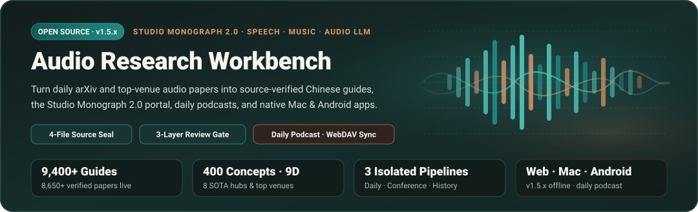
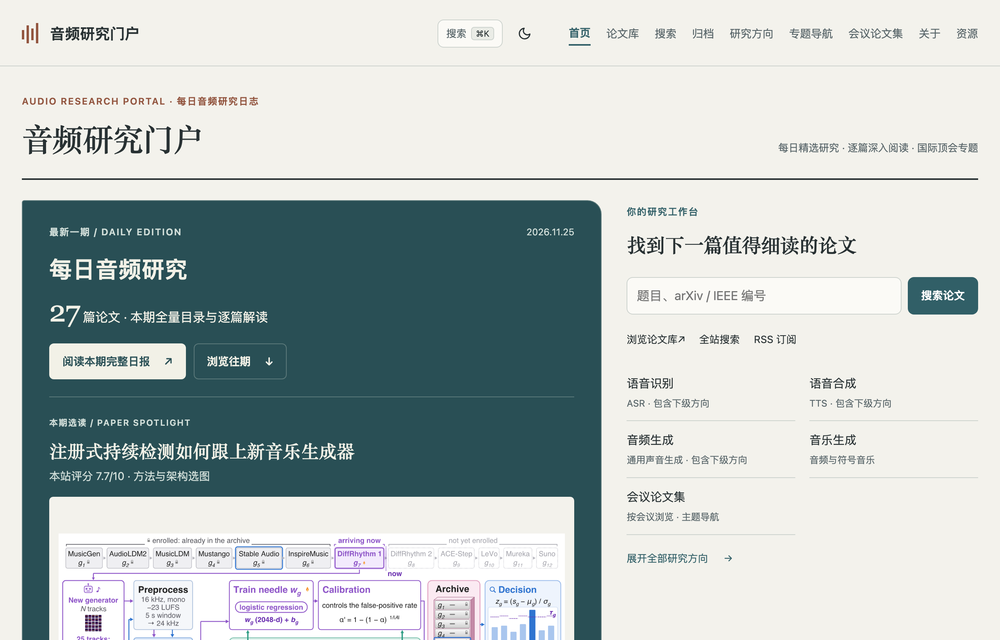
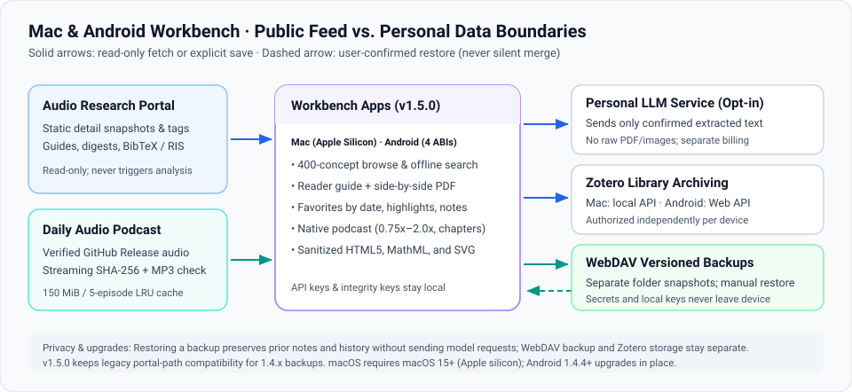

<p align="center">
  
</p>

<p align="center">
  <a href="README.md">简体中文</a> · <strong>English</strong> ·
  <a href="https://nanless.github.io/audio-research-portal/">Audio Research Portal (Live)</a> ·
  <a href="https://github.com/nanless/audio-research-workbench/releases">Download Mac / Android Apps</a> ·
  <a href="docs/README.en.md">Documentation Index</a>
</p>

<p align="center">
  <a href="https://nanless.github.io/audio-research-portal/"></a>
  <a href="https://github.com/nanless/audio-research-workbench/releases/tag/v1.5.0"></a>
  
  
  
  <a href="LICENSE"></a>
</p>

Dozens of new speech, music, acoustics, and Audio LLM papers arrive on arXiv and top venues every week—skimming abstracts hides critical trade-offs, while reading every full PDF eats your entire morning. **Audio Research Workbench (`音频研究工作台`)** breaks that workflow into three isolated open-source layers where every metric, equation, and original figure traces back to sealed source bytes:

- **Public Knowledge Portal ([Audio Research Portal / 音频研究门户](https://nanless.github.io/audio-research-portal/))**: Built with **Studio Monograph 2.0**, hosting **9,300+ verified Chinese paper guides (8,650+ unique papers)**, daily digests, 19 venue collections, and 8 audio SOTA domain hubs with `⌘K` search, zoomable figure inspection, sortable tables, and one-click Obsidian / BibTeX / RIS export.
- **Native Desktop & Mobile Workbenches (macOS & Android 1.5.x)**: Subscribe read-only to portal snapshots and daily audio podcasts for side-by-side PDF reading, offline multi-word search, opt-in personal LLM study, Zotero archiving, and one-click bidirectional WebDAV sync.
- **Content Production Engine (this repo)**: Runs an LLM/API pipeline by default—handling fetch deduplication, screening, four-file source sealing, deep analysis, eight-dimension scoring, nine-facet classification, and long-form Chinese guides (**Reader** in code)—and pushes only after a strict three-layer review gate.

> **Language note**: Published articles and portal pages are in Chinese. This README guides English-speaking readers and maintainers through the architecture, apps, and CLI workflows; linked operational docs are in Chinese unless stated otherwise.

---

## Inside the Studio Monograph 2.0 Portal

<table>
  <tr>
    <td width="50%" valign="top">
      <a href="https://nanless.github.io/audio-research-portal/">
        
      </a>
      <p align="center"><sub><strong>Studio Monograph 2.0 Home</strong> · Latest edition spectrogram masthead &amp; spotlight, <code>⌘K</code> search, and 8 audio SOTA domain hubs</sub></p>
    </td>
    <td width="50%" valign="top">
      <a href="https://nanless.github.io/audio-research-portal/">
        
      </a>
      <p align="center"><sub><strong>Deep-Dive Paper View</strong> · Sticky left TOC, KaTeX math &amp; verified figure with invert/zoom viewer, sticky right 8-dim score ring &amp; source rail</sub></p>
    </td>
  </tr>
</table>

| Common Reading Pain Point | How Audio Research Workbench Solves It |
|---|---|
| Jargon-heavy summaries that hide how a method actually works | Public **Reader** guides span **5,000–18,000 Chinese characters** across 5–9 problem/mechanism/finding sections with structured implementation specs and optional concept bridges—kept separate from the 13-section internal audit analysis. |
| Hallucinated metrics, broken equations, mismatched figures | Official HTML and PDF bytes are sealed into a 4-file SHA-256 bundle before writing starts; table cells trace back to original tables, display equations come from source TeX, and original figures pass visual and caption checks. |
| Dead "open-source" links and inflated scores | Code, weight, and demo URLs are probed for reachability (only verified `available` resources are marked open-source); scores use **type-aware 8-dimension rubrics (`type-aware-v2`)** recomputed in code. |
| Silent publish regressions or broken live pages | Every release executes `generate → 3-layer review → receipt-bound push → GitHub Pages deploy check → live HTTP 200 & title verification`, blocking publication on any failure. |

---

## Find Your Entry Point in 30 Seconds

| What you want to do | Where to start |
|---|---|
| Read 9,300+ verified guides & 8 SOTA hubs in your browser | Open the **[Audio Research Portal](https://nanless.github.io/audio-research-portal/)** · tools & export in [reading tools](docs/blog-reading-tools.md) (Chinese) |
| Read side-by-side with PDFs & archive to Zotero on Mac | Follow the **[Mac Guide](apps/macos/README.en.md)** (Apple silicon, macOS 15+, no `.env` needed) |
| Read offline & listen to daily podcasts on Android | Follow the **[Android Guide](apps/android/README.en.md)** (Android 9+, all 4 ABIs) |
| Understand how sources, engine, portal & apps fit together | Read the **[Project Walkthrough](docs/project-guide.md)** (Chinese) |
| Deploy the content engine and run digests | Complete **[First-time setup](#first-time-setup-maintainers)** below and follow the **[Operating Manual](SKILL.md)** |

---

## Three-Layer Architecture & Native 1.5.x Workbenches


Production, publishing, and personal reading stay isolated: this repository pushes reviewed diffs into the Hugo portal (serving `client/details/*` content-addressed snapshots and the podcast feed), while the Mac and Android clients consume those static files read-only without ever calling a production LLM.



| Capability | Audio Research Portal (Web) | macOS Workbench (1.5.x) | Android Workbench (1.5.x) |
|---|:---:|:---:|:---:|
| 9,300+ guides, 400-concept taxonomy & score/OSS filters | Instant browse + `⌘K` palette | Offline snapshots + NFKC search | Offline snapshots + idle preload |
| Guide + side-by-side PDF with physical page anchors | Direct source links | AppKit + PDFKit split view | Phone 1-col / Tablet 2-col |
| Daily Audio Podcast (chapters, `0.75×–2.0×`) | Web podcast player | `AVAudioPlayer` + SHA cache | `MediaPlayer` + SHA cache |
| Typography & figure/table UX (Studio Monograph) | 1×–6× lightbox / sortable tables | Strict allowlist sanitizer | Material 3 compact sanitizer |
| Personal LLM Q&A (user endpoint, isolated billing) | — | Approved extracted text only | Approved extracted text only |
| Zotero Archiving (metadata + guide + PDF + notes) | BibTeX / RIS / Obsidian | Local Zotero Desktop API | Official Zotero Web API v3 |
| Nutstore WebDAV sync & full-space backups | — | One-click bidirectional sync + lossless merge / snapshots | One-click bidirectional sync + lossless merge / snapshots |

- **Source & public release**: Current source version is **1.5.1 (build 25) (not yet published)** (see the [1.5.1 pre-release record](docs/workbench-1.5.1-review.md)). The latest published release on both macOS and Android is **1.5.0 / build 24** (published 26 Nov 2026, commit `5b5a8e79`); see [GitHub Release v1.5.0](https://github.com/nanless/audio-research-workbench/releases/tag/v1.5.0), [1.5.0 release record](docs/workbench-1.5.0-review.md), and [client release verification](docs/client-release-verification.md).
- **Upgrade notes**: Upgrading macOS from 1.4.x renames the bundle to `音频研究工作台.app` while keeping `com.nanless.PaperDigest`, data directories, and Keychain entries (local ad-hoc signature, macOS 15+ Apple silicon)—quit and remove the old bundle after installing. Android keeps the 1.4.4+ signing certificate so 1.4.4–1.5.0 upgrade in place; 1.4.3 requires backing up and uninstalling first.

---

## Content Pipeline & Four Engineering Safeguards


Content production runs an **LLM/API pipeline by default** across three active, parity-aligned workflows:

| Workflow | Status | Purpose & Source Boundary | Guide |
|---|---|---|---|
| **Daily digest** | **Active** | Tracks daily arXiv & HuggingFace audio preprints; syncs portal remote, deduplicates published pages only, seals official HTML + PDF | [Daily procedure](SKILL.md#1-日更) · [Fetch boundary](docs/daily-fetch-boundary.md) |
| **Official conference** | **Active (Daily parity)** | Covers 22 official providers (including v2 & `2025+` core-audio families), default v2 PDF extraction, Studio Monograph 2.0 rendering, and Pages deploy verification | [Conference workflow](docs/conference-workflow.md) · [New conference guide](docs/conference-workflow.md#新会议全流程接入指南20262027) |
| **Historical update** | **Active (Daily parity)** | Discovers outdated posts via `history:outdated`, rewrites from sealed/local original papers with atomic daily-summary sync, and strictly preserves URLs | [Historical updates](docs/history-rewrite.md) · [Outdated rewrite guide](docs/history-rewrite.md#过时历史博客批量重写指南) · [Publication](docs/history-direct-publication.md) |

Four engineering safeguards keep quality verifiable and cost bounded:

1. **Four-file source sealing**: Before analysis begins, each paper's `source.txt`, `source.pdf`, `source-runtime.json`, and `source-manifest.json` are hashed and frozen; writing, repairs, and cold replay read only this bundle.
2. **Tiered per-stage reasoning + prefix caching**: Enabled by default (`PD_TIERED_REASONING_EFFORT=1`, `PD_OPENAI_RESPONSES_PROMPT_CACHE_KEY=1`)—`xhigh` for primary analysis & Reader guides, `high` for scoring audits & repairs, `medium` for figure/structure patches, `low` for screening & text review, and `minimal` for mechanical tagging/OSS checks.
3. **Expiry-priority shared account pool & immutable ledger**: Keys on the same route merge into one shared pool scheduled by earliest monthly reset date (Beijing time) and highest remaining monthly headroom across monthly/weekly/5-hour windows (`PD_LLM_ACCOUNT_POOL_STRATEGY=expiry_priority`, or `equal_rotation`), auto-syncing official `/zen/go/v1/usage` quotas over the project proxy (5 min TTL, or `npm run llm:accounts:quota -- sync`). Only quota 429 or insufficient-balance 401 rotates within a request; auth 401 halts dispatch to protect in-flight work. Usage records default to flat layout (`0`), with opt-in Beijing-date sharding via `PD_LLM_USAGE_SHARD_BY_DATE=1`, and are never wiped.
4. **Three-layer review gate & permanent SHA cache**: Programmatic checks, text/figure audits, and full Hugo builds gate every push; approved pages cache permanently by relative path and content SHA.

---

## First-time setup (maintainers)

> Skip this section completely if you only read the portal or use the Mac / Android apps—no repository clone or API key is needed.

1. **Verify workspace & role**: Enter `$HOME/code/github_repos/audio-research-workbench`, check `pwd`, and run `npm run workspace:role -- status` to confirm role `daily` (historical commands run via `PD_WORKSPACE_ALLOW_CROSS_ROLE=1` in `.env`).
2. **Install runtimes & `.env`**: Follow [setup](docs/setup.md) (Chinese) for Node (`>=20.18.1 <21 || >=22.3.0`), Python 3.11+ (`scripts/python-runtime.sh` prefers `.venv`), and dependencies; copy `env.example` to `.env` with API keys, HTTP CONNECT proxy, and your local Hugo portal repo path.
3. **Run read-only diagnostics**: Run `npm run doctor -- --offline` and `npm run config:check`. Both the primary model and any optional secondary model are validated against `scripts/lib/env-schema.js` (currently configured as `muse-spark-1.3-contributor`, `xhigh` ceiling; leaving the secondary model unset skips only legacy figure add-ons and never disables API Reader figures). Muse and arXiv traffic require the project HTTP CONNECT proxy.
4. **Confirm clean concurrency**: Ensure no other generate/review/push task is active and the portal repo has no conflicting uncommitted edits for the target date.

Authoritative hard rules live in [AGENTS.md](AGENTS.md), with walkthroughs in [onboarding](docs/onboarding.md) and the [operating manual](SKILL.md).

---

## Common maintenance commands

Replace example dates, IDs, and paths with real values before running:

| Task | Command & guide |
|---|---|
| **Run today's daily digest** | `npm run digest:prepare -- YYYY-MM-DD` (`digest:api` alias); [daily procedure](SKILL.md#1-日更) |
| **Diagnostics & source probes** | `npm run doctor -- --offline` (`--network` probes arXiv), `npm run config:check`, `npm run source:probe -- --date YYYY-MM-DD`, `npm run llm:accounts`, `npm run llm:accounts:quota -- sync` |
| **Live progress & stage scorecard** | `npm run digest:status -- --date YYYY-MM-DD --watch`, `npm run digest:scorecard -- --date YYYY-MM-DD` |
| **Diagnose failures & build patches** | `npm run recover -- --date YYYY-MM-DD`, `npm run manifest:new -- --spec SPEC.json`, `npm run table:check -- --draft FILE` |
| **Live site verification & closeout** | `npm run verify:web -- --date DATE --deploy OID`, `npm run publish:finish -- --date DATE` |
| **Full local verification suite** | `npm run verify` (pinned Hugo 0.160.1 + syntax + JS/Python suites + `docs:check` + `validate:data`) |

<details>
<summary>More maintenance & optional CLIs (conferences, history, republish, storage, podcast)</summary>

| Task | Command & notes |
|---|---|
| **Official conference sweep** | `conference:acquire` → `conference:discover` → filter → `conference:process` → `conference:publish:*`; [conference workflow](docs/conference-workflow.md) |
| **Audit & rewrite historical pages** | Run `npm run history:outdated`, then `history:inputs --arxiv-only` / `plan` / `sources` / `run` / `aggregate`; [historical updates](docs/history-rewrite.md) |
| **Publish & verify historical output** | `npm run history:publication -- plan\|generate\|review\|publish\|status` (supports `--waive-visuals`), then `verify:web -- --historical-publication-id UUID`; [historical publication](docs/history-direct-publication.md) |
| **Republish a daily presentation** | `npm run blog:generate -- --date YYYY-MM-DD --republish UUID`, then `blog:review` → `blog:push` |
| **Register earlier fetch witness** | `npm run fetch:witness:prepare -- --date YYYY-MM-DD --source-date YYYY-MM-DD` |
| **Impact check & review overrides** | `npm run impact -- --git`, `npm run review:overrides -- --date DATE --file F.json` |
| **Locks, docs & data integrity** | `npm run locks`, `npm run docs:check`, `npm run validate:data` |
| **Ledger compaction & PDF dedupe** | `npm run papers:compact`, `npm run storage:pdf-dedupe`, `npm run storage:report`, `npm run storage:prune` |
| **Opt-in CLIs: calibration / podcast** | `npm run digest:calibrate -- --dry-run`, `npm run podcast:generate -- --date YYYY-MM-DD --dry-run` |

</details>

---

## Running a daily digest

Use **today's Beijing date**:

```bash
npm run digest:prepare -- YYYY-MM-DD
```

This runs the complete pipeline: portal remote sync → boundary fetch & published-page dedup → prefilter & LLM triage → four-file HTML/PDF sealing → full analysis, scoring, tagging & Reader writing → page generation & three-layer review → receipt-bound push & no-visuals attestation. After push, confirm GitHub Pages deployment and verify every live URL, HTTP 200 status, and title.

Three hard boundaries:

- **No daily posters or covers**: Following the standing 2026-11-02 directive, daily runs skip generated posters/covers (`--no-visuals` kept for compatibility) and record a bound no-visuals attestation ([troubleshooting](docs/troubleshooting.md#11-不生图登记失败)); original paper figures remain fetched, displayed, and reviewed.
- **Today only for fresh fetch**: Historical dates cannot restart daily fetching; resume from controlled data via `--from generate|review|push|visual` or use the historical rewrite workflow ([fetch boundaries](docs/daily-fetch-boundary.md)).
- **Published-only deduplication**: Unpublished papers in the local library remain eligible for future catch-up runs.

---

## Continuing after a failure

Always let the active round finish and save every paper before retrying only eligible failures. Passing sources, checkpoints, drafts, attempt counts, and cost ledgers are preserved intact and never wiped.

| Where work stopped | How to resume |
|---|---|
| Daily analysis or Reader writing | `npm run deep`, `npm run batch`, or `npm run api:reader:refresh` (reuses the same sealed bundle) |
| Official conference run or maintenance | Resume `conference:process` / `conference:migrate-process`; see [conference recovery](docs/conference-workflow.md#已有完整会议只更新页面) |
| Historical prep or analysis | Continue the same plan with `npm run history:run`; resume paused jobs with `npm run history:resume` |
| Blog text or figure rejection | Complete the review batch first; text goes through Reader maintenance, figures can use a certified PDF publication view before re-review |
| Auth, balance, config, or save error | Halt new dispatches, preserve in-flight work, diagnose the full account pool or fault, then resume |

For a small stubborn tail after automatic retries, apply source-bound operator corrections (1–8 existing nodes per paper, still checked by full qualification and blog review; see [explanation recovery](docs/reader-explicit-retry.md)). Necessary paid follow-up windows are covered by the standing authorization in [AGENTS.md](AGENTS.md#持续授权以效率和效果为准) under separate accounting.

> **Retired legacy boundary**: Batch Manual authoring and WeChat/Feishu/Xiaohongshu publishing are retired. [manual/README.en.md](manual/README.en.md) retains only legacy record verification and independent manual review (configured with `gpt-6.1-sol/high`).

---

## What counts as done

A daily digest is complete only when all six criteria in [AGENTS.md](AGENTS.md#日更完成的六项) hold:

1. **Data & sources**: Formal analysis, sealed sources, Reader guide, 8-dim score, and 9-facet tags pass all checks.
2. **Review**: Pages pass programmatic, text, figure, and Hugo checks with receipts covering the full target set.
3. **Remote push**: Only the receipt-approved diff is pushed and remote `main` OID matches.
4. **Deployment**: GitHub Pages `build` and `deploy` both succeed for the published commit (or a descendant preserving reviewed bytes).
5. **Live web check**: Every target page passes HTTP 200, canonical URL, and title checks (`npm run verify:web`) with saved proof.
6. **No-visuals & final status**: A bound no-visuals record is valid and `npm run digest:status -- --date YYYY-MM-DD` is re-read.

`digest:status` is a snapshot at read time and never substitutes for live deployment and page verification.

---

## Repository Map

```text
audio-research-workbench/
├── scripts/               # Production engine (fetch, filter, seal, analyze, score, Reader, review, push, podcast)
│   └── lib/               # Shared libs: LLM router/cache/pool, source checks, SVG/PDF pipeline, locks & ledgers
├── prompts/current/       # Active stage prompt templates (with Git blob cold-replay evidence index)
├── config/                # 400-concept 9-facet taxonomy, protocol registries (clients*.json), workspace roles
├── apps/
│   ├── macos/             # Native macOS Audio Research Workbench (Swift / AppKit / WebKit / PDFKit / AVAudioPlayer)
│   └── android/           # Native Android Audio Research Workbench (Kotlin / Jetpack Compose / Atomic JSON + PDFBox / WorkManager)
├── web/tag-explorer/      # Offline 400-concept 9-facet taxonomy browser frontend (served via npm run tags:serve)
├── prototypes/macos-research/ # Offline PDF/figure prototype & committed MiCLA test fixtures
├── docs/                  # Architecture, data contracts, playbooks, acceptance & Studio Monograph diagrams (docs/images/)
├── skills/                # Reusable clear-technical-writing and engineering skills
├── manual/                # Read-only legacy verification & independent single-paper manual review
└── tests/                 # Node.js + Python regression suites (offline contracts & cold-replay tests)
```

---

## Documentation

- **[Project walkthrough](docs/project-guide.md)** (Chinese): sources, analysis engine, portal, and clients at a glance.
- **[Operating manual](SKILL.md)** & **[AGENTS.md](AGENTS.md)** (Chinese): procedures, recovery paths, and hard rules.
- **[Documentation index](docs/README.en.md)**: setup, data contracts, taxonomy, backups, performance, and troubleshooting.
- **[Script guide](scripts/README.en.md)** & **[full script index](scripts/INDEX.md)**: CLI entry points, shared core, and helpers.
- **[Client release verification](docs/client-release-verification.md)** (Chinese): macOS/Android signing, certificates, 12 assets, and SHA-256 records.
- **[Clear technical writing](skills/clear-technical-writing/SKILL.md)** & **[project writing guide](docs/writing-guide.md)** (Chinese): clarity, terminology, diagrams, and bilingual rules.
