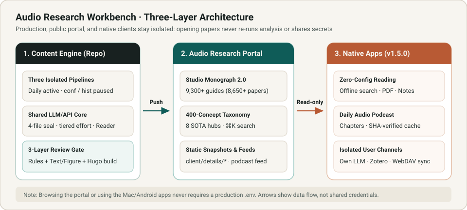
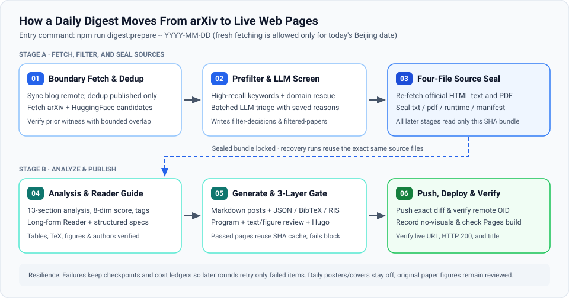

# Audio Research Workbench (论文速递工作台)

[中文](README.md) · **English**

Keeping up with new speech, music, and audio papers on arXiv every day easily eats an hour or two. This project splits that work in two: a backend pipeline fetches each selected paper's official text and PDF, writes a beginner-friendly Chinese deep-dive (**Reader** in code), an eight-dimension score, nine-facet tags, author affiliations, and citations, and publishes pages only after a three-layer review; a public Hugo site plus native Mac and Android apps let you read quietly, compare the original PDF, take notes, and listen to daily audio briefings.

The internal 13-section analysis used for programmatic checks is stored separately from the reader-facing Reader article, and neither replaces the other. Every table, displayed equation, original paper figure, affiliation, and open-source claim must remain traceable to the exact source files used for that run.

> The published articles are written in Chinese. This README explains how to use and maintain the project in English; it does not imply an English article collection.



## Start where you need

| What you want to do | Where to go |
|---|---|
| Read published Chinese paper guides in a browser | Open the [web portal](https://nanless.github.io/audio-research-portal/); see [reading & download tools](docs/blog-reading-tools.md) (Chinese) |
| Read on Mac with side-by-side PDFs, notes, and personal study | Follow the [Mac guide](apps/macos/README.en.md) (Apple silicon, macOS 15+) |
| Read and listen on Android phones, tablets, or foldables | Follow the [Android guide](apps/android/README.en.md) (4 ABIs) |
| Learn how the pieces fit together | Read the [project walkthrough](docs/project-guide.md) (Chinese) |
| Operate daily digests, conferences, or historical rewrites | Follow the setup steps below and the [operating manual](SKILL.md) (Chinese) |

## Mac and Android Workbench (1.5.0)

The website and production pipeline are called **论文速递**; the Mac and Android apps are called **论文速递工作台**. Both apps fetch published catalogs, guides, digests, and podcasts read-only—opening a paper never triggers model calls and never requires a production `.env`.

- **Current source version**: **1.5.0 (build 24)** on both macOS and Android (pending public release; adds the native daily podcast player, aligned offline search/filtering, and legacy portal-path migration support—see the [1.5.0 record](docs/workbench-1.5.0-review.md), in Chinese).
- **Latest public release**: **1.4.7 / build 23** (published 23 Nov 2026; see [GitHub Release v1.4.7](https://github.com/nanless/audio-research-workbench/releases/tag/v1.4.7) and [client release verification](docs/client-release-verification.md), in Chinese). Older release records live in [docs/README.en.md](docs/README.en.md).
- **Platform & upgrade notes**: macOS targets ARM64 Apple silicon on macOS 15+ (locally signed, not Apple-notarized). Android ships four ABIs; users on 1.4.4+ can upgrade in place, while 1.4.3 requires uninstalling first due to the signing key change in 1.4.4.


Personal study is strictly opt-in: a model service is called only when you explicitly ask a question or test a connection, sending only confirmed extracted text (never raw PDFs or images), with usage and billing completely separate from website production. Restoring a WebDAV backup keeps prior notes and history without firing new requests, and API keys or local integrity keys never leave the device.

## How a paper becomes a published page

Content production uses an LLM/API pipeline by default across three workflows: **daily digests**, **official conferences**, and **historical blog updates**. They share the analysis engine, eight-dimension rubric, 400-concept nine-facet taxonomy, Reader writer, and page renderers, while verifying their own sources, deduplication baselines, and publication receipts independently.



Before writing a single word of analysis, the pipeline seals four files per paper (`source.txt`, `source.pdf`, `source-runtime.json`, `source-manifest.json`) with SHA-256 digests. Generation, local repairs, and pre-publication checks all read that exact frozen bundle, and after pushing to Git the workflow still verifies deployment and checks every live URL for HTTP 200 and a valid title.

## First-time setup (maintainers)

Skip this section if you only read the website or use the Mac/Android apps. To run production tasks:

1. Verify `pwd` resolves to `$HOME/code/github_repos/audio-research-workbench` and run `npm run workspace:role -- status` to confirm role `daily` (historical commands run here via `PD_WORKSPACE_ALLOW_CROSS_ROLE=1` in `.env`).
2. Follow [setup](docs/setup.md) (Chinese) to install Node (`>=20.18.1 <21 || >=22.3.0`), Python 3.11+, and dependencies, then copy `env.example` to `.env` with your API keys, proxy, and real Hugo blog repo path.
3. Run read-only checks: `npm run doctor -- --offline` and `npm run config:check`. Both primary and any enabled secondary model use `muse-spark-1.3-contributor` (`xhigh` ceiling with tiered per-stage reasoning enabled by default); arXiv and Muse traffic require the project HTTP CONNECT proxy.
4. Make sure no other generate/review/push task is active and the target date has no conflicting manual edits in the blog repo.

Execution constraints live in [AGENTS.md](AGENTS.md), and step-by-step guidance lives in [onboarding](docs/onboarding.md) and the [operating manual](SKILL.md) (all in Chinese).

## Common maintenance commands

Replace example dates, IDs, and paths with real task inputs. Linked guides below are in Chinese unless noted.

| Goal | Command & guide |
|---|---|
| Run today's daily digest | `npm run digest:prepare -- YYYY-MM-DD` (`digest:api` alias); [daily procedure](SKILL.md#1-日更) |
| Check environment and `.env` | `npm run doctor -- --offline` (`--network` probes arXiv), `npm run config:check` |
| Probe arXiv/HF & inspect account pool | `npm run source:probe -- --date YYYY-MM-DD`, `npm run llm:accounts` |
| Watch run progress & stage scorecard | `npm run digest:status -- --date YYYY-MM-DD --watch`, `npm run digest:scorecard -- --date YYYY-MM-DD` |
| Process an official conference | `conference:acquire` → `conference:discover` → filter → `conference:process`; [conference workflow](docs/conference-workflow.md) |
| Rewrite historical pages (keep URLs) | Fix scope, then `history:inputs/plan/sources/run/aggregate`; [historical updates](docs/history-rewrite.md) |
| Publish historical results | `npm run history:publication -- plan\|generate\|review\|publish\|status`; [historical publication](docs/history-direct-publication.md) |
| Republish a complete daily batch | `npm run blog:generate -- --date YYYY-MM-DD --republish UUID`, then `review → push` |
| Diagnose failures & prepare patches | `npm run recover -- --date YYYY-MM-DD`, `npm run manifest:new -- --spec SPEC.json` |
| Register earlier fetch witness | `npm run fetch:witness:prepare -- --date YYYY-MM-DD --source-date YYYY-MM-DD` |
| Check tables, code impact & overrides | `npm run table:check -- --draft FILE`, `npm run impact -- --git`, `npm run review:overrides -- --date DATE --file F.json` |
| Verify live site & post-push checklist | `npm run verify:web -- --date DATE --deploy OID`, `npm run publish:finish -- --date DATE` |
| Inspect locks, docs & data integrity | `npm run locks`, `npm run docs:check`, `npm run validate:data` |
| Compact ledger, dedupe PDFs & storage | `npm run papers:compact`, `npm run storage:pdf-dedupe`, `npm run storage:report`, `npm run storage:prune` |
| Optional CLIs: calibration / podcast | `npm run digest:calibrate -- --dry-run`, `npm run podcast:generate -- --date YYYY-MM-DD --dry-run` |
| Run full local verification | `npm run verify` (pinned Hugo 0.160.1 + syntax + JS/Python suites + data validation) |

## Running a daily digest

Use today's Beijing date:

```bash
npm run digest:prepare -- YYYY-MM-DD
```

The command syncs the blog remote, fetches and deduplicates against formally published pages, screens candidates, seals official HTML/PDF sources, runs analysis, scoring, tagging, and Reader writing, generates and reviews pages, pushes the exact approved diff, and records no-visuals. Afterward, confirm GitHub Pages deployment and verify every live URL, HTTP 200 status, and title.

Key operational boundaries:

- **No daily posters or covers**: Following the standing 2026-11-02 instruction, daily runs skip generated posters/covers (`--no-visuals` kept for compatibility) and record a bound no-visuals attestation after push; original paper figures are still fetched, shown, and reviewed.
- **Today only for fresh fetch**: Historical dates cannot restart daily fetching; resume from controlled data or use the historical rewrite workflow ([fetch boundaries](docs/daily-fetch-boundary.md)).
- **Published-only dedup**: Unpublished papers in the local library still remain eligible for catch-up.

## Continuing after a failure

Let the current round finish and save every paper before retrying only retryable failures. Passing sources, checkpoints, drafts, attempt counts, and cost ledgers are always preserved and never reset.

| Where work stopped | How to continue |
|---|---|
| Daily analysis or Reader writing | Run `npm run deep`, `npm run batch`, or `npm run api:reader:refresh` on the same sealed sources |
| Conference processing or migration | Resume `conference:process` / `conference:migrate-process`; see [conference recovery](docs/conference-workflow.md#已有完整会议只更新页面) |
| Historical prep or analysis | Continue the same plan with `npm run history:run`; resume paused runs with `npm run history:resume` |
| Blog text or figure review rejection | Finish the review batch first; text goes through Reader maintenance, figures can use a certified PDF publication view before re-review |
| Auth, quota, config, or storage fault | Stop new dispatches, keep in-flight results, diagnose the full account pool or fault, then resume |

Passed pages reuse their review cache permanently by relative path and content SHA. For a small stubborn tail after automatic rounds, use source-bound operator corrections (1–8 existing nodes per paper, still checked by full qualification and blog review; see [explanation recovery](docs/reader-explicit-retry.md)). Necessary paid follow-up windows are covered by the standing authorization in [AGENTS.md](AGENTS.md#持续授权以效率和效果为准), recorded under separate accounting.

Batch Manual authoring and WeChat/Feishu/Xiaohongshu publishing are retired. [manual/README.en.md](manual/README.en.md) covers only legacy record verification and independent manual review (configured with `gpt-6.1-sol/high`).

## What counts as done

A daily digest is complete only when all six items in [AGENTS.md](AGENTS.md#日更完成的六项) hold:

1. **Data & sources**: Formal analysis, sealed sources, Reader article, scores, and tags pass current checks.
2. **Review**: Pages pass programmatic, text, figure, and Hugo checks with receipts covering the full target set.
3. **Remote push**: Only the receipt-approved diff is pushed, and the remote `main` OID matches.
4. **Deployment**: Pages `build` and `deploy` succeed for the published commit (or a descendant preserving reviewed bytes).
5. **Live web check**: Every target page passes HTTP 200, canonical URL, and title verification with saved records.
6. **No-visuals & final status**: A bound no-visuals record is saved and `npm run digest:status -- --date YYYY-MM-DD` is re-read.

`digest:status` is a snapshot at read time and never replaces live deployment and page checks.

## Documentation

- [Project walkthrough](docs/project-guide.md) (Chinese): sources, analysis, portal, and reading apps at a glance.
- [Operating manual](SKILL.md) & [AGENTS.md](AGENTS.md) (Chinese): procedures, recovery rules, and hard constraints.
- [Documentation index](docs/README.en.md): setup, data contracts, taxonomy, backups, performance, and troubleshooting.
- [Script guide](scripts/README.en.md) & [full script index](scripts/INDEX.md): entry points, shared core, and compatibility helpers.
- [Client release verification](docs/client-release-verification.md) (Chinese): macOS/Android signing, certificates, assets, and SHA-256 verification.
- [Writing skill](skills/clear-technical-writing/SKILL.md) & [project writing guide](docs/writing-guide.md) (Chinese): clarity, terminology, diagrams, and bilingual standards.
