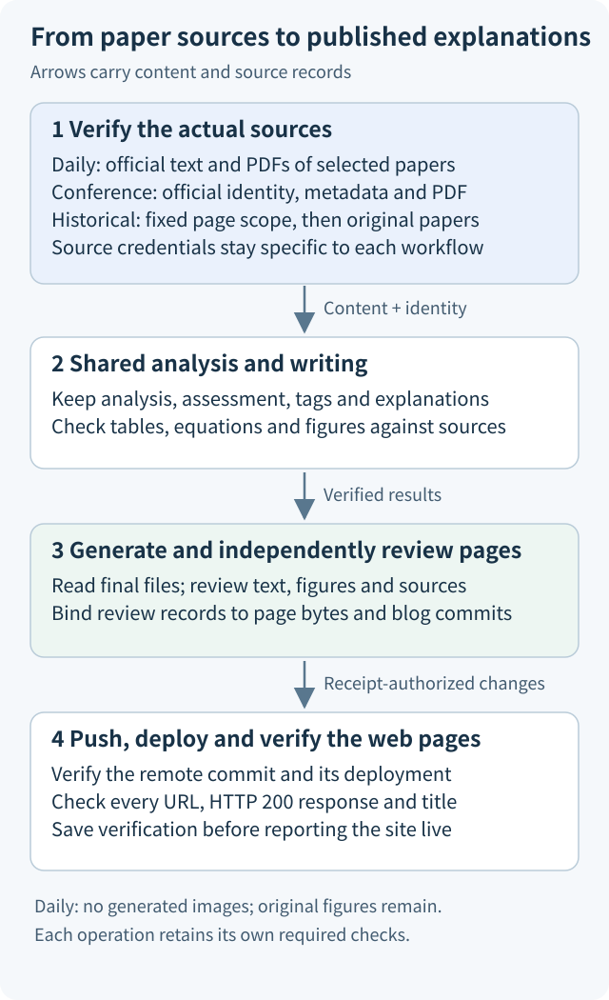

# Audio Paper Digest（论文速递）

[中文](README.md) · **English**

Audio Paper Digest turns full research papers into detailed Chinese explanations, eight-dimension assessments, author and affiliation records, resource information, citations, and published blog pages. The explanations help researchers who are new to a topic understand the problem, follow the method, interpret the experiments, and recognize the limits of the findings.

The reader-facing explanation is called **Reader** in the code. A separate internal analysis supports programmatic checks. Neither replaces the other. Assessments, figures, equations, affiliations, and resource claims must remain traceable to the paper material actually used.

The articles are written in Chinese. This English README explains how to use and maintain the project; it does not imply that an English article collection exists.

## Choose how you want to use the project

| Your goal | Start here |
|---|---|
| Read published Chinese paper explanations | Visit the [website](https://nanless.github.io/audio-paper-digest-blog/); see [reading and downloads](docs/blog-reading-tools.md), in Chinese |
| Read on Mac, compare the original PDF, take notes, or study a paper | Follow the [Mac guide](apps/macos/README.en.md) |
| Read on an Android phone, tablet, or foldable window | Follow the [Android guide](apps/android/README.en.md) |
| Understand how the project works | Read the [project walkthrough](docs/project-guide.md), in Chinese, then choose a task |
| Maintain the website or run daily, conference, or historical work | Follow the preparation steps below and the [operating manual](SKILL.md), in Chinese |

The website and content pipeline are called **论文速递**. The Mac and Android applications are called **论文速递工作台**. The applications read published indexes, explanations, and collections. Opening a paper does not run the production analysis or assessment again.

Personal study is a separate application feature. A model service is called only when the user actively starts study or tests a connection. A service configured on the device can still run remotely. Personal responses, usage, costs, and authorization are recorded separately from website production. The [data flow diagram](docs/images/client-data-flow.en.svg) shows these relationships. Restored backups retain their history; additional requests still follow the authorization for the current task.

The 1.3.0 source adds browsing across the full website classification and revises both interfaces. See the [review record](docs/workbench-1.3.0-review.md), in Chinese, for the actual scope. Android 1.3.2 addresses automatic sync, VPN-related network errors, and slow loading of explanations. The Android source is at 1.3.3 (build 11), which adjusts text size and spacing on phones. See the [1.3.2 fixes](docs/android-1.3.2-review.md) and [1.3.3 fixes](docs/android-1.3.3-review.md), both in Chinese. The Mac source is at 1.3.0. Favorites use the website hierarchy and their recorded favorite dates; see the [favorites guide](docs/favorite-collections.md), in Chinese. Public packages are identified by the [release page](https://github.com/nanless/audio-paper-digest/releases).

The Mac application targets ARM64 Apple silicon and requires macOS 15 or later. It uses local signing and has not been notarized by Apple. Android includes native libraries for four processor architectures (ABIs) and retains the existing application identity and signing certificate. Installation steps, tested environments, and limitations are described in the application guides and the [client security record](docs/client-security-audit.md), in Chinese.

## How content reaches the website

Content production calls a language model service through an API by default. There are three workflows: a daily digest for the current Beijing date, official conference processing, and updates to existing historical blog pages. They share analysis, assessment, classification, paper explanation, and page-generation code. Each workflow separately verifies its sources, selected scope, and publication records.

The workflow preserves the paper material actually used before analysis and writing. Generated pages must pass programmatic checks and text and figure review before they can be pushed to the blog repository. A successful push is followed by deployment and page checks; it does not by itself establish that the website is live.



The arrows show content and source records passing to the next operation. They do not make source credentials interchangeable between workflows. The [project walkthrough](docs/project-guide.md), in Chinese, explains the distinctions.

## First-time setup for production work

Reading the website or using an application does not require the production project's `.env`. The steps below are for website maintainers.

1. Resolve and verify the actual path of `$HOME/code/github_repos/audio-paper-digest`, then run `npm run workspace:role -- status`. All three workflows use this directory with the `daily` role. Historical commands use the configured cross-role switch.
2. Follow [installation and configuration](docs/setup.md), in Chinese, to prepare Node, Python, and dependencies, configure the project `.env`, and identify the real Hugo blog repository.
3. The primary model and any enabled secondary model must use the project-selected `muse-spark-1.3-contributor`. Muse and arXiv requests must use the project's HTTP CONNECT proxy.
4. Check that no other task is generating, reviewing, or pushing blog content and that the target pages do not have conflicting manual edits. Then select the workflow.

[AGENTS.md](AGENTS.md) states the execution constraints. The [operating manual](SKILL.md) gives the normal sequence and recovery rules. The [onboarding guide](docs/onboarding.md) explains inputs, results, and how to continue. These detailed guides are in Chinese.

## Choose a maintenance task

Replace the example dates, identifiers, and paths with real task materials. Conference and historical operations also require the files and identifiers produced by their preceding steps. Linked detailed instructions in this table are in Chinese.

| Task | Entry point and instructions |
|---|---|
| Run today's digest | `npm run digest:prepare -- YYYY-MM-DD`; [daily procedure](SKILL.md#1-日更) |
| Check the environment and configuration | `npm run doctor -- --offline`; add `--network` when an online probe is needed; [diagnostics](docs/maintenance.md#运行前体检运行中状态与错误指引) |
| Probe sources, inspect account status, or check configuration | `npm run source:probe -- --date YYYY-MM-DD`, `npm run llm:accounts`, `npm run config:check`; [probes and configuration](docs/maintenance.md#抓取前探测与配置检查) |
| Observe running work | `npm run digest:status -- --date YYYY-MM-DD --watch`; [status instructions](docs/maintenance.md#运行前体检运行中状态与错误指引) |
| Process an official conference | Acquire official sources, extract evidence, filter, then run `conference:process`; [conference workflow](docs/conference-workflow.md) |
| Rewrite existing blog pages from original papers while retaining URLs | Fix the page scope and prepare the sources and plan; [historical updates](docs/history-rewrite.md) |
| Publish completed historical results | The plan, generate, review, publish, and status actions of `history:publication`; [historical publication](docs/history-direct-publication.md) |
| Update the presentation of a complete published daily batch | `npm run blog:generate -- --date YYYY-MM-DD --republish UUID`, followed by review and push; [republication](docs/data-format.md#同来源同分析的日批重发布) |
| Choose a recovery route | `npm run recover -- --date YYYY-MM-DD`; prepare a correction manifest with `npm run manifest:new -- --spec SPEC.json`; [recovery tools](docs/maintenance.md#恢复决策与清单生成) |
| Register an earlier checkpoint when original published inputs cannot be read again | `npm run fetch:witness:prepare -- --date YYYY-MM-DD --source-date YYYY-MM-DD`; [explicit recovery conditions](docs/daily-fetch-boundary.md#published-input-drift-recovery) |
| Check a table or the affected code paths | `npm run table:check -- --draft DRAFT.json`, `npm run impact -- scripts/x.js`; [targeted checks](docs/maintenance.md#表格与影响面预检) |
| Inspect an explanation of a suspected review error | `npm run review:overrides -- --date DATE --file OVERRIDES.json`; [review diagnostics](docs/maintenance.md#发布后网页核验与收尾) |
| Verify published pages | `npm run verify:web -- --date DATE --deploy OID`; `npm run publish:finish -- --date DATE` only prints remaining actions; [publication follow-up](docs/maintenance.md#发布后网页核验与收尾) |
| Inspect locks or check documented commands | `npm run locks`, `npm run docs:check`; [locks and documentation](docs/maintenance.md#锁视图与文档一致性) |
| Inspect storage and cleanup advice | `npm run storage:report`; preview cleanup with `npm run storage:prune`; [retention rules](docs/maintenance.md#存储保留建议) |
| Run complete verification after code changes | `npm run verify`; [maintenance guide](docs/maintenance.md) |

For an already completed conference, first check whether its original process has been published. Then choose the appropriate [page-recovery route](docs/conference-workflow.md#已有完整会议只更新页面).

## Run a daily digest

After setup succeeds, replace the date with the current date in Beijing:

```bash
npm run digest:prepare -- YYYY-MM-DD
```

The entry point fetches candidates, removes papers already formally published, filters candidates, and seals the selected papers' official sources. It then performs analysis, assessment, classification, and explanation writing before generating, reviewing, and pushing the blog. `digest:api` is an equivalent alias.

After the push, the entry point records that this publication does not require generated images. The operator then confirms deployment, verifies the addresses, HTTP 200 responses, and titles of every target page, and reads the full status again.

Daily digests do not generate paper posters or a collection cover by default. This is the user's standing instruction dated 2026-11-02. There is no need to add `--no-visuals` each time, although the old option remains compatible. After verified publication, the program directly records that no images will be generated, binding the generation manifest, actual review receipt, and verified remote commit. Original paper figures remain displayed and reviewed. If that registration fails, follow the [recovery instructions](docs/troubleshooting.md#11-不生图登记失败).

Fetching must verify records of previously acquired papers and cover the complete source window. Only formally published pages participate in publication deduplication; papers present in the library but not published remain eligible for catch-up. A historical date cannot restart the daily fetching stage. Use existing controlled sources instead, as described in the [fetch-boundary rules](docs/daily-fetch-boundary.md).

## Continue after a failure

Wait for all papers in the current round to finish and save their results. Then continue only papers whose failures remain retryable. A normal invocation uses up to three rounds by default. Verified sources, completed stages, drafts, attempt counts, and costs are retained.

The standing authorization for an existing task covers necessary subsequent paid recovery windows. The operator registers them according to actual progress and cost without asking again for each round. Each window's technical limits still apply, and new usage is recorded separately. Investigate persistent lack of progress. Authentication, quota, configuration, or saving failures stop new dispatch while in-flight results are preserved.

| Where work stopped | How to continue |
|---|---|
| Daily analysis or explanation writing | Use deep, batch, or the explanation-refresh entry point with the same sealed sources; see the [manual](SKILL.md) |
| Conference processing or checks on old completed results | Continue the original process; follow [migration and recovery](docs/conference-workflow.md#已有完整会议只更新页面), then register [subsequent windows](docs/conference-workflow.md#原额度耗尽后的独立付费恢复) when needed under the standing authorization |
| Historical preparation or analysis | Continue the same plan, source-acquisition sequence, and `history:run`; resume a paused task through its original control protocol |
| Rejected blog text or figures | Complete the full review batch first. Use [normal explanation maintenance](docs/conference-workflow.md#博客拒稿后的正常-reader-维护) for text, or a [publication view from the same PDF](docs/conference-workflow.md#认证-pdf-的独立出版视图) for a figure before review; semantic errors still require text correction |
| A service or saving failure affects the run | Preserve in-flight results, resolve the fault, and resume from the original stage; see [troubleshooting](docs/troubleshooting.md) |

Manual corrections must bind the complete failure set, original draft, genuine sources, and authorized node scope. Interrupted work continues through the same manifest. Figures, tables, footnotes, equations, units, and resource claims remain subject to source checks, full qualification, and final blog review. See [explanation recovery](docs/reader-explicit-retry.md).

Passed review pages reuse their original valid protocol and cache by relative path and content SHA. A rejected page whose bytes are unchanged can be reviewed again only when both the old and new protocol identities are valid and different. The latest failure and unfinished factual corrections still block completion and publication. Shared validation errors are corrected after production stops, using real saved drafts and positive and negative cases, followed by normal checks. See [publication records](docs/data-format.md) and [execution rules](AGENTS.md).

Batch Manual authoring and WeChat, Feishu, and Xiaohongshu publication are retired. [manual/README.en.md](manual/README.en.md) covers only legacy verification and independent manual review. New independent review uses the actual `gpt-6.1-sol/high` configuration and records the real reviewer identity.

## What counts as completion

1. Formal analysis, sources, the explanation, assessment, and classification pass current checks.
2. Final pages pass programmatic, text, figure, and Hugo review. The receipt covers the complete target set.
3. Only the exact changes allowed by the receipt are pushed, and the remote `main` commit ID is verified.
4. The corresponding commit, or a descendant preserving the reviewed page bytes, deploys successfully. Every target page is checked for HTTP 200, its official address, and title, with records saved.
5. A no-image-generation record is bound to the current publication, and status is read again. Image tasks apply only when the user separately and explicitly requests them for that batch.

`digest:status` describes the state at the time it is read. Deployment and web pages require separate verification. During work, `--watch` refreshes every ten seconds by default, but does not fully verify publication waivers. After a push, image record, or waiver changes, read the ordinary full status again.

## Documentation

- [Project walkthrough](docs/project-guide.md), in Chinese: understand sources, generated results, the blog, and reading applications.
- [Operating manual](SKILL.md), in Chinese: normal execution, recovery, and completion.
- [Documentation index](docs/README.en.md): find configuration, sources, explanations, classification, and troubleshooting.
- [Script index](scripts/README.en.md): locate entry points, shared modules, and legacy verification.
- [Writing skill](skills/clear-technical-writing/SKILL.md) and [project writing rules](docs/writing-guide.md), in Chinese: beginner explanations, paragraphs, terminology, diagrams, and bilingual requirements.
