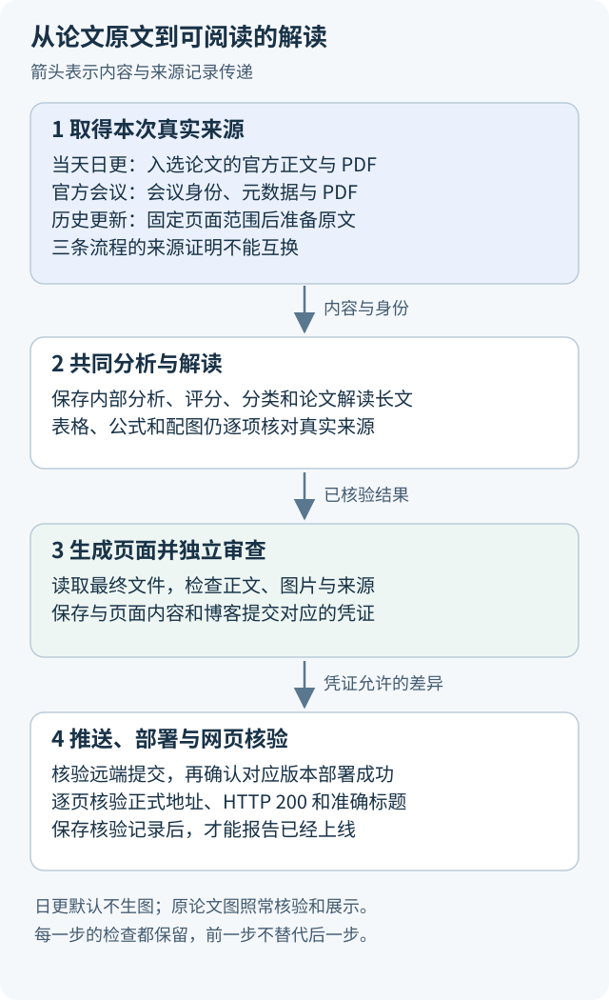

# 论文速递（Audio Paper Digest）

**中文** · [English](README.en.md)

<a id="你会得到什么"></a>

论文速递从真实论文全文整理中文解读、八维评分、作者机构、公开资源状态和引用资料，再发布为可阅读、可下载的博客页面。解读面向第一次接触相关方向的研究者，说明论文处理什么问题、方法怎样工作、实验在什么条件下成立，以及还有哪些限制。

面向读者的论文解读长文在程序中称为 **Reader**。供程序检查的内部主分析另外保存，两者不能互相代替。评分、图表、公式、作者信息和资源声明，都要能对应实际使用的论文来源。

## 先选择你的使用方式

| 你想做什么 | 从哪里开始 |
|---|---|
| 阅读已发布的中文论文解读 | 打开[论文速递网站](https://nanless.github.io/audio-paper-digest-blog/)；下载方式见[网页阅读说明](docs/blog-reading-tools.md) |
| 在 Mac 上阅读、对照原始 PDF、记笔记和研究论文 | 查看[Mac 使用说明](apps/macos/README.md) |
| 在 Android 手机、平板或折叠窗口中阅读 | 查看[Android 使用说明](apps/android/README.md) |
| 第一次了解项目怎样工作 | 阅读[项目导读](docs/project-guide.md)，再按任务进入详细文档 |
| 维护网站，执行日更、会议整理或历史更新 | 先看下面的准备步骤，再按[操作手册](SKILL.md)执行 |

网站与内容生产项目叫“论文速递”，Mac 和 Android 应用叫“论文速递工作台”。应用读取网站已经发布的目录、解读和汇总，不因打开论文而重新分析或评分。

个人研究是应用中的独立功能。只有用户主动研究或测试连接时，应用才调用自己配置的模型服务；这不代表推理一定在设备上完成。个人回答、实际用量、费用和授权，与网站生产任务分别保存。两部分怎样读取和保存资料，见[客户端数据流图](docs/images/client-data-flow.svg)。恢复备份沿用原记录，新增请求仍按当前任务授权执行。

1.3.0 源码增加全站分类浏览并整理两端界面，实际范围见[审改记录](docs/workbench-1.3.0-review.md)。安卓 1.3.2 修复自动同步、VPN 联网异常和导读打开慢的问题。安卓源码现为 1.3.3（构建号 11），进一步调整手机阅读的字号和留白。详见 [1.3.2 修复记录](docs/android-1.3.2-review.md)与 [1.3.3 修复记录](docs/android-1.3.3-review.md)。Mac 源码为 1.3.0。收藏沿用网站多级分类，按真实收藏时间分区，见[收藏说明](docs/favorite-collections.md)。安装包是否公开，以[发行页](https://github.com/nanless/audio-paper-digest/releases)为准。

Mac 面向 ARM64 架构的 Apple 芯片，要求 macOS 15 及以上，采用本地签名，尚未通过 Apple 公证。Android 包含四种处理器架构的原生库（ABI），沿用原签名和应用标识。安装方法、实际验证范围和限制分别见两端使用说明与[客户端安全说明](docs/client-security-audit.md)。

<a id="默认行为"></a>
<a id="架构概览"></a>

## 内容怎样生成和发布

内容生产默认调用语言模型服务（LLM/API），包括当天日更、官方会议整理、历史博客更新三条流程。三条流程共享分析、评分、分类、论文解读和页面生成代码，但各自核对来源、处理范围和发布记录。

先保存本次真实使用的论文材料，再分析和写作。生成的页面经过程序检查、正文与图片审查后，才能推送到博客仓库。推送成功还不等于网页已经上线，最后须确认部署和目标页面。



图中的箭头表示内容和来源记录向下一步传递。它不表示三条流程可以交换来源凭证；详细解释见[项目导读](docs/project-guide.md)。

<a id="5-分钟开始"></a>
<a id="第一次使用"></a>

## 第一次使用：运行生产任务

仅阅读网站或使用应用时，不需要配置内容生产项目的 `.env`。下面的步骤供网站维护者使用。

1. 展开并核对 `$HOME/code/github_repos/audio-paper-digest` 的真实目录，执行 `npm run workspace:role -- status`。三条流程都在这里运行，工作区角色保持 `daily`；历史入口使用已经配置的跨角色开关。
2. 按[安装与配置](docs/setup.md)准备 Node、Python 和项目依赖，填写项目 `.env`，确认它指向真实 Hugo 博客仓库。
3. 主模型及启用的副模型统一使用项目指定的 `muse-spark-1.3-contributor`。Muse 和 arXiv 必须经过项目配置的 HTTP CONNECT 代理。
4. 确认没有其他任务同时生成、审查或推送博客，目标页面也没有人工修改冲突，然后选择本次流程。

[AGENTS.md](AGENTS.md)列出必须保留的执行限制，[操作手册](SKILL.md)说明正常顺序与失败恢复。[新人上手](docs/onboarding.md)解释各步骤的输入、结果和继续方法。

<a id="核心命令"></a>

## 选择任务

下表用于找到入口，不能把示例中的日期、编号或路径直接当作真实任务材料。会议和历史命令还需要上一步生成的实际文件与编号。

| 任务 | 入口与说明 |
|---|---|
| 当天日更 | `npm run digest:prepare -- YYYY-MM-DD`；见[日更操作](SKILL.md#1-日更) |
| 检查环境与配置 | `npm run doctor -- --offline`；需要联网探测时加 `--network`；见[体检](docs/maintenance.md#运行前体检运行中状态与错误指引) |
| 抓取前探测来源、核对账号或配置 | `npm run source:probe -- --date YYYY-MM-DD`、`npm run llm:accounts`、`npm run config:check`；见[探测与配置](docs/maintenance.md#抓取前探测与配置检查) |
| 观察运行进度 | `npm run digest:status -- --date YYYY-MM-DD --watch`；见[状态说明](docs/maintenance.md#运行前体检运行中状态与错误指引) |
| 官方会议整理 | 获取官方来源、提取证据、筛选，再执行 `conference:process`；见[会议流程](docs/conference-workflow.md) |
| 从原文更新旧博客并保留地址 | 固定页面范围，准备来源与更新计划；见[历史更新](docs/history-rewrite.md) |
| 发布已完成的历史结果 | `history:publication` 的 plan、generate、review、publish、status；见[历史发布](docs/history-direct-publication.md) |
| 只更新完整已发布日批的呈现 | `npm run blog:generate -- --date YYYY-MM-DD --republish UUID`，再审查、推送；见[重发布](docs/data-format.md#同来源同分析的日批重发布) |
| 失败后选择恢复方法 | `npm run recover -- --date YYYY-MM-DD`；人工清单准备用 `npm run manifest:new -- --spec SPEC.json`；见[恢复工具](docs/maintenance.md#恢复决策与清单生成) |
| 已发布原输入无法重新读取时，登记更早检查点 | `npm run fetch:witness:prepare -- --date YYYY-MM-DD --source-date YYYY-MM-DD`；见[显式恢复条件](docs/daily-fetch-boundary.md#published-input-drift-recovery) |
| 核对表格或代码影响范围 | `npm run table:check -- --draft DRAFT.json`、`npm run impact -- scripts/x.js`；见[定向检查](docs/maintenance.md#表格与影响面预检) |
| 核对审查误报解释 | `npm run review:overrides -- --date DATE --file OVERRIDES.json`；见[误报诊断](docs/maintenance.md#发布后网页核验与收尾) |
| 发布后核验网页 | `npm run verify:web -- --date DATE --deploy OID`；`npm run publish:finish -- --date DATE` 只打印后续清单；见[发布收尾](docs/maintenance.md#发布后网页核验与收尾) |
| 查看锁和检查文档命令 | `npm run locks`、`npm run docs:check`；见[锁与文档检查](docs/maintenance.md#锁视图与文档一致性) |
| 查看存储与清理建议 | `npm run storage:report`；清理先用 `npm run storage:prune` 预览；见[保留规则](docs/maintenance.md#存储保留建议) |
| 修改代码后完整验证 | `npm run verify`；见[维护指南](docs/maintenance.md) |

已有完整会议时，先核对原会议处理任务是否已经发布，再按[会议页面恢复](docs/conference-workflow.md#已有完整会议只更新页面)选择入口。

## 运行一次日更

安装与配置通过后，将日期替换为北京时间当天：

```bash
npm run digest:prepare -- YYYY-MM-DD
```

入口依次抓取候选、去除已经正式发布的论文、筛选，并封存入选论文的官方来源。随后执行分析、评分、标签和解读写作，再生成、审查、推送博客。`digest:api` 是等价别名。

推送后，入口自动登记本次发布不生图。执行者继续确认部署成功，核验全部目标页面的地址、HTTP 200 和标题，再重新读取完整状态。

日更默认不生成论文长图和汇总封面，这是用户于 2026-11-02 确定的持续要求。无须每次添加 `--no-visuals`，旧参数仍兼容。程序在真实发布后直接登记不生图，记录绑定生成清单、审查凭证及远端提交。论文原图仍正常展示和审查；登记失败按[恢复说明](docs/troubleshooting.md#11-不生图登记失败)处理。

日更抓取须核验上次已获取论文的记录，并完整覆盖来源窗口。仅正式已发布页面参与去重，库内尚未发布论文仍参加补更。历史日期不能从日更抓取阶段重跑，只能沿用已有受控来源，详见[抓取边界](docs/daily-fetch-boundary.md)。

## 失败后从哪里继续

先等本轮全部论文处理和保存结束，再只续可重试的失败论文。每次正常调用默认最多 3 轮；通过检查的来源、阶段结果、草稿、次数和费用保留。

已有任务的持续付费授权覆盖必要后续窗口，由执行者按实际进展和成本登记，无需逐轮重新确认。窗口限额仍分别核验，新增消费另记。持续无进展时先查原因；认证、配额、配置或保存故障发生后，先停止新派发并保存在途结果。

| 停在哪里 | 怎样继续 |
|---|---|
| 日更分析或解读写作 | 选择 deep、batch 或解读刷新入口，继续使用同一组封存来源；见[操作手册](SKILL.md) |
| 会议处理或旧完成稿检查 | 继续原任务；按[迁移与恢复](docs/conference-workflow.md#已有完整会议只更新页面)处理，耗尽后按持续授权登记[后续窗口](docs/conference-workflow.md#原额度耗尽后的独立付费恢复) |
| 历史准备或分析 | 继续同一计划、来源获取序号和 `history:run`；暂停任务先按原控制协议恢复 |
| 博客正文或图片被拒 | 先完成整批审查。正文问题走[正常解读维护](docs/conference-workflow.md#博客拒稿后的正常-reader-维护)；图片可用[同篇 PDF 出版视图](docs/conference-workflow.md#认证-pdf-的独立出版视图)后重审，语义错误仍须修正文 |
| 整次运行受到服务或保存故障影响 | 保存在途结果、排除故障，再从原阶段继续；见[故障排查](docs/troubleshooting.md) |

人工修正须对应完整失败集合、原稿、真实来源和明确节点范围；中断后沿同一清单继续。图表、脚注、公式、单位与作者资源声明仍须有对应来源，完整检查和最终博客审查继续执行。详见[解读恢复](docs/reader-explicit-retry.md)。

已通过审查的页面按“相对路径 + 内容 SHA”复用原合法协议与缓存。内容字节相同的拒稿页，只有旧、新协议均合法且确实变化时才能正常重审。最新失败与尚未完成的事实纠错继续阻断完成和发布；共性误报在生产停止后用真实原稿及正反例修复，再正常检查。详见[发布记录](docs/data-format.md)与[执行约束](AGENTS.md)。

整批 Manual 写作与微信、飞书、小红书发布已退役。[manual/README.md](manual/README.md)仅保留旧记录核验及独立人工审查；新独立审查实际使用 `gpt-6.1-sol/high`，并登记真实身份。

## 怎样才算完成

1. 正式分析、来源、解读长文、评分和标签通过当前检查。
2. 最终页面通过程序、正文、图片及 Hugo 审查，凭证覆盖完整目标集合。
3. 只推送凭证允许的精确差异，核验远端 `main` 提交 ID。
4. 对应提交或保留已审页面字节的后续提交部署成功；逐页核验 HTTP 200、正式地址与标题，并保存记录。
5. 登记与当前发布绑定的不生图记录，最后重新读取状态。只有用户另行明确要求生图，才执行该批次相应图片任务。

`digest:status` 只报告读取时的状态。部署和网页仍须分别验收，不能只凭状态显示完成就宣布上线。运行中用 `--watch` 观察，默认每 10 秒刷新；它不完整核验豁免，最终发布、图片登记或豁免变化后，要重新读取普通完整状态。

## 文档导航

- [项目导读](docs/project-guide.md)：先认识来源、处理结果、博客和阅读应用的关系。
- [操作手册](SKILL.md)：正常顺序、恢复入口和完成要求。
- [文档索引](docs/README.md)：按读者任务找到配置、来源、解读、分类和故障说明。
- [脚本索引](scripts/README.md)：查入口、公共模块和旧记录兼容代码。
- [写作 skill](skills/clear-technical-writing/SKILL.md)与[项目写作约定](docs/writing-guide.md)：初学者解释、段落、术语、图表和双语要求。
