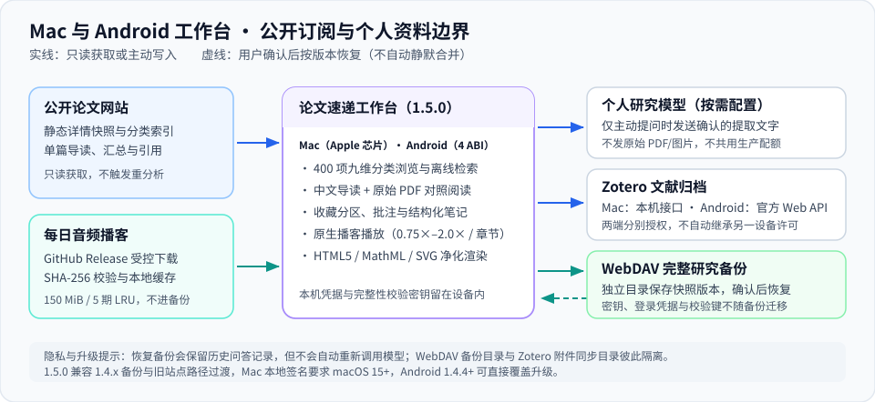

# 论文速递工作台（Audio Research Workbench）

**中文** · [English](README.en.md)

<a id="你会得到什么"></a>

每天刷完语音、音乐和音频方向的 arXiv 新论文往往要花掉一两个小时。这个项目把整件事拆成两半：后台先拿每篇论文的官方正文与 PDF，写成面向初学研究者的中文长文解读（代码中称为 **Reader**）、八维评分、九维分类、作者机构与引用资料，通过三层审查后再发到公开网站；前台提供网页与 Mac / Android 原生应用，用来安静阅读、对照原 PDF、记笔记和收听每日播客。

内部供程序核验的十三节主分析与面向读者的 Reader 分开保存，互不替代。文章里的每张表、每个展示公式、每张论文原图、作者单位和开源声明，都必须对应本次真实使用的论文来源。


## 先选适合你的入口

| 你想做什么 | 直接从这里开始 |
|---|---|
| 浏览器看已发布的中文论文解读 | 打开[论文速递网站](https://nanless.github.io/audio-research-portal/)；下载原论文与引用见[网页阅读说明](docs/blog-reading-tools.md) |
| 在 Mac 上对照 PDF、做笔记和个人研究 | 查看 [Mac 使用说明](apps/macos/README.md)（Apple 芯片，macOS 15+） |
| 在 Android 手机或平板上阅读和听播客 | 查看 [Android 使用说明](apps/android/README.md)（4 种 ABI 全覆盖） |
| 第一次了解项目怎么运作 | 先读[项目导读](docs/project-guide.md)，再按任务查对应手册 |
| 自己运行日更、会议整理或历史更新 | 先完成下方准备步骤，再按[操作手册](SKILL.md)执行 |

## Mac 与 Android 工作台（1.5.0）

网站和内容生产链叫“论文速递”，Mac 和 Android 原生应用叫“论文速递工作台”。应用只读获取网站已经发布的目录、导读、汇总和播客，打开论文不会触发任何模型重算，也不需要配置生产环境的 `.env`。

- **当前版本**：Mac 与 Android 源码均为 **1.5.0（构建号 24）**（待发布，新增原生每日音频播客播放器、离线检索筛选对齐与跨版本站点路径兼容，详见 [1.5.0 变更记录](docs/workbench-1.5.0-review.md)）。
- **最近公开发行**：**1.4.7 / 构建号 23**（2026-11-23 发布，见 [GitHub Release v1.4.7](https://github.com/nanless/audio-research-workbench/releases/tag/v1.4.7) 与[客户端发行核验](docs/client-release-verification.md)）。历史各版记录保留在 [docs/README.md](docs/README.md#阅读历史评审记录)。
- **安装与升级**：Mac 面向 ARM64 Apple 芯片，本地签名、尚未经过 Apple 公证；Android 1.4.4 及以上可直接覆盖升级，1.4.3 需卸载重装。



应用里的个人研究是独立开关：只有你主动提问或测试连接时，才会把确认过的提取文字发给你自己配置的模型服务（不传原 PDF 或图片），账单、问答与网站生产任务彼此隔开。恢复 WebDAV 备份会保留历史笔记与问答，但不会自动重新调用模型，也不会把密钥或本机校验键带到云端。

<a id="默认行为"></a>
<a id="架构概览"></a>

## 内容怎样从论文走到网页

内容生产默认调用语言模型服务（LLM/API），分三条独立流程：**当天日更**、**官方会议整理**和**历史博客更新**。它们共用分析引擎、八维评分、400 项九维分类、Reader 写作和页面渲染代码，但各自独立核验来源、去重基线和发布凭证，来源证明不能跨流程混用。


为什么要先把原文和 PDF 封存成四文件（`source.txt`、`source.pdf`、`source-runtime.json`、`source-manifest.json`）再写作？因为网页链接会变、模型会漏看或误读数字。封存并计算 SHA-256 之后，生成、局部修复和发布前的重新核验都读同一份原始材料，推送后还要确认部署成功并逐页核对 HTTP 200 和标题，避免“推上去了但页面打不开”。

<a id="5-分钟开始"></a>
<a id="第一次使用"></a>

## 第一次使用

如果只是看文章或用 Mac / Android 应用，直接跳过这一节。下面的步骤面向维护网站、运行内容生产任务的人：

1. 进入工作区 `$HOME/code/github_repos/audio-research-workbench` 并核对 `pwd`，执行 `npm run workspace:role -- status` 确认角色为 `daily`（历史命令通过 `.env` 里的 `PD_WORKSPACE_ALLOW_CROSS_ROLE=1` 跨角色执行）。
2. 按[安装与配置](docs/setup.md)准备好 Node（`>=20.18.1 <21 || >=22.3.0`）、Python 3.11+ 与依赖，复制 `env.example` 为 `.env` 并填写模型密钥、代理和真实 Hugo 博客仓库路径。
3. 运行只读体检 `npm run doctor -- --offline` 与 `npm run config:check`。当前项目指定主、副模型为 `muse-spark-1.3-contributor`（推理上限 `xhigh`，默认启用按阶段分级推理），arXiv 抓取和 Muse 请求强制走项目 HTTP CONNECT 代理。
4. 确认当前没有其他生成、审查或推送任务在跑，且博客仓库目标日期没有人工未提交改动。

完整执行约束见 [AGENTS.md](AGENTS.md)，分步骤说明见[新人上手](docs/onboarding.md)与[操作手册](SKILL.md)。

<a id="核心命令"></a>

## 选择任务

下表列出常用入口；示例中的日期、编号和路径运行前需替换为当次真实参数。

| 你要做什么 | 命令与说明 |
|---|---|
| 运行当天日更 | `npm run digest:prepare -- YYYY-MM-DD`（`digest:api` 等价）；见[日更步骤](SKILL.md#1-日更) |
| 开跑前体检与配置核查 | `npm run doctor -- --offline`（加 `--network` 探测 arXiv）、`npm run config:check` |
| 抓取前探源与看账号池 | `npm run source:probe -- --date YYYY-MM-DD`、`npm run llm:accounts` |
| 观察进度与分析耗时记分卡 | `npm run digest:status -- --date YYYY-MM-DD --watch`、`npm run digest:scorecard -- --date YYYY-MM-DD` |
| 整理官方会议论文 | `conference:acquire` → `conference:discover` → 筛选 → `conference:process`；见[会议流程](docs/conference-workflow.md) |
| 从原文重写历史博客（保留原 URL） | 固定范围后执行 `history:inputs/plan/sources/run/aggregate`；见[历史更新](docs/history-rewrite.md) |
| 发布历史更新结果 | `npm run history:publication -- plan\|generate\|review\|publish\|status`；见[历史发布](docs/history-direct-publication.md) |
| 仅更新已发布完整日批的呈现 | `npm run blog:generate -- --date YYYY-MM-DD --republish UUID`，随后 `review → push` |
| 失败诊断与人工清单准备 | `npm run recover -- --date YYYY-MM-DD`、`npm run manifest:new -- --spec SPEC.json` |
| 旧发布输入丢失时登记早批次见证 | `npm run fetch:witness:prepare -- --date YYYY-MM-DD --source-date YYYY-MM-DD` |
| 表格预检、影响面与误报核对 | `npm run table:check -- --draft FILE`、`npm run impact -- --git`、`npm run review:overrides -- --date DATE --file F.json` |
| 推送后核验网页与收尾清单 | `npm run verify:web -- --date DATE --deploy OID`、`npm run publish:finish -- --date DATE` |
| 查看运行锁、文档与数据完整性 | `npm run locks`、`npm run docs:check`、`npm run validate:data` |
| 账本压缩、重复 PDF 去重与存储建议 | `npm run papers:compact`、`npm run storage:pdf-dedupe`、`npm run storage:report`、`npm run storage:prune` |
| 可选工具：批后分数校准 / 每日播客 | `npm run digest:calibrate -- --dry-run`、`npm run podcast:generate -- --date YYYY-MM-DD --dry-run` |
| 改代码后完整本地验收 | `npm run verify`（固定 Hugo 0.160.1 + 全仓语法 + JS/Python 单测 + 数据校验） |

## 运行一次日更

把日期换成北京时间当天：

```bash
npm run digest:prepare -- YYYY-MM-DD
```

程序会按顺序同步博客远端、补抓并去除已发布论文、关键词预筛加模型筛选、封存每篇的官方 HTML 与 PDF、完成分析评分与 Reader 长文、生成页面并过三层审查，最后推送博客并登记本次不生图。推动完成后，还需确认 Pages 部署成功并逐页核验正式地址、HTTP 200 与标题。

几点边界值得提前记住：

- **默认不生图**：按用户 2026-11-02 起的持续要求，日更不再生成论文长图和汇总封面（旧 `--no-visuals` 兼容保留），推送后自动登记不生图记录；论文原图照常获取、展示与审查。登记失败按[排障说明](docs/troubleshooting.md#11-不生图登记失败)恢复。
- **仅当天可重抓**：日更抓取只针对北京时间当天，历史日期不能从日更抓取阶段重跑，只能沿用已有受控来源或走历史维护流程（详见[抓取边界](docs/daily-fetch-boundary.md)）。
- **只按已发布页去重**：库里未发布的论文仍会参与补更，不会因为曾进过候选列表就被静默跳过。

## 失败后从哪里继续

遇到单篇失败时，先把这一轮其余论文跑完并保存结果，再只续可重试的失败集合。已通过的来源、阶段检查点、草稿、调用次数和费用都会保留，不会推倒重来，也不会清零账本。

| 停在哪一步 | 怎样继续 |
|---|---|
| 日更分析或 Reader 长文 | 用 `npm run deep`、`npm run batch` 或 `npm run api:reader:refresh`，自动复用同一组封存来源 |
| 官方会议处理或页面维护 | 续跑原 `conference:process` / `conference:migrate-process`；详见[会议恢复](docs/conference-workflow.md#已有完整会议只更新页面) |
| 历史准备或分析 | 继续原计划与 `npm run history:run`；暂停任务用 `npm run history:resume` 恢复 |
| 博客正文或图片审查未通过 | 先跑完整批审查；正文回正常 Reader 维护，图片可先派发同篇认证 PDF 出版视图再重审 |
| 认证、余额、配置或保存故障 | 先停止新派发、保存在途结果并排除故障（多账号池逐号独立诊断），再从原阶段继续 |

通过审查的页面按“相对路径 + 内容 SHA”永久复用；多次自动轮后若只剩少量顽固项，再使用来源绑定的受控人工修正（每篇 1–8 个已有节点，仍须过完整校验与博客审查，详见[解读恢复](docs/reader-explicit-retry.md)）。任务内为提升效率与成稿质量所需的后续付费窗口已获[持续授权](AGENTS.md#持续授权以效率和效果为准)，按实际进度另记账即可。

整批 Manual 写作与微信、飞书、小红书发布已退役。[manual/README.md](manual/README.md) 仅保留旧记录核验及独立人工审查（新独立审查使用 `gpt-6.1-sol/high` 并登记真实身份）。

## 怎样才算完成

一次日更必须同时满足 [AGENTS.md 的六项完成定义](AGENTS.md#日更完成的六项)才算结束（权威口径在 AGENTS.md）：

1. **数据与来源**：正式分析、封存来源、Reader 长文、评分与标签全部通过当前检查。
2. **审查**：最终页面通过程序、正文、原图及 Hugo 构建审查，凭证覆盖完整目标集合。
3. **远端发布**：只推送凭证允许的精确差异，并核对远端 `main` 提交 OID。
4. **部署**：对应提交（或保留已审页面字节的后续提交）的 Pages 构建与部署均成功。
5. **网页核验**：逐页核对汇总与单篇的 HTTP 200、正式地址与准确标题，并保存记录。
6. **不生图登记与重读状态**：绑定本次发布的不生图记录有效，最后重跑 `npm run digest:status -- --date YYYY-MM-DD` 复核。

`digest:status` 只反映读取瞬间的本地与发布状态，不能代替第 4、5 项的真实部署和网页核验。

## 文档导航

- [项目导读](docs/project-guide.md)：10 分钟看懂来源、分析、网站和客户端之间的关系。
- [操作手册](SKILL.md)与 [AGENTS.md](AGENTS.md)：完整操作顺序、失败恢复与不可绕过的执行限制。
- [文档总索引](docs/README.md)：按场景找配置、来源、标签、备份、客户端性能与故障排查。
- [脚本指南](scripts/README.md)与[完整脚本索引](scripts/INDEX.md)：查入口、核心库与兼容模块。
- [客户端发行核验](docs/client-release-verification.md)：Mac 与 Android 安装包签名、证书、附件与 SHA-256 校验记录。
- [写作 skill](skills/clear-technical-writing/SKILL.md)与[项目写作约定](docs/writing-guide.md)：面向初学者的讲解、段落、术语与配图规范。
