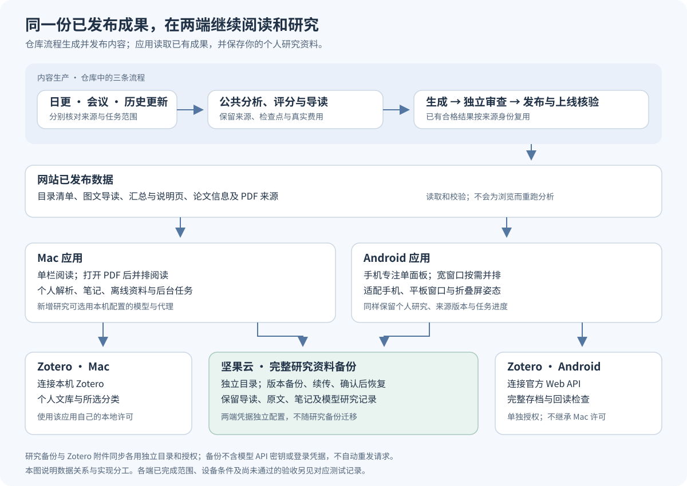

# 论文速递（Audio Paper Digest）

<a id="你会得到什么"></a>

从真实论文全文生成中文解读、八维评分、作者机构、资源状态、引用资料和博客页面。面向读者的解读长文称为 **Reader**；供程序解析的内部主分析另行保存和核验。

## 先选择你的使用方式

| 你想完成什么 | 从这里开始 |
|---|---|
| 直接阅读已经发布的论文解读 | [论文速递网站](https://nanless.github.io/audio-paper-digest-blog/)；下载资料见[网页阅读说明](docs/blog-reading-tools.md) |
| 在 Mac 上阅读、看原始 PDF、记笔记和开展个人研究 | [论文速递工作台（Mac）](apps/macos/README.md) |
| 在 Android 手机上阅读，或使用平板、折叠窗口 | [论文速递工作台（Android）](apps/android/README.md) |
| 维护网站，运行日更、会议或历史更新 | 继续阅读下面的生产任务入口，再按[操作手册](SKILL.md)执行 |

Mac 与 Android 客户端叫 **论文速递工作台**，网站和内容生产项目叫 **论文速递**。应用直接读取网站已经发布的论文、图文导读和汇总页面。个人模型只在你主动研究或测试连接时调用，原回答与实际用量分别保存。客户端个人资料、模型配置、费用和授权与网站生产任务分开；恢复备份沿用原记录，新增请求仍按当前任务授权执行。



Mac 1.0.1 面向 ARM64、macOS 15，采用本地签名，尚未通过 Apple 公证；Android 1.0.1 支持四种 ABI，沿用原签名和应用标识。安装方式与验证范围见 [Mac 说明](apps/macos/README.md)、[Android 说明](apps/android/README.md)；安全检查见[客户端安全说明](docs/client-security-audit.md)。

<a id="默认行为"></a>
<a id="架构概览"></a>

内容生产默认调用 LLM/API，有当天日更、官方会议整理、历史博客更新三条流程。它们共用分析、Reader、评分、标签和页面展示；各自核验来源、处理范围与发布记录。

<a id="5-分钟开始"></a>
<a id="第一次使用"></a>

## 第一次使用：运行生产任务

1. 在 `$HOME/code/github_repos/audio-paper-digest` 展开并核对真实目录和角色：`npm run workspace:role -- status`。三条流程都在此运行，角色保持 `daily`；历史入口使用已配置的跨角色开关。
2. 按[安装与配置](docs/setup.md)安装依赖、填写项目 `.env` 并检查真实博客仓库。
3. 主模型及启用的副模型统一使用项目指定的 `muse-spark-1.3-contributor`。Muse 和 arXiv 必须经项目 HTTP CONNECT 代理。
4. 确认没有其他任务同时生成、审查或推送博客，目标页面没有人工修改冲突，再选择流程。

执行前阅读 [AGENTS.md](AGENTS.md)。文件、检查点和来源的关系见[三流程与共享核心](docs/three-workflows.md)；编辑文档和论文解读时遵循[写作约定](docs/writing-guide.md)。

<a id="核心命令"></a>

## 选择任务

| 任务 | 入口 | 操作说明 |
|---|---|---|
| 运行北京时间当天的论文速递 | `npm run digest:prepare -- YYYY-MM-DD` | [日更](SKILL.md#1-日更) |
| 检查环境、账号、磁盘和博客仓库 | `npm run doctor -- --offline`；联网探测加 `--network` | [运行前体检](docs/maintenance.md#运行前体检运行中状态与错误指引) |
| 抓取前探测来源、核对账号或配置 | `npm run source:probe -- --date YYYY-MM-DD`、`npm run llm:accounts`、`npm run config:check` | [探测与配置检查](docs/maintenance.md#抓取前探测与配置检查) |
| 查看运行阶段、失败与费用 | `npm run digest:status -- --date YYYY-MM-DD --watch` | [运行中状态](docs/maintenance.md#运行前体检运行中状态与错误指引) |
| 整理官方会议 | 获取官方来源、提取摘要证据、筛选，再执行 `conference:process` | [会议流程](docs/conference-workflow.md) |
| 从原文更新既有博客并保留 URL | 冻结页面清单，建立来源与重写计划 | [历史更新](docs/history-rewrite.md) |
| 发布已完成的历史结果 | `history:publication` 的 plan、generate、review、publish、status | [历史发布](docs/history-direct-publication.md) |
| 只更新已发布完整日批的呈现 | `npm run blog:generate -- --date YYYY-MM-DD --republish UUID`，再审查、推送 | [同来源重发布](docs/data-format.md#同来源同分析的日批重发布) |
| 失败后选择恢复路线 | `npm run recover -- --date YYYY-MM-DD`；人工清单准备用 `npm run manifest:new -- --spec SPEC.json` | [恢复工具](docs/maintenance.md#恢复决策与清单生成) |
| 核对表格或代码影响范围 | `npm run table:check -- --draft DRAFT.json`、`npm run impact -- scripts/x.js` | [定向预检](docs/maintenance.md#表格与影响面预检) |
| 核对审查误报解释 | `npm run review:overrides -- --date DATE --file OVERRIDES.json` | [误报诊断](docs/maintenance.md#发布后网页核验与收尾) |
| 发布后核验网页 | `npm run verify:web -- --date DATE --deploy OID`；`npm run publish:finish -- --date DATE` 打印后续清单 | [发布收尾](docs/maintenance.md#发布后网页核验与收尾) |
| 查看锁、检查文档命令 | `npm run locks`、`npm run docs:check` | [锁与文档检查](docs/maintenance.md#锁视图与文档一致性) |
| 查看存储保留建议 | `npm run storage:report`；清理先用 `npm run storage:prune` 预览 | [存储保留](docs/maintenance.md#存储保留建议) |
| 修改代码后完整验证 | `npm run verify` | [维护与验证](docs/maintenance.md) |

阶段名用于选择入口。会议和历史命令还需填入上一步生成的真实 ID、文件和参数。已有完整会议先核对原 process 是否已经发布，再按[会议页面恢复](docs/conference-workflow.md#已有完整会议只更新页面)选择入口。第一次操作可先看[新人上手](docs/onboarding.md)。

## 运行一次日更

安装和配置通过后，将日期替换为北京时间当天：

```bash
npm run digest:prepare -- YYYY-MM-DD
```

入口依次抓取、筛选、封存官方来源，完成分析、Reader、评分、标签，再生成、审查和推送博客。推送后继续完成部署、网页及视觉验收。`digest:api` 是等价别名。

只有用户明确取消视觉时，才加 `--no-visuals`。程序仍在真实发布后建立任务清单并登记本次发布的豁免，不准备图片或生图。规划失败按[视觉恢复](docs/troubleshooting.md#11-视觉-pending-或-record-失败)处理。

日更抓取只用于北京时间当天，须核验上次获取见证并完整覆盖来源窗口。仅正式已发布页面参与去重，库内未发布论文仍参加补更。历史日期沿用已有受控来源，见[抓取边界](docs/daily-fetch-boundary.md)。

## 失败后从哪里继续

先等本轮全部论文处理和保存结束，再只续可重试失败集合。每次正常调用默认最多 3 轮，原来源、草稿、次数和费用保留。已有任务的持续付费授权覆盖必要后续窗口，由执行者按实际进展和成本登记，无需逐轮重新确认；技术窗口的限额仍分别核验，新增消费另记。持续无进展时先查原因，认证、配额、配置或保存故障先停止新派发并保存在途结果。

| 停在哪里 | 下一步 |
|---|---|
| 日更分析或 Reader | 选择 deep、batch 或 Reader 刷新，继续同一封存来源，见[操作手册](SKILL.md)。 |
| 会议处理或旧完成稿检查 | 继续原 process；实现变化时按[迁移与恢复](docs/conference-workflow.md#已有完整会议只更新页面)处理。原窗口耗尽后，在已有授权内登记[后续窗口](docs/conference-workflow.md#原额度耗尽后的独立付费恢复)，保留前序完整记录。 |
| 历史准备或分析 | 继续同一计划、来源获取序号和 `history:run`；暂停任务先按原控制协议恢复。 |
| 博客正文或图片被拒 | 先完成整批审查。会议正文及格式问题走[正常 Reader 维护](docs/conference-workflow.md#博客拒稿后的正常-reader-维护)；图片可用[同篇 PDF 出版视图](docs/conference-workflow.md#认证-pdf-的独立出版视图)后重新审查，语义错误仍须修正正文。 |
| 运行级故障 | 停止新派发、保存结果、排除故障，再从原阶段继续，见[故障排查](docs/troubleshooting.md)。 |

优先复用已通过的阶段和真实付费响应。人工修正绑定完整失败集合、原稿、真实来源和明确节点范围，中断沿同一清单继续；详见[Reader 恢复](docs/reader-explicit-retry.md)。科学表格保留真实条件、方法、指标及单位，图表、脚注和作者资源声明须有对应来源。正常解析、完整资格与最终博客审查始终保留。

审查通过页按“相对路径 + 内容 SHA”复用，原合法协议和缓存记录保留。同字节内容拒稿只有旧、新协议均合法且确实变化时才能正常重审。最新失败和未完成事实纠错义务继续阻断完成与发布；共性误报须在生产停止后用真实原稿和正反例修复，再执行正常检查。规则见[发布记录](docs/data-format.md)与[执行约束](AGENTS.md)。

整批 Manual 写作与微信、飞书、小红书发布已退役。[manual/](manual/README.md)保留旧记录核验和受控独立审查；新独立审查实际使用 `gpt-6.1-sol/high` 并登记真实身份。

## 怎样才算完成

1. 正式分析、来源、Reader、评分和标签通过当前检查。
2. 最终页面通过程序、正文、图片及 Hugo 审查，凭证覆盖完整目标集合。
3. 只推送凭证允许的精确差异，核验远端 `main` 提交 ID。
4. 对应提交或保留已审页面字节的后续提交部署成功，逐页核验 HTTP 200、正式地址及标题，保存记录。
5. 完成视觉任务，或登记用户明确授权、与当前发布绑定的有效豁免，最后重新读取状态。

`digest:status` 报告读取时的状态；部署、网页和视觉按上述步骤分别验收。运行中观察用 `--watch`（默认 10 秒），最终发布、图片登记或豁免发生变化后重新读取。

## 文档导航

- [操作手册](SKILL.md)：正常顺序、恢复入口和完成要求。
- [文档索引](docs/README.md)：配置、来源、Reader、标签和故障说明。
- [脚本索引](scripts/README.md)：入口、公共模块和旧记录兼容代码。
- [三流程与共享核心](docs/three-workflows.md)：调用关系、来源与发布边界。
- [写作约定](docs/writing-guide.md)：术语、段落、图表和操作说明。
