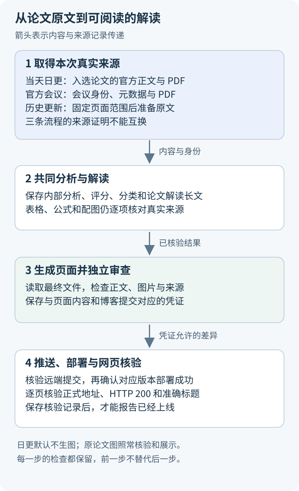
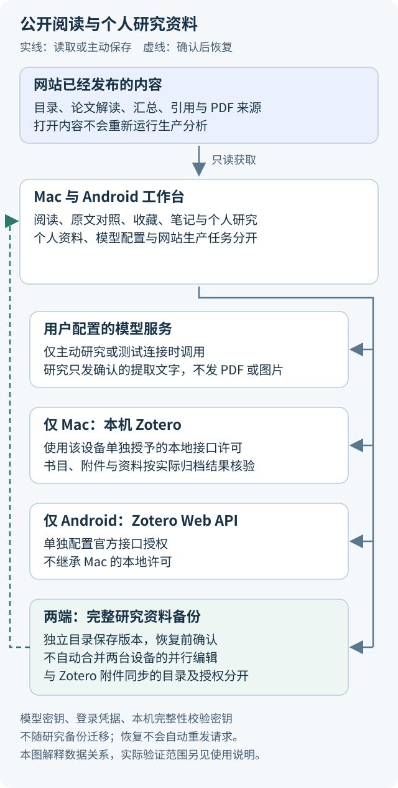

# 项目导读：从论文原文到阅读与维护

这份导读面向第一次接触论文速递的读者。先认识项目处理的对象，再选择阅读、个人研究或网站维护的入口。你不必先学完所有发布协议，才能打开一篇文章。

## 先分清网站与阅读应用

论文速递网站保存已经正式发布的中文论文解读、评分、引用资料和汇总。Mac 与 Android 上的“论文速递工作台”读取这些公开内容，提供原始 PDF 对照、收藏、笔记和个人研究。

打开已经发布的论文，不会让内容生产流程重新分析它。应用里的个人研究是另一项主动操作：用户选择材料、配置模型服务并确认后，才会发送实际材料。网站生产任务与个人研究各自保存授权、结果、用量和费用。

仅阅读时，直接打开[网站](https://nanless.github.io/audio-paper-digest-blog/)，或按 [Mac](../apps/macos/README.md)、[Android](../apps/android/README.md)说明安装应用。生产项目的 `.env` 用于维护任务，不是阅读应用的安装前提。

## 三条内容生产流程分别处理什么

| 流程 | 从什么范围开始 | 解决什么问题 |
|---|---|---|
| 当天日更 | 北京时间当天的候选与已核验抓取边界 | 从新获取的论文中筛选相关工作，生成当天解读与汇总 |
| 官方会议整理 | 官方会议身份、元数据、论文文件和筛选结果 | 按会议的实际来源与选定范围处理论文 |
| 历史博客更新 | 事先固定的已发布页面范围 | 从原文更新旧内容，并按计划保留原有地址 |

三条流程调用共同的分析和写作代码，所以公共规则修正可以同时用于它们。但是，来源的身份和获取方式不同，不能把日更的来源证明复制给会议，也不能拿旧博客代替本次论文原文。

图中的箭头表示实际材料与身份记录传给下一步，不表示任何一步可以只凭上一步的“通过”字段省略自己的检查。

## 为什么先保存原文，再写解读

模型写作需要知道本次真正读到了什么。日更在筛选后重新获取官方正文和 PDF，同时保存获取信息与来源清单。这组文件叫“封存来源”：它们留下本次输入的实际内容，而不只是一个以后可能变化的网址。

文件还配有按内容字节计算的 SHA-256 指纹。指纹可以帮助发现文件是否改变，但不证明论文结论正确。程序既核对文件内容，也核对论文身份、日期、清单和本次任务之间的关系。

恢复日更分析时，程序沿用当前任务已经封存的来源，不悄悄重新下载另一份内容。来源缺失或指纹不符时，先按对应规则处理，不把旧缓存补成新的来源证明。具体目录和边界见[抓取与来源说明](daily-fetch-boundary.md)。

## 内部分析与读者长文各做什么

内部主分析有固定的十三节标题，供程序提取和检查。它记录对论文任务、方法、实验、限制与评价的分析结果。

面向读者的论文解读长文，程序中称为 Reader。它要把研究问题、方法步骤、必要概念、实验比较与结论限制连成可读的解释，而不是把内部字段逐个拼成段落。正文中的表格、公式和配图仍须对应真实来源。

八维评分、分类和资源信息也有独立核对。网址能够访问，不等于作者已经公开代码或模型权重；作者说未来会发布，也不等于现在已经可以下载。读者看到的状态要与真实证据一致。

阅读写作要求可从[项目写作约定](writing-guide.md)开始。需要修改来源字段、表格或失败稿时，再读[解读写作与来源要求](reader-writing.md)。

## 从生成页面到网页上线，还差哪些检查

生成页面只是把已核验内容写成博客文件。随后审查程序读取最终文件，检查正文、配图和来源，并保存与文件路径、内容指纹及博客提交绑定的凭证。推送入口只允许提交凭证覆盖的精确差异。

推送成功只说明 Git 远端收到了提交。部署服务还需要构建网站；构建成功后，还要逐页核对正式地址、HTTP 200 和标题。只有对应发布、部署和网页记录都完整，才能报告内容已经上线。

日更持续遵循用户“以后不再生图”的要求。入口在真实发布后登记本次不生成长图或汇总封面；论文原图仍正常展示与审查。这个登记只处理生图要求，不能代替来源、正文、推送或网页检查。

## 应用怎样保存你的个人资料

应用从网站读取公开资料，个人研究、笔记和收藏在本机保存。配置远程模型服务时，用户确认的提取文字会发送给该服务；当前应用不发送 PDF 原文件或图片。使用扫描件而没有提取文字时，不能把它当作模型已经看过图片。

图中的实线表示读取、主动发送或存档；虚线表示用户确认后的资料恢复。每个目标旁边都标明适用对象和用途，不能据此推断两端会自动合并资料。

Mac 与 Android 的 Zotero 连接分别授权。Mac 使用本机 Zotero 接口；Android 使用官方 Web API。它们保存书目、附件及相应材料，不自动继承另一设备的许可。

完整研究资料备份是另一条路径。它以独立目录保存版本，恢复前需要确认，不实时合并两台设备的并行编辑。模型密钥、登录凭据和本机完整性校验密钥不随研究备份迁移。具体范围见[云端备份](mac-app-cloud.md)与[Android 备份合同](android-cloud-contract.md)。

## 失败时为什么保留旧记录

已经返回的模型内容、调用次数和费用是实际发生的历史。后续文字检查失败，不会使原调用变成没有发生；新一轮恢复也不能清零原账。

因此，正常批次先完成本轮全部论文，再只处理仍可重试的失败项。通过的阶段可以在核对身份后复用。新稿通过完整检查后才保存为正式结果，不能手动把失败标记改成成功。

持续付费授权允许执行者安排必要后续窗口，但每个窗口的来源、范围和技术限额仍分别登记。认证、余额、配置或保存故障影响整次运行时，先停止新请求并保存在途结果，再排除故障。详见[恢复顺序](three-workflows.md#全批轮次与失败集合)。

## 接下来读什么

- 想直接阅读或下载资料：看[网页阅读说明](blog-reading-tools.md)。
- 第一次执行当天日更：先看[安装配置](setup.md)，再看[新人上手](onboarding.md)和[操作手册](../SKILL.md)。
- 需要维护会议或历史内容：分别进入[会议流程](conference-workflow.md)、[历史更新](history-rewrite.md)。
- 需要理解文件字段：查[数据格式](data-format.md)，遇到陌生简称可查[术语说明](writing-guide.md#术语先解释再统一称呼)。
- 需要修改文档：先使用[把技术写清楚](../skills/clear-technical-writing/SKILL.md)，再按[项目写作约定](writing-guide.md)复核来源、段落和图表。
