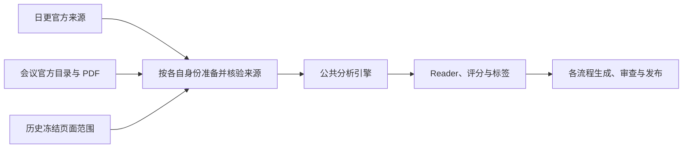

# 三流程与共享核心

只有日更、官方会议、历史博客更新三条生产流程。新任务均调用当前公共引擎与 Prompt；来源和页面范围的差异通过适配器保留，不能伪装成 arXiv 身份。

## 先理解共同部分与来源差异

Reader 是给读者看的论文长文，主分析是供内部阶段解析和核验的十三节正文。检查点保存阶段进度，凭证绑定真实来源或操作；文件存在、状态 complete 和网站上线分别核对。SHA、CAS 等词见[术语说明](writing-guide.md#术语先解释再统一称呼)。

历史任务先冻结要保留的页面及 URL，再准备论文真实来源。图中的共用实现不表示来源凭证可以互换，也不表示分析通过就能省略发布审查。

| 要核对什么 | 日更 | 官方会议 | 历史更新 |
|---|---|---|---|
| 处理范围 | 当前正式批次与日期 | 官方目录经筛选后的固定成员 | 冻结页面与论文对应关系 |
| 实际来源 | 本批官方 HTML/PDF 四文件 | 官方目录、PDF 与来源账本 | 新获取的 arXiv 来源或核验过的本地会议 PDF |
| 恢复身份 | 同批次、同源、原候选与反馈 | 原 process、逐篇执行及父子运行 | 同计划、获取序号、真实来源路线 |
| 发布依据 | 日更页面清单与审查凭证 | 会议生成、审查、发布凭证及图床事务 | 完整页面覆盖、私有生成与独立发布凭证 |

## 从哪里进入

| 流程 | 获取/范围 | 分析/恢复 | 生成与发布 |
|---|---|---|---|
| 日更 | `run-daily-digest.sh` → `scripts/full-fetch.js` | `analysis-engine.js`；`deep-analysis-only.js`、`batch-analyze.js`、`refresh-api-reader.js` | `generate-blog.py`、`review-blog.py`、`push-blog.py` → `publish-to-blog.py` |
| 官方会议 | `official-conference-acquire.js`、`conference-discover.js`、`conference-filter-run.js` | `conference-process.js` → `lib/conference-analysis-adapter.js` → 同一 `analysis-engine.js` | `conference-page-render.py`、`publish-conference.py` |
| 历史更新 | `history-inventory.py`、`historical-direct-rewrite-inputs.js`、`historical-direct-rewrite-plan.js`、来源准备 | `historical-direct-rewrite-run.js` → `lib/historical-direct-rewrite-runner.js` → 同一引擎；`history-resume.js` | `historical-page-render.py`、`lib/historical-direct-publication.js` |

## 三条流程共用什么

2026-10-17 的逐段调用审计、六类真实缺口、公共实现收敛及两轮交叉复核见[公共部件审计](shared-workflow-review.md)。

| 职责 | 权威代码 | 要保留的规则 |
|---|---|---|
| 分析编排、锁、检查点、费用与恢复 | `scripts/analysis-engine.js`、`scripts/deep-analyzer.js` | 同篇锁内重读合并，原稿、失败与费用保留 |
| 网络与模型 | `utils.js`、`llm-account-pool.js`、`publish_common.py` | Muse/arXiv 强制代理，只有声明的账号额度故障可向后切号 |
| 全文、表格、公式、作者和资源身份 | `lib/fresh-analysis-context.js`、`lib/reader-*`、`reader_sealed_pdf_*.py` | 来源 SHA、结构化单元格、原始 TeX、真实像素、作者逐项身份与资源可达状态 |
| Reader 写作与局部修复 | `deep-analyzer.js`、`lib/reader-contract.js`、`reader-repair.js`、`reader-draft-order.js` | 同一长文结构、术语机制解释、来源绑定、受限修复预算；新稿、保存稿与 Python 发布共用占位结果表检测，旧签名不能代替当前内容资格 |
| 资源宣称 | `deep-analyzer.js` 的共享资源规则与发布只读重放 | 代码可访问不等于权重可下载；否定、条件、第三方引用与本文发布声明区分；“开源代码、可下载权重、可运行系统是三件事”等闭合概念列举只识别自身范围；作者提供声明须有同类型原文且保留当前核验限定，不豁免前后独立当前声明或双否；新阶段绑定 reader-resource-availability-claims-v1 |
| 评分与标签 | `analysis-contract.js`、`lib/tag-stage-record.js`、`tag_stage_record.py`、`tag_catalog.py` | 八维评分、封顶总分；第三方闭源对照与本文资源缺失分开检查，后者仍按原维度归属；当前中文标签与明确主任务/方法，严格纯追加按原SHA只读重放旧分类证明 |
| 页面展示与引用导出 | `publish-to-blog.py`、`paper_reader_presentation.py`、`tag_presentation.py` | 同一资源去重、作者展示、评分说明、多级分类路径及 JSON/BibTeX/RIS/上下文导出；会议使用真实会议身份 |
| 站点分类版本 | 日更 `tag_catalog_file_contents()`；会议/历史 `tag_catalog_publication.py` | 日更将词表资产纳入发布清单；会议/历史只读核验双份版本目录及本批原快照，缺失先阻断 |
| 实现指纹 | `lib/workflow-implementation-files.js` | 收录共享模块和 Python worker 的传递依赖；当前 Prompt 只由版本登记表选取 |
| 不可变文件与页面暂存 | `lib/publication-file-primitives.js`、`lib/paper-page-staging.js` | inode/单链接/目录、严格 UTF-8、SHA 回读和精确路径守卫 |
| 发布与审查 | `publish-to-blog.py`、`publish_common.py`、流程发布适配器 | 内容 SHA 审查复用、事务锁、精确文件清单、远端 OID、部署与网页核验 |

`lib/reader-*` 分成来源、表格、修复和恢复等模块是职责拆分；它们仍由公共引擎调用，不能因文件多而删掉守卫。

### 日更和会议逐阶段对照

| 阶段 | 直接共享的实现 | 会议必须保留的输入或状态适配 |
|---|---|---|
| 候选获取与去重 | 网络、代理、字节与 SHA 校验规则 | 日更按来源窗口重叠补抓并仅以已发布页去重；会议按官方完整目录、真实会议 ID 和唯一 exact PDF 固定全集，不套用日更日期边界 |
| 摘要与关键词预筛 | `lib/keyword-prefilter.js` | 日更使用官方元数据摘要；会议先从受控 PDF 定位摘要，证据不可用及核心音频会议按明确规则放行给 LLM，不能凭缺摘要排除 |
| LLM 筛选 | 当前 `filter-v5.md`、`lib/filter-decision.js`、`lib/filter-prompt.js`、`requestLlmJson()` | 会议填入真实会议类别和 PDF 摘要证据，保留每会 spec、来源集合、请求/响应和选择回执；不混用日更的候选文件或筛选 SHA |
| 全文预处理 | 公共来源上下文、输入清洗、均衡证据取样与预算 | 日更读取本批封存 HTML/PDF 四文件；会议的 PDF 文本、布局、图像、摘要证据由官方来源账本适配进入公共引擎，不能伪造 HTML DOM 或原 TeX |
| 深度分析与后处理 | 同一 `analysis-engine.js` / `deep-analyzer.js`、13 节主分析、审校、资源/表格/方法/结构/摘要修复、八维评分、标签和 Reader 当前模板 | 来源能力决定表格、公式、作者和图片哪些证据可用；会议分析保存隔离的 canonical analysis 和真实会议身份，不写入日更 `data/current` |
| 失败集合恢复 | `lib/analysis-failure-rounds.js`、论文锁、阶段指纹、付费稿与预算守卫 | 会议 process 原尝试窗口、冷却及显式 `--retry-failed` 仍有效；一轮一篇、整轮后仅续失败集合，不让内部单篇调用提前精修 |
| 单篇与汇总展示 | 作者、资源、评分、研究引用和 `tag_presentation.py` 多级路径 | 会议暂存页及汇总从同一原入选集合生成，官方记录/PDF 链接替代 arXiv；汇总多级统计区仅列本会命中子树，并区分直接计数与子树去重计数 |
| 审查与上线 | 公共正文及逐图审查、Hugo、路径+内容 SHA 通过缓存、远端及页面核验 | 会议独立 process/完成/生成/审查/发布凭证及图床事务；不能混用日更 receipt，也不能覆写已有不可变发布凭证 |

上述共享发生在生产入口的实际调用中，不另建会议专用分析、Reader 或标签 Prompt。来源解析器和各流程清单负责提供可核验输入与范围，公共内容引擎负责同一质量标准。只更新排版时先重暂存单篇与完整汇总，复用已合格分析；原 process 是否已发布决定后续入口，见[会议页面更新](conference-workflow.md#已有完整会议只更新页面)。

评分稳定性由 `lib/scoring-stability.js` 统一 Node 的恢复与最终检查，Python 页面使用固定向量逐项核对的同一严格判据。会议与历史汇总把真实原分析送入有界展示桥，与单篇页共同解析详细摘要、资源状态和评分说明；详细摘要仍冷核原阶段。展示结果不授予发布资格，原完整来源、成员集合、预算、URL 和审查凭证继续独立核验。

完整会议旧稿的当前检查失败也走同一批次原则：先完成全体正常后处理，再以显式迁移重试恢复失败集合；原稿保留，来源绑定的子运行按真实资源预检复用公共 Reader、评分＋Reader 或完整分析。评分成功即保存检查点，Reader 失败只续 Reader，不重复付已完成评分。会议保留自己的父子运行、完成及来源凭证，不能借日更 `api:reader:refresh` 冒用四文件封存身份，也不能重签旧模型输入。

评分刷新未完成、没有本子运行的新检查点且已留下失败历史时，外层重试须停止评分新派发；继承的父稿完整评分不能洗掉该失败。最后一次传输失败也可能发生在已有内容响应之后，缺少可持久重放的消耗记录时不能假定原额度完整剩余。单次逻辑请求内部仍正常重试传输；原费用和失败历史保留，只有真实新评分检查点才允许其后的 Reader 独立续跑。

共享修复器的诊断身份同样由来源适配：日更保持 arXiv 身份，会议使用认证执行与规范会议 ID，历史直改使用本次运行、真实路线和来源凭证，并绑定实际全文和结构化来源 SHA。候选恢复也使用该真实身份桥，不把会议编号包装为 arXiv 别名。新 Reader 的资源声明检查在生成收尾和冷启动发布中都重放真实来源上下文；已保存的付费合格稿先做完整只读复验，再决定是否还需请求模型，不因接口修复增加次数或清零旧失败。

日更的临时图片适配会有意嵌套 `fresh` 与 `direct` 来源上下文；恢复器须重读本批封存文件，确认论文、运行、来源及快照 SHA、代次、清单、候选目录和完整来源对象全部相同，才视为同一来源。会议与其他来源混用、跨论文或来源不一致仍立即拒绝，不能按上下文优先级静默选一份。

PDF 表格单位另由认证来源适配到共享 Reader。日更保留真实四源及 DOM 列证明；会议和历史 PDF 使用真实来源程序签发的私有能力，按原 PDF 的唯一连续表范围、表头或明确表注、行标签与数值顺序派生引文证明，并在保存和冷启动出版时重放。没有原表单位、重复列或重排无法唯一对应时继续失败，不能从正文定义、图轴或其他表借单位。该能力保留 `source_quotes` 身份，不新增假 DOM、假 arXiv 或原 TeX，也不增加模型预算。旧完整会议的出版补证仍受原分析及 Reader 全文 SHA 约束，不等于正常未完成稿的来源准入。

会议子运行固定轮次与 process 重试窗口分别计数，任一耗尽都报告真实技术阻断。旧活跃付费候选可在安全临时副本中通过同一正常恢复器做零新模型请求复验，只有完整资格通过才正常保存；独立异步禁请求作用域不影响其他论文。没有正文、仍不合格或需要新模型的候选不因此获得该零请求能力的模型额度。实现变化不隐式重开旧窗口，原合法余额沿原链核验；后续付费窗口由执行者在已有任务授权内受控登记，无需逐轮重新确认，详见[会议恢复边界](conference-workflow.md#已有完整会议只更新页面)。

会议迁移的 `--postprocess-only` 可单独保存全批正常检查与实现迁移，不进入付费派发或重试放行。已授权的认证来源事实修正使用独立资源/核心物理清单及同一正常 Reader、评分和整篇资格；资源权限不编辑核心，核心权限保护其余十二节、完整评分和资源，保留最新主文及原失败、次数和费用。此会议恢复能力不改变日更或历史入口，详见[零请求来源纠正](conference-workflow.md#认证来源事实的零请求纠正)。

会议旧候选的只读 Prompt 声明也须绑定唯一真实付费链、原 Git 字节和认证来源，只在禁模型的私有范围内使用。共享 Reader 仍执行当前完整解析与来源检查，保存原模板身份；该声明不授权新写作或重开次数。日更及历史入口不因会议恢复获得这份私有权限。

## 标签目录与多级路径

三条流程共用当前386项九维词表及 `tag_presentation.py` 展示函数，所选概念从原词表完整核验后生成父级路径。论文的直接标签仍为3–5项，祖先只作导航；文章不显示无命中的分面、兄弟方向或全目录。总目录保留全部方向及零计数节点。新分类只选[新版目录](https://nanless.github.io/audio-paper-digest-blog/tags/)已有概念，原262项和历史签名保留。

会议与历史发布通过 `tag_catalog_publication.py` 检查站点已保存本批词表的双份目录和原快照；新版本须先经受控词表同步，不能发布后才发现分类被隐藏。日更把这些资产纳入正常生成清单。词表纯追加的只读兼容、快照及发布边界见[标签规则](tag-display-policy.md#三条流程共用的目录与呈现)。

修改共享渲染器或同步目录资产不会自动改写已发布文章。用户要求某批既有页面采用新呈现时，须通过对应流程重新生成单篇和汇总，再审查、精确推送并逐页上线核验；已有合格分析及原分类证明只读复用，不为排版变化重新调用分析模型。各流程的调用与恢复位置见[页面切换说明](tag-display-policy.md#已发布页面切换到当前呈现)。

## 全批轮次与失败集合

用户已明确持续授权当前任务的全部必要付费轮时，执行者按效率、效果和累计成本自主安排同一任务及既定来源范围内的后续恢复，无需逐轮重新确认。新许可文件、回执或 UUID 是落实既有授权的技术执行凭证，不是每次向用户索取批准的理由。

下面几种限制解决不同问题，仍按当前实现执行。窗口耗尽时保留断点、原次数、无进展、失败和费用，核对后续方案并登记新的受控窗口，不能篡改旧账或只改轮数绕过检查。技术窗口不构成用户的总付费授权上限；没有正文进展的重复请求须先停派查因，来源、身份、运行级故障和完整质量检查仍可阻断继续。实际任务、来源或人工修改范围扩大时，再核对是否仍在原授权内。

| 限制 | 控制什么 | 不代表什么 |
|---|---|---|
| 并发 | 同时处理的论文或阶段数 | 不增加每篇次数与输出预算 |
| 批次总轮数 | 整轮结束后，是否再处理可重试失败集合 | 不重置原候选、阶段尝试或费用 |
| 单阶段请求尝试 | 某一阶段的原请求恢复上限 | 不重置旧计数，也不是整项任务的授权限次 |
| Reader 原预算 | 原候选可用的全文、局部及物理请求额度 | 实现升级不自动重开旧窗口，后续窗口另行登记 |
| 人工接手建议 | 报告少量持续失败及原因 | 不写成功、不改状态、不安装模型调用窗口 |

来源和任务范围先通过各入口核验。首轮让本次选定且有执行资格的论文统一走正常流程：主分析、审校、Reader、评分、标签及对应暂存。每篇每轮进入一次正常流水线；保留各阶段原有的内部请求尝试和校验。等本轮所有在途论文结束，逐篇结果及轮次记录保存完毕，下一轮才启动。

后续轮仅处理上轮仍可重试的失败集合，按原来源和检查点恢复；通过当前资格检查的成功论文不重复请求模型。认证、配额、配置、保存故障或已标为运行级的错误停止新论文和新轮，等待在途结果保存；来源或身份不能核实、不可重试及额度耗尽的项不靠增加批次轮数放行。额度耗尽时由执行者在已有授权内核验并选择受控后续方案，不逐轮重新询问用户。普通单篇内容失败不抢在其余论文首轮结束前反复精修。

来源绑定的事实反馈进入正常修复前，须持有论文锁并核验原严格反馈包，随后保存 `analysisFactReviewObligation`。原成功正文、阶段和费用照常保留，但不能代表本次纠错完成；无反馈续跑须读取原包继续同一范围。只有当前反馈的阶段证明、反馈 SHA、拒绝原句和完整内容资格全部通过，正常收尾才清除该义务与最新失败。批次保存、零工作与最终统计使用同一反馈完成判定；旧反馈已满足也不能替更晚失败作证。发布侧在义务字段存在时一律拒绝，即使请求仍在途中、尚未写入失败标记。该字段不给任何新请求额度，普通付费原稿仍可经真实正常复验成功返回后恢复。

公共调度由 `scripts/lib/analysis-failure-rounds.js` 实现。`PD_ANALYSIS_BATCH_MAX_ROUNDS` 控制本次调用最多执行多少轮，默认 3，范围 1–10；旧 `PD_ANALYSIS_MAX_RETRIES=N` 兼容为总共 `N+1` 轮，默认 2 对应 3 轮。它们改变外层调度，不清零阶段尝试、Reader 原候选、无进展记录或费用，也不自动建立新的付费 Reader 窗口。这些是单次调用的技术限制；已有持续付费授权不因达到该数值失效，必要后续窗口按受控入口登记，不靠重复确认或修改旧计数续跑。单篇内部恢复、明确预算追加和来源重新获取是不同操作，见 [Reader 恢复预算](reader-explicit-retry.md)。

三流程共用 `reader-repair.js` 对当前 Reader 问题与原双签名作保守比较。完整解析已运行、原记录完整一致、新问题不再包含旧规则组，且原内容响应额度尚未耗尽时，旧连续失败停止条件不阻断新问题使用原余额；计数和历史保留。全文已用完两次时，只能对明确覆盖全部新问题的 1–8 个既有节点使用原局部补丁余额，最终请求前核对整稿和旧节点 SHA，禁止来源整稿重试、整组操作和全文回退。同组新增单元格、改变数量阈值、缺失签名、归一化先失败、传输或来源阻断均不授予这种续跑，详见[正常原余额](reader-explicit-retry.md#正常候选中的原余额)。

三条流程仍有必要边界：日更只使用当前批次完整封存来源；会议每篇仍受原尝试窗口和跨调用冷却约束，同次调用的轮次最多为公共上限与原 3 次窗口的较小值，这是当前技术窗口而非人类授权总轮数；历史的队列、`--paper-ids`、`--max-papers` 在首轮确定，失败轮不扩大该范围。来源下载、会议筛选和博客审查保留各自请求及恢复规则，不能把分析轮次参数套用到这些阶段。

Reader 批量刷新默认使用配置并发5和总轮数3，分别可用 `--concurrency N`（1–60）及 `--rounds N`（1–10）覆写。只有错误明确标为 `retryable=true` 的论文进入下一轮；来源计划、运行级或存储错误停止新派发，其余不可重试失败保留阻断原因并交回受控处理。显式强制重分析只在本次首次准备每篇时执行获准的候选重置；同次后续失败轮继续原候选与预算，不重复重置。

会议 `conference:process` 外层并发默认1、`conference:migrate-process` 默认3，均可显式设置 `--concurrency N`（1–60）。Reader 仍受原 `PD_API_READER_CONCURRENCY` 限制，正常完整分析修订最多占用原主分析配置下的3槽，每篇内部并发仍为1；调度并发不改变来源计划、模型、请求额度或整批轮次。

博客审查遇到正常内容拒稿时继续检查本批其他页面，最后汇总阻断发布；服务、存储、页面字节变化或凭证损坏按各入口的运行级故障规则停止新派发。一次审查不会因普通拒稿在同次调用中反复请求该页；修正后重跑审查，只按各流程的真实通过缓存复用未变页面或分块。失败审查记录是审计，不能充当通过记录。

共享图片审查对可识别的 Reader 图组保留完整的导读、看图路径、原图、图注与解释，包含当前图的 PDF 整页来源说明；不再用固定字符窗口夹入下一张图的导读。合法的前图解释兼作后图导读时，该完整段落可在两图上下文中分别保留，其他图的路径、图像与图注仍隔离。不识别的旧排版继续使用原局部窗口，不猜测或改写归属；图片自身的图文矛盾仍须正常拒绝。上下文修复只改变审查请求及协议，通过页仍按原路径与内容 SHA 复用，原失败记录和真实费用保留。

只有自动正常流程经过多轮、最终只剩少量持续失败项时，才考虑受控人工修正。`manualHandoff` 是建议和诊断：默认最多 5 篇、每项本次至少失败 3 轮；语义无进展默认观察 3 轮。到总轮上限仍有新稿变化，也可报告 `small_persistently_failed_set`；配置更多轮时，达到连续无进展阈值可提前结束自动轮。次数、时间戳和费用增加不算正文进展。把 `PD_ANALYSIS_MANUAL_HANDOFF_MAX_ITEMS` 设为 0 可关闭这项建议。

报告不修改失败状态，`newApiRequestsAuthorized` 始终为 `false`：该字段仅表示 `manualHandoff` 工具本身没有安装模型调用窗口，不是否认用户已有的任务级付费授权。服务故障、不可重试和预算耗尽分别保留阻断原因；执行者可在已有授权内登记必要的受控后续窗口，但不能让建议报告自动重开旧额度。人工修改须保留原稿和真实费用，绑定本篇来源、当前失败稿 SHA、具体反馈及获准修改范围；修正后重新通过正常来源、正文、Reader、评分、标签和发布审查。不得手填 complete、删除失败记录或跳过校验来“手动通过”，见 [独立人工审查边界](../manual/README.md)。

## 必须保留的适配差异

日更 Reader-only 完成核验按真实父子反馈组合只读重放，禁止模型和写入；旧父恢复先核验完整主检查点，并保护所有非 Reader 上游不被失效或改写。该规则不改变会议或历史的来源范围，也不为任一流程补发预算，详见[事实反馈恢复](reader-explicit-retry.md#已完成主文的独立-reader-事实反馈)。

日更封存本次官方 arXiv HTML/PDF；会议核验官方版本、会议 ID、账本和 PDF。只有 PDF 的来源不能声称有 HTML DOM 表格或公式能力，已授权的单一替代 PDF 例外仍受白名单限制。

历史按冻结页面范围去重，同篇论文只分析一次，再生成对应历史页面；保留的会议元数据/PDF须核验，arXiv按历史来源策略重新获取。无独立摘要或公开来源 URL 时，导出资料明确标为本次发布元数据不可得，不生成假 arXiv 链接或私有文件路径。

三者共用内容审查函数，但页面集合、来源账本和 Git 基线不同，仍需各自清单与审查凭证；不能复用不属于当前范围的凭证。

## Prompt 的唯一选择入口

`scripts/lib/prompt-text-versions.js` 登记各阶段当前版本。三流程通过公共分析引擎选取同一份主分析、审校、评分、Reader 和局部修复 Prompt；当前文件及用途见 [Prompt 索引](../prompts/README.md)。筛选和页面审查保留各自任务上下文，共用网络、模型路由与请求封装。

旧提示词正文不再保存在工作树；`scripts/lib/git-prompt-evidence-index.json` 只登记原路径、Git blob OID 和整文件 SHA。旧记录通过受控读取器从 Git 取回原字节，复核整文件及首围栏模板 SHA，并保留原声明、来源、检查点和付费记录；缺失或不符就停止，不能用当前正文补签旧结果。新请求只读取当前登记的 18 份 Prompt。

旧资源协议记录仅按其声明只读核验，不补签新合同；当前出版总是按最新资源规则对封存来源重放，缺少版本字段不能绕过。

## 已收敛的旧链

整批 Manual v5/v6/shadow 作者、任务、spec 与 records 链，以及微信、飞书、小红书、旧 backfill、隔离 Reader 效率实验和视觉调试渲染已退役。

会议独立 execution/analyze/postprocess CLI 已删除，统一走 `conference:process`。历史旧独立分析、标签、暂存、汇总、发布 CLI 和旧整批重写 CLI 已删除，统一走当前历史计划与 `history:resume`。

`manual/` 的剩余源码仅为旧记录来源/签名/正文核验，以及独立单页人工审查。旧历史核心中仍被受限恢复入口调用的部分保留，不允许重新建立旧任务或重置预算。单篇人工修正与审查是三流程的恢复能力。

独立人工审查的文章记录与受控机器资产分区，最终凭证仍覆盖完整生成清单。资产沿用正常来源、词表、引用资料重建与已审引用页核验，不将二进制文件当 Markdown，也不为资产伪造语义审查身份，见[独立审查边界](../manual/README.md)。

## 操作与验证文档

- [操作手册](../SKILL.md)、[会议流程](conference-workflow.md)、[历史更新](history-rewrite.md)、[历史发布](history-direct-publication.md)。
- [安装配置](setup.md)、[来源补抓边界](daily-fetch-boundary.md)、[Reader 写作](reader-writing.md)、[恢复预算](reader-explicit-retry.md)。
- [数据格式](data-format.md)、[标签规则](tag-display-policy.md)、[维护验证](maintenance.md)、[故障排查](troubleshooting.md)。
