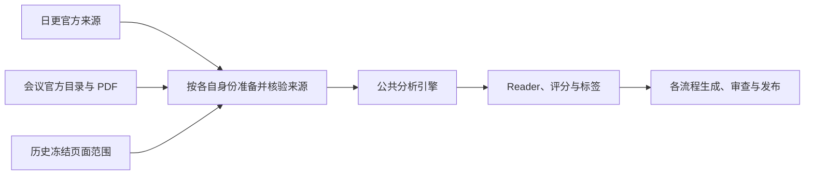

# 三流程与共享核心

只有日更、官方会议、历史博客更新三条生产流程。新任务均调用当前公共引擎与 Prompt；来源和页面范围的差异通过适配器保留，不能伪装成 arXiv 身份。

## 先理解共同部分与来源差异

Reader 是给读者看的论文长文，主分析是供内部阶段解析和核验的十三节正文。检查点保存阶段进度，凭证绑定真实来源或操作；文件存在、状态 complete 和网站上线分别核对。SHA、CAS 等词见[术语说明](writing-guide.md#术语先解释再统一称呼)。

历史任务先冻结要保留的页面及 URL，再准备论文真实来源。图中的共用实现不表示来源凭证可以互换，也不表示分析通过就能省略发布审查。

| 要核对什么 | 日更 | 官方会议 | 历史更新 |
|---|---|---|---|
| 处理范围 | 当前正式批次与日期 | 官方目录经筛选后的固定成员 | 冻结页面与论文对应关系 |
| 实际来源 | 本批官方 HTML/PDF 四文件 | 官方目录、PDF 与来源账本 | 新获取的 arXiv 来源或核验过的本地会议 PDF |
| 恢复身份 | 同批次、同源、原候选与反馈 | 原 process、逐篇执行及父子运行 | 同计划、获取序号、真实来源路线 |
| 发布依据 | 日更页面清单与审查凭证 | 会议生成、审查、发布凭证及图床事务 | 完整页面覆盖、私有生成与独立发布凭证 |

## 从哪里进入

| 流程 | 获取/范围 | 分析/恢复 | 生成与发布 |
|---|---|---|---|
| 日更 | `run-daily-digest.sh` → `scripts/full-fetch.js` | `analysis-engine.js`；`deep-analysis-only.js`、`batch-analyze.js`、`refresh-api-reader.js` | `generate-blog.py`、`review-blog.py`、`push-blog.py` → `publish-to-blog.py` |
| 官方会议 | `official-conference-acquire.js`、`conference-discover.js`、`conference-filter-run.js` | `conference-process.js` → `lib/conference-analysis-adapter.js` → 同一 `analysis-engine.js` | `conference-page-render.py`、`publish-conference.py` |
| 历史更新 | `history-inventory.py`、`historical-direct-rewrite-inputs.js`、`historical-direct-rewrite-plan.js`、来源准备 | `historical-direct-rewrite-run.js` → `lib/historical-direct-rewrite-runner.js` → 同一引擎；`history-resume.js` | `historical-page-render.py`、`lib/historical-direct-publication.js` |

## 三条流程共用什么

2026-10-17 的逐段调用审计、六类真实缺口、公共实现收敛及两轮交叉复核见[公共部件审计](shared-workflow-review.md)。

| 职责 | 权威代码 | 要保留的规则 |
|---|---|---|
| 分析编排、锁、检查点、费用与恢复 | `scripts/analysis-engine.js`、`scripts/deep-analyzer.js` | 同篇锁内重读合并，原稿、失败与费用保留 |
| 网络与模型 | `utils.js`、`llm-account-pool.js`、`publish_common.py` | Muse/arXiv 强制代理，只有声明的账号额度故障可按等权轮转切换 |
| 全文、表格、公式、作者和资源身份 | `lib/fresh-analysis-context.js`、`lib/reader-*`、`reader_sealed_pdf_*.py` | 来源 SHA、结构化单元格、原始 TeX、真实像素、作者逐项身份与资源可达状态 |
| Reader 写作与局部修复 | `deep-analyzer.js`、`lib/reader-contract.js`、`reader-repair.js`、`reader-draft-order.js` | 同一长文结构、术语机制解释、来源绑定、受限修复预算；新稿、保存稿与 Python 发布共用占位结果表检测，旧签名不能代替当前内容资格 |
| 资源宣称 | `deep-analyzer.js` 的共享资源规则与发布只读重放 | 代码可访问不等于权重可下载；否定、条件、第三方引用与本文发布声明区分；“开源代码、可下载权重、可运行系统是三件事”等闭合概念列举只识别自身范围；作者提供声明须有同类型原文且保留当前核验限定，不豁免前后独立当前声明或双否；新阶段绑定 reader-resource-availability-claims-v1 |
| 评分与标签 | `analysis-contract.js`、`lib/tag-stage-record.js`、`tag_stage_record.py`、`tag_catalog.py` | 八维评分、封顶总分；第三方闭源对照与本文资源缺失分开检查，后者仍按原维度归属；当前中文标签与明确主任务/方法，严格纯追加按原SHA只读重放旧分类证明 |
| 页面展示与引用导出 | `publish-to-blog.py`、`paper_reader_presentation.py`、`tag_presentation.py` | 同一资源去重、作者展示、评分说明、多级分类路径及 JSON/BibTeX/RIS/上下文导出；会议使用真实会议身份 |
| 站点分类版本 | 日更 `tag_catalog_file_contents()`；会议/历史 `tag_catalog_publication.py` | 日更将词表资产纳入发布清单；会议/历史只读核验双份版本目录及本批原快照，缺失先阻断 |
| 实现指纹 | `lib/workflow-implementation-files.js` | 收录共享模块和 Python worker 的传递依赖；当前 Prompt 只由版本登记表选取 |
| 不可变文件与页面暂存 | `lib/publication-file-primitives.js`、`lib/paper-page-staging.js` | inode/单链接/目录、严格 UTF-8、SHA 回读和精确路径守卫 |
| 发布与审查 | `publish-to-blog.py`、`publish_common.py`、流程发布适配器 | 内容 SHA 审查复用、事务锁、精确文件清单、远端 OID、部署与网页核验 |

`lib/reader-*` 分成来源、表格、修复和恢复等模块是职责拆分；它们仍由公共引擎调用，不能因文件多而删掉守卫。

### 日更和会议逐阶段对照

| 阶段 | 直接共享的实现 | 会议必须保留的输入或状态适配 |
|---|---|---|
| 候选获取与去重 | 网络、代理、字节与 SHA 校验规则 | 日更按来源窗口重叠补抓并仅以已发布页去重；会议按官方完整目录、真实会议 ID 和唯一 exact PDF 固定全集，不套用日更日期边界 |
| 摘要与关键词预筛 | `lib/keyword-prefilter.js` | 日更使用官方元数据摘要；会议先从受控 PDF 定位摘要，证据不可用及核心音频会议按明确规则放行给 LLM，不能凭缺摘要排除 |
| LLM 筛选 | 当前 `filter-v5.md`、`lib/filter-decision.js`、`lib/filter-prompt.js`、`requestLlmJson()` | 会议填入真实会议类别和 PDF 摘要证据，保留每会 spec、来源集合、请求/响应和选择回执；不混用日更的候选文件或筛选 SHA |
| 全文预处理 | 公共来源上下文、输入清洗、均衡证据取样与预算 | 日更读取本批封存 HTML/PDF 四文件；会议的 PDF 文本、布局、图像、摘要证据由官方来源账本适配进入公共引擎，不能伪造 HTML DOM 或原 TeX |
| 深度分析与后处理 | 同一 `analysis-engine.js` / `deep-analyzer.js`、13 节主分析、审校、资源/表格/方法/结构/摘要修复、八维评分、标签和 Reader 当前模板 | 来源能力决定表格、公式、作者和图片哪些证据可用；会议分析保存隔离的 canonical analysis 和真实会议身份，不写入日更 `data/current` |
| 失败集合恢复 | `lib/analysis-failure-rounds.js`、论文锁、阶段指纹、付费稿与预算守卫 | 会议 process 原尝试窗口、冷却及显式 `--retry-failed` 仍有效；一轮一篇、整轮后仅续失败集合，不让内部单篇调用提前精修 |
| 单篇与汇总展示 | 作者、资源、评分、研究引用和 `tag_presentation.py` 多级路径 | 会议暂存页及汇总从同一原入选集合生成，官方记录/PDF 链接替代 arXiv；汇总多级统计区仅列本会命中子树，并区分直接计数与子树去重计数 |
| 审查与上线 | 公共正文及逐图审查、Hugo、路径+内容 SHA 通过缓存、远端及页面核验 | 会议独立 process/完成/生成/审查/发布凭证及图床事务；不能混用日更 receipt，也不能覆写已有不可变发布凭证 |

上述共享发生在生产入口的实际调用中，不另建会议专用分析、Reader 或标签 Prompt。来源解析器和各流程清单负责提供可核验输入与范围，公共内容引擎负责同一质量标准。只更新排版时先重暂存单篇与完整汇总，复用已合格分析；原 process 是否已发布决定后续入口，见[会议页面更新](conference-workflow.md#已有完整会议只更新页面)。

正常分析与评分维护通过 `lib/scoring-audit-consensus.js` 共用评分稳定调度：以实际评分输入的正文分数为基准，变动超过0.5时追加独立审计；前两份超过0.3容差才再审一次，三份中最接近的一对仍不共识则失败。正文分数不可解析时才按原规则回退已存分数；旧缓存不能压掉有效正文触发的检查。每份审计的原内容尝试、来源和反馈校验保持，三份独立审计不等于最多三次 HTTP 请求。`lib/scoring-stability.js` 统一 Node 的恢复与最终检查，Python 页面使用固定向量逐项核对同一严格判据。

会议与历史汇总把真实原分析送入有界展示桥，与单篇页共同解析详细摘要、资源状态和评分说明；详细摘要仍冷核原阶段。展示结果不授予发布资格，原完整来源、成员集合、预算、URL 和审查凭证继续独立核验。

日更 `api:reader:refresh --scoring-and-reader` 在评分完成回调中，持论文锁及完整父稿 CAS 立即保存 `dailyScoringRefreshCheckpoint`；随后 Reader 失败或进程中断，沿相同命令和原反馈恢复时，先重读本批来源、科学上游、模型、提示词、预算、资源和评分输入指纹，合格才只续 Reader。原评分专用反馈仍须保留已签 Reader，不扩大成全文重写。正常完整 Reader 及整篇资格通过后才清除待完成字段，完整原父稿与失败保存在私有归档，正式记录只追加紧凑引用，不递归嵌套历史。

日更评分的正式保存失败时停止新派发，已返回的处理后评分稿保存在 `data/runtime/daily-scoring-refresh-recovery/` 的私有原件；它不冒充原始模型响应。下次先核同一日更运行和父稿，再正常采纳和续 Reader，不能因旧 Reader 仍完整而从 `--all` 漏选。私有保存也失败时明确报告尚未落盘。待完成字段或同来源运行未消费的私有保存稿阻断普通重分析及发布；Python 日更发布调用同一 Node 辅助函数判定原件，其他真实历史或新日更来源不继承旧运行的待恢复义务。来源、反馈、父稿或完整输入漂移须保留失败，不能静默丢稿并重复评分。

完整会议旧稿的当前检查失败也走同一批次原则：先完成全体正常后处理，再以显式迁移重试恢复失败集合；原稿保留，来源绑定的子运行按真实资源预检复用公共 Reader、评分＋Reader 或完整分析。评分成功即保存检查点，Reader 失败只续 Reader，不重复付已完成评分。会议保留自己的父子运行、完成及来源凭证，不能借日更 `api:reader:refresh` 冒用四文件封存身份，也不能重签旧模型输入。

评分刷新未完成、没有本子运行的新检查点且已留下失败历史时，外层重试须停止评分新派发；继承的父稿完整评分不能洗掉该失败。最后一次传输失败也可能发生在已有内容响应之后，缺少可持久重放的消耗记录时不能假定原额度完整剩余。单次逻辑请求内部仍正常重试传输；原费用和失败历史保留，只有真实新评分检查点才允许其后的 Reader 独立续跑。

共享修复器的诊断身份同样由来源适配：日更保持 arXiv 身份，会议使用认证执行与规范会议 ID，历史直改使用本次运行、真实路线和来源凭证，并绑定实际全文和结构化来源 SHA。候选恢复也使用该真实身份桥，不把会议编号包装为 arXiv 别名。新 Reader 的资源声明检查在生成收尾和冷启动发布中都重放真实来源上下文；已保存的付费合格稿先做完整只读复验，再决定是否还需请求模型，不因接口修复增加次数或清零旧失败。

日更的临时图片适配会有意嵌套 `fresh` 与 `direct` 来源上下文；恢复器须重读本批封存文件，确认论文、运行、来源及快照 SHA、代次、清单、候选目录和完整来源对象全部相同，才视为同一来源。会议与其他来源混用、跨论文或来源不一致仍立即拒绝，不能按上下文优先级静默选一份。

PDF 表格单位另由认证来源适配到共享 Reader。日更保留真实四源及 DOM 列证明；会议和历史 PDF 使用真实来源程序签发的私有能力，按原 PDF 的唯一连续表范围、表头或明确表注、行标签与数值顺序派生引文证明，并在保存和冷启动出版时重放。没有原表单位、重复列或重排无法唯一对应时继续失败，不能从正文定义、图轴或其他表借单位。该能力保留 `source_quotes` 身份，不新增假 DOM、假 arXiv 或原 TeX，也不增加模型预算。旧完整会议的出版补证仍受原分析及 Reader 全文 SHA 约束，不等于正常未完成稿的来源准入。

会议子运行固定轮次与 process 重试窗口分别计数，任一耗尽都报告真实技术阻断。旧活跃付费候选可在安全临时副本中通过同一正常恢复器做零新模型请求复验，只有完整资格通过才正常保存；独立异步禁请求作用域不影响其他论文。没有正文、仍不合格或需要新模型的候选不因此获得该零请求能力的模型额度。实现变化不隐式重开旧窗口，原合法余额沿原链核验；后续付费窗口由执行者在已有任务授权内受控登记，无需逐轮重新确认，详见[会议恢复边界](conference-workflow.md#已有完整会议只更新页面)。

会议迁移的 `--postprocess-only` 可单独保存全批正常检查与实现迁移，不进入付费派发或重试放行。已授权的认证来源事实修正使用独立资源/核心物理清单及同一正常 Reader、评分和整篇资格；资源权限不编辑核心，核心权限保护其余十二节、完整评分和资源，保留最新主文及原失败、次数和费用。此会议恢复能力不改变日更或历史入口，详见[零请求来源纠正](conference-workflow.md#认证来源事实的零请求纠正)。

会议旧候选的只读 Prompt 声明也须绑定唯一真实付费链、原 Git 字节和认证来源，只在禁模型的私有范围内使用。共享 Reader 仍执行当前完整解析与来源检查，保存原模板身份；该声明不授权新写作或重开次数。日更及历史入口不因会议恢复获得这份私有权限。

## 标签目录与多级路径

三条流程共用当前386项九维词表及 `tag_presentation.py` 展示函数，所选概念从原词表完整核验后生成父级路径。论文的直接标签仍为3–5项，祖先只作导航；文章不显示无命中的分面、兄弟方向或全目录。总目录保留全部方向及零计数节点。新分类只选[新版目录](https://nanless.github.io/audio-paper-digest-blog/tags/)已有概念，原262项和历史签名保留。

会议与历史发布通过 `tag_catalog_publication.py` 检查站点已保存本批词表的双份目录和原快照；新版本须先经受控词表同步，不能发布后才发现分类被隐藏。日更把这些资产纳入正常生成清单。词表纯追加的只读兼容、快照及发布边界见[标签规则](tag-display-policy.md#三条流程共用的目录与呈现)。

修改共享渲染器或同步目录资产不会自动改写已发布文章。用户要求某批既有页面采用新呈现时，须通过对应流程重新生成单篇和汇总，再审查、精确推送并逐页上线核验；已有合格分析及原分类证明只读复用，不为排版变化重新调用分析模型。各流程的调用与恢复位置见[页面切换说明](tag-display-policy.md#已发布页面切换到当前呈现)。

## 全批轮次与失败集合

用户已明确持续授权当前任务的全部必要付费轮时，执行者按效率、效果和累计成本自主安排同一任务及既定来源范围内的后续恢复，无需逐轮重新确认。新许可文件、回执或 UUID 是落实既有授权的技术执行凭证，不是每次向用户索取批准的理由。

下面几种限制解决不同问题，仍按当前实现执行。窗口耗尽时保留断点、原次数、无进展、失败和费用，核对后续方案并登记新的受控窗口，不能篡改旧账或只改轮数绕过检查。技术窗口不构成用户的总付费授权上限；没有正文进展的重复请求须先停派查因，来源、身份、运行级故障和完整质量检查仍可阻断继续。实际任务、来源或人工修改范围扩大时，再核对是否仍在原授权内。

| 限制 | 控制什么 | 不代表什么 |
|---|---|---|
| 并发 | 同时处理的论文或阶段数 | 不增加每篇次数与输出预算 |
| 批次总轮数 | 整轮结束后，是否再处理可重试失败集合 | 不重置原候选、阶段尝试或费用 |
| 单阶段请求尝试 | 某一阶段的原请求恢复上限 | 不重置旧计数，也不是整项任务的授权限次 |
| Reader 原预算 | 原候选可用的全文、局部及物理请求额度 | 实现升级不自动重开旧窗口，后续窗口另行登记 |
| 人工接手建议 | 报告少量持续失败及原因 | 不写成功、不改状态、不安装模型调用窗口 |

来源和任务范围先通过各入口核验。首轮让本次选定且有执行资格的论文统一走正常流程：主分析、审校、Reader、评分、标签及对应暂存。每篇每轮进入一次正常流水线；保留各阶段原有的内部请求尝试和校验。等本轮所有在途论文结束，逐篇结果及轮次记录保存完毕，下一轮才启动。

后续轮仅处理上轮仍可重试的失败集合，按原来源和检查点恢复；通过当前资格检查的成功论文不重复请求模型。认证、配额、配置、保存故障或已标为运行级的错误停止新论文和新轮，等待在途结果保存；来源或身份不能核实、不可重试及额度耗尽的项不靠增加批次轮数放行。额度耗尽时由执行者在已有授权内核验并选择受控后续方案，不逐轮重新询问用户。普通单篇内容失败不抢在其余论文首轮结束前反复精修。

来源绑定的事实反馈进入正常修复前，须持有论文锁并核验原严格反馈包，随后保存 `analysisFactReviewObligation`。原成功正文、阶段和费用照常保留，但不能代表本次纠错完成；无反馈续跑须读取原包继续同一范围。只有当前反馈的阶段证明、反馈 SHA、拒绝原句和完整内容资格全部通过，正常收尾才清除该义务与最新失败。批次保存、零工作与最终统计使用同一反馈完成判定；旧反馈已满足也不能替更晚失败作证。发布侧在义务字段存在时一律拒绝，即使请求仍在途中、尚未写入失败标记。该字段不给任何新请求额度，普通付费原稿仍可经真实正常复验成功返回后恢复。

公共调度由 `scripts/lib/analysis-failure-rounds.js` 实现。`PD_ANALYSIS_BATCH_MAX_ROUNDS` 控制本次调用最多执行多少轮，默认 3，范围 1–10；旧 `PD_ANALYSIS_MAX_RETRIES=N` 兼容为总共 `N+1` 轮，默认 2 对应 3 轮。它们改变外层调度，不清零阶段尝试、Reader 原候选、无进展记录或费用，也不自动建立新的付费 Reader 窗口。这些是单次调用的技术限制；已有持续付费授权不因达到该数值失效，必要后续窗口按受控入口登记，不靠重复确认或修改旧计数续跑。单篇内部恢复、明确预算追加和来源重新获取是不同操作，见 [Reader 恢复预算](reader-explicit-retry.md)。

三流程共用 `reader-repair.js` 对当前 Reader 问题与原双签名作保守比较。完整解析已运行、原记录完整一致、新问题不再包含旧规则组，且原内容响应额度尚未耗尽时，旧连续失败停止条件不阻断新问题使用原余额；计数和历史保留。全文已用完两次时，只能对明确覆盖全部新问题的 1–8 个既有节点使用原局部补丁余额，最终请求前核对整稿和旧节点 SHA，禁止来源整稿重试、整组操作和全文回退。同组新增单元格、改变数量阈值、缺失签名、归一化先失败、传输或来源阻断均不授予这种续跑，详见[正常原余额](reader-explicit-retry.md#正常候选中的原余额)。

三条流程仍有必要边界：日更只使用当前批次完整封存来源；会议每篇仍受原尝试窗口和跨调用冷却约束，同次调用的轮次最多为公共上限与原 3 次窗口的较小值，这是当前技术窗口而非人类授权总轮数；历史的队列、`--paper-ids`、`--max-papers` 在首轮确定，失败轮不扩大该范围。来源下载、会议筛选和博客审查保留各自请求及恢复规则，不能把分析轮次参数套用到这些阶段。

Reader 批量刷新默认使用配置并发5和总轮数3，分别可用 `--concurrency N`（1–60）及 `--rounds N`（1–10）覆写。只有错误明确标为 `retryable=true` 的论文进入下一轮；来源计划、运行级或存储错误停止新派发，其余不可重试失败保留阻断原因并交回受控处理。显式强制重分析只在本次首次准备每篇时执行获准的候选重置；同次后续失败轮继续原候选与预算，不重复重置。

会议 `conference:process` 外层并发默认1、`conference:migrate-process` 默认3，均可显式设置 `--concurrency N`（1–60）。Reader 仍受原 `PD_API_READER_CONCURRENCY` 限制，正常完整分析修订最多占用原主分析配置下的3槽，每篇内部并发仍为1；调度并发不改变来源计划、模型、请求额度或整批轮次。

会议完成稿的迁移后处理默认按同一并发使用最多5个私有工作线程；迁移可用 `--postprocess-concurrency 1–5` 单独设置完成稿暂存及完整汇总池，不改变 Reader/分析调度。各线程执行原资格、来源和暂存检查，硬禁模型请求，从真实归档重建来源能力；主线程核实际交接文件与原包SHA后统一CAS提交，运行级故障停止补派并等待在途结果。普通 Reader 维护的单篇同步读取还合并重复历史断言，公共完整修订读取器也覆盖保存候选恢复的锁前、锁内和后续读取，每次返回前关闭同步范围。每个断言首次及退出前仍完整重读，原来源、正文、资产和父子SHA检查保留；不跨异步或成功保存复用资格。这些本地调度变化不会增加三流程的单篇预算。

出版来源批核只去掉同次检查中真实私有句柄的重复文件读取；每次重新核验唯一文件全部字节。历史父包在首次完整加载后，以 intent/run/source/analysis 四文件原 SHA 和固定成员身份检查不变，当前子稿及科学资格照常完整核验。旧出版实现升级须显式重算并另存真实当前证明，不能改签旧记录；这些会议只读优化不向日更、历史写作或付费调度授予新权限。

完整会议汇总复用该线程池，每篇一次正常 `loadStage` 内完成资格、页面渲染和实际文件核验，再复用该结果。同步来源升级接口保留相同检查并消除重复 `loadCompleted`。并行批能力只由固定真实worker建立，绑定完整计划成员、原状态物理SHA和实现；主线程持进程操作锁，在汇总写入前复核原正文、来源、页面、资产与状态，不接受调用者JSON或裁剪子集授予资格。

已完成会议的博客拒稿另使用[正常 Reader 维护](conference-workflow.md#博客拒稿后的正常-reader-维护)：先完整审查，再把全部 text 及未解决格式问题交共享 Reader 全批处理，仅失败集合续轮。原始意见标作待核验，原主文、核心、评分、标签与费用保留，必要独立窗口按持续授权登记，不借人工条数上限或伪 partial。全部 image 失败可诚实 deferred 先走同 PDF 完整页新展示和正常目标图审查，残余语义再维护 Reader；出版像素与原模型像素分别认证，私有两阶段历史能力不授新通过。pending 阻断发布和普通迁移。此会议来源与登记适配不改变日更、历史的封存/计划入口，也不改旧日更 SVG 输出或 proof。

博客审查遇到正常内容拒稿时继续检查本批其他页面，最后汇总阻断发布；服务、存储、页面字节变化或凭证损坏按各入口的运行级故障规则停止新派发。会议审查稳定优先派汇总，但并发仍为5、范围1–5，单页分块仍串行；记录恢复原 generation 顺序。一次审查不会因普通拒稿在同次调用中反复请求该页；修正后重跑审查，只按各流程的真实通过缓存复用未变页面或分块。会议后续整批允许旧协议永久通过记录与当前协议失败并存：每个 passed 项须等于正式路径/页 SHA 内容寻址 cache，核完整 result 自哈希及合法原协议；不能改签或因协议不同重审未变通过页。失败审查记录是审计，不能充当通过记录。

共享图片审查对可识别的 Reader 图组保留完整的导读、看图路径、原图、图注与解释，包含当前图的 PDF 整页来源说明；不再用固定字符窗口夹入下一张图的导读。合法的前图解释兼作后图导读时，该完整段落可在两图上下文中分别保留，其他图的路径、图像与图注仍隔离。不识别的旧排版继续使用原局部窗口，不猜测或改写归属；图片自身的图文矛盾仍须正常拒绝。上下文修复只改变审查请求及协议，通过页仍按原路径与内容 SHA 复用，原失败记录和真实费用保留。

只有自动正常流程经过多轮、最终只剩少量持续失败项时，才考虑受控人工修正。`manualHandoff` 是建议和诊断：默认最多 5 篇、每项本次至少失败 3 轮；语义无进展默认观察 3 轮。到总轮上限仍有新稿变化，也可报告 `small_persistently_failed_set`；配置更多轮时，达到连续无进展阈值可提前结束自动轮。次数、时间戳和费用增加不算正文进展。把 `PD_ANALYSIS_MANUAL_HANDOFF_MAX_ITEMS` 设为 0 可关闭这项建议。

报告不修改失败状态，`newApiRequestsAuthorized` 始终为 `false`：该字段仅表示 `manualHandoff` 工具本身没有安装模型调用窗口，不是否认用户已有的任务级付费授权。服务故障、不可重试和预算耗尽分别保留阻断原因；执行者可在已有授权内登记必要的受控后续窗口，但不能让建议报告自动重开旧额度。人工修改须保留原稿和真实费用，绑定本篇来源、当前失败稿 SHA、具体反馈及获准修改范围；修正后重新通过正常来源、正文、Reader、评分、标签和发布审查。不得手填 complete、删除失败记录或跳过校验来“手动通过”，见 [独立人工审查边界](../manual/README.md)。

会议最后失败集有单独的[零请求人工入口](conference-workflow.md#最后失败集合的零请求-reader-修正)。显式 `historical-normal-terminal-v1` 可核验至少2次真实同源正常执行及当前技术停止，不能把它称为当前许可已满3轮。仅版本字段有误的完整付费JSON和原两张已绑定TABLE占位恢复，分别使用明确来源及字节声明，真实记录null候选、版本投影和0→2表格变化；仍受完整失败集、原材料树、来源、最多8个已有节点及正常全文校验约束。这些会议适配不改变日更或历史入口的默认人工准入。

## 必须保留的适配差异

日更 Reader-only 完成核验按真实父子反馈组合只读重放，禁止模型和写入；旧父恢复先核验完整主检查点，并保护所有非 Reader 上游不被失效或改写。该规则不改变会议或历史的来源范围，也不为任一流程补发预算，详见[事实反馈恢复](reader-explicit-retry.md#已完成主文的独立-reader-事实反馈)。

日更封存本次官方 arXiv HTML/PDF；会议核验官方版本、会议 ID、账本和 PDF。只有 PDF 的来源不能声称有 HTML DOM 表格或公式能力，已授权的单一替代 PDF 例外仍受白名单限制。

历史按冻结页面范围去重，同篇论文只分析一次，再生成对应历史页面；保留的会议元数据/PDF须核验，arXiv按历史来源策略重新获取。无独立摘要或公开来源 URL 时，导出资料明确标为本次发布元数据不可得，不生成假 arXiv 链接或私有文件路径。

三者共用内容审查函数，但页面集合、来源账本和 Git 基线不同，仍需各自清单与审查凭证；不能复用不属于当前范围的凭证。

## 日更审查的同次 HTML 观察记录

正常 `review-blog.py` 审查可为新的 schema 3 日更凭证保存本次 Hugo 实际生成的主 HTML 和机器来源映射。适用模式为 `llm_api_production` 与 `legacy_v5_maintenance`，发布范围仍取原生成清单。来源、Reader、文字、图片、资产和最终页面字节检查全部照常执行；观察记录不能代替其中任何一项。

首版只识别单个本地主题或根布局、标准 `main/baseof`、单语言及普通页唯一 HTML 输出，保留首页原有 HTML/RSS/JSON 输出格式。原 Hugo 调用的工作目录、选定配置、外置内容、静态文件、资源及资产隔离方式保留；只在临时目录复制根布局并附加不输出正文的映射模板，不改博客仓库。事前识别为不支持的布局沿原审查流程运行，不附观察引用。已选择捕获后，复制、构建、映射、输入变化或保存失败都必须中止本次凭证签发，不能去掉引用再宣称审查成功。

记录位于 `data/runtime/daily-render-observations/<日期>/<随机 ID>/`，先以仅创建方式保存并同步 HTML、映射及清单，再由原凭证写入可选 `renderObservation` 引用。记录绑定原完整已审文件集合、生成清单 SHA、发布模式和范围、Git 基线、审查协议及采用时间；正常推送后来追加的远端 OID 字段不改变记录。没有被凭证引用的孤立记录不授予任何资格，也不会在恢复时自动采纳。保存故障保留原逐页通过缓存，恢复走正常审查入口，不因重新捕获 Hugo 输出重复请求已通过的文字审查。

正常凭证读取和已发布结果复用均检查已有引用及其完整文件；引用存在但为 `null`、格式错误、缺文件或 SHA 不符时必须拒绝。旧凭证没有引用时只报告 `not_recorded`，不重建过去的 HTML、不补签旧凭证。内部只读查询 `read_daily_render_observation()` 通过固定日期、当前发布范围及原凭证读取器返回 `observation_available`，并核对读取期间凭证与清单未变。

该状态只表示本次观察材料可用。`inputBinding` 固定为 `observed_before_after`，`fullInputSnapshot` 固定为 `not_established`：动态 `readFile`、资源全局池、GitInfo、Lastmod 和时钟依赖尚未完整封存，前后观察也不排除中间变化后恢复。生产构建产物相等、正文投影、完整公网资产、当前科学资格、部署、线上 GET 和浏览器执行均为 `not_checked`，仍须由各自正常检查得出结论。会议与历史的既有发布合同不因此获得新的来源或完成资格。

内部读取器 `read_daily_observed_projection(date_str, include_id=...)` 可在原日期和显式发布范围内，从已引用的观察材料派生静态摘要。它持原博客发布锁，先后调用原正常凭证读取器，复核完整已审 Markdown 集合、清单及每页 HTML 的字节，使用固定纯解析器源码生成摘要，返回前再次检查输入与实现。没有观察引用时返回 `not_recorded`，存在但损坏的引用必须阻断；不补抓、重建或补签。摘要只在内存中返回，不能作为可导入的发布凭证。

纯解析器采用有限 HTML 合同：页面须有唯一标题、H1、canonical 和 `div.post-content`，正文保留元素顺序、词间空白、代码原文、表格边界及链接和图片属性。正文引用单独编号，导航增加引用不会改变正文摘要；正文链接地址改变则会改变摘要。当前 v2 数学规则只保留单一原文本节点内的 ASCII 裸定界字面，允许内部各位置的孤立单空格，逐字保留且不解析 TeX。首尾空格、连续空格、换行等其他空白、跨节点公式和未支持的浏览器解析形状明确返回 `unsupported`，不能删去问题部分后宣称整页可用。该有限合同不保证所有现有主题和 Reader 页面均可解析，也不保证构建器对所有允许字面都保持不变。

两个内部读取接口现统一使用固定 v2：静态摘要合同为 `daily-observed-static-page-set-v2`，已审目标合同为 `daily-reviewed-primary-targets-v2`，解析 profile 为 `daily-static-html-projection-v2`。接口参数及字段结构保留，接受范围、版本、静态摘要域和实现指纹明确改变；旧 v1 摘要不能跨版本充当相等证明，不自动回退。纯解析入口 `project_daily_html()` 仍保留原 v1 无空白规则，新增固定入口 `project_daily_html_v2()`；它们都不能跳过正常凭证链。原观察引用、来源及已审文件集合按原身份核验，不重写或补签旧记录。

读取器限制页数、HTML 总字节、累计节点、事件、引用、投影字节和最终摘要大小；超过限制返回阻断结果。`projection_available` 仅表示这些已保存 HTML 的有限静态摘要可用，生产构建、完整公开资产、当前科学资格、部署、线上 GET 与浏览器执行仍为 `not_checked`。原观察的 `bodyProjection: not_checked` 保留，派生摘要另行报告静态观察，不能改写原记录。实现指纹绑定本次固定解析源码、读取器启动及前后观察，不声称完整 Python 执行闭包或排除了中间变化后恢复。

同一读取器的 `read_daily_reviewed_targets(date_str, include_id=...)` 在同一次正常校验和锁范围内派生已审主页面目标，返回 `reviewed_targets_observed`。目标使用原观察记录中的站点策略、canonical、相对链接、实际输出路径和映射 SHA，保留完整已审文件集合的摘要与全部删除路径。页面地址保持原字面；去重键统一同一 UTF-8 路径的中文和百分号书写，区分保留字符的字面与编码写法，并保留路径大小写及不同 Unicode 字节的差别。歧义目标或预算超限会阻断整批结果。

该目标集只覆盖原发布范围内的非删除 Markdown 主 HTML。删除前 URL 未被原记录保存，因此 `deletedUrls` 为 `null`，别名覆盖为 `not_checked`；不能根据文件名补出旧地址或把空列表当作没有删除义务。目标数据在内存中返回，不授予 Git 发布、远端部署、在线网页或当前科学资格。两个接口共用固定 v2 静态解析与原正常校验；目标身份、删除范围等额外检查仅作用于目标派生。

## 本地 Git 原始对象的受限读取

内部库 `local_git_object.py` 的 `read_local_git_object()` 只读取一个明确指定的本地原始对象，不提供生产命令。日更的本地发布观察仅在原正常审查范围内组合调用这些机械检查，不将单个对象结果当作发布凭证。调用者传入规范绝对仓库路径、完整小写 SHA-1 OID 及 `commit`、`tree` 或 `blob` 类型；参数和限额先于仓库读取检查。首版支持普通非 bare、单工作树的 `.git` 目录和有限配置，其他布局或未知配置明确拒绝，不改配置来求通过。

读取使用固定平台 Git、固定参数与隔离环境，禁用对象替换、自动补抓和传输。先核类型与尺寸，再有界读取原始字节并重算 Git OID；树对象不使用格式化文本代替原字节。缺对象、损坏、超限、超时或读取错误均不返回半截结果，也不能解释成某个文件不存在。受支持的 promisor 仓库只有目标对象已在本地时才能读取，不补齐缺失对象，不修改仓库对象、索引或引用。

输出管道和子进程共用有限预算；超时或输出超限时清理同组子进程，包括父进程先退出而子进程仍持管道的情形。这不表示可以强制中断全部同步文件系统读取，也不保证 Git 原生内存或系统总资源的硬上限。仓库配置、控制文件、对象布局和 Git 文件的前后观察不能排除中途变化后恢复，不是完整执行快照。

返回值含内部原始字节和机械观察，不自动记录或展示原文、配置或远端地址。读到树不证明其子对象齐全，读到提交不证明父提交或完整变更集；该结果不授予来源、正常审查或发布资格，不能代替原凭证、当前科学检查、远端部署和网页验收。

### 本地提交的目录树与精确差异

`local_git_commit_delta.py` 的 `read_local_commit_delta()` 接受明确的基线和候选提交 OID，以及路径、删除标志和内容 SHA 组成的文件期望。它核验候选原始提交的唯一父提交恰为基线，完整读取两份根目录及沿目录条目可达的所有子树，再比较全部普通文件的路径、模式与对象 OID。目录和文件分别保留，目录占着某个路径时不能称该路径已删除。首版允许空根目录，拒绝空子目录、符号链接、子模块和未知模式；缺子树或超限均整体失败，不能退为只检查选定路径。

每个期望路径在基线中存在的普通文件都须读取，包括待删除文件；候选中的非删除文件还须与期望 SHA 一致。删除要求候选完整目录中确无该路径。按基线内容计算的期望变更集合必须与实际完整文件差异相等，清单外的新增、修改或删除均拒绝；改名按原路径删除和新路径新增处理。仅改执行位、内容未变时会拒绝；内容与执行位一起改变时仍按同一路径比较，不能据此声称执行位已获审查。

同一次调用可以复用已经核过的对象，但同一子树挂在不同目录下仍须分别展开路径、计算预算。建立完整初始观察后，成功和失败均在返回前复核仓库及 Git 的原观察，变化时不返回旧的成功结果；初始准入未完成时不能声称观察通过。现有单对象读取接口保留原限额和错误处理顺序；复合检查使用自己的总预算，不开放自定义执行器或外传证明句柄。

文件期望只是待比较数据，没有正常审查或来源权限。未列且未变的普通文件仅检查目录条目，不保证其对象存在、真实类型或正文可读；结果明确保留完整对象图、祖先历史、签名、工作树、索引、HEAD、分支、远端、来源、正常审查和发布部署未检查。该内部接口没有生产命令；日更的本地发布观察从原正常审查链取得完整文件期望后调用它，不能把外传的普通结果导入为发布证明。

### 本地主分支与远端配置的观察

`local_git_publication.py` 的两个固定内部接口检查本地 HEAD 直接指向 `main`，实际提交等于明确指定的 OID，并核对本地唯一有效推送地址与给定身份是否相符。地址只在内存中计算身份，不发请求或在结果中展示。HEAD、引用父目录、分支文件及 `packed-refs` 都有类型、字节和前后身份检查；符号链接、引用链和无法唯一解释的配置明确拒绝，不从错误输出推断某条引用不存在。

组合接口还在同一真实读取范围内核验基线、单父提交及完整文件差异，绑定实际仓库目录和 Git 身份；单独上下文接口供后续时点重新观察，不重复读取全部正文。这些仍是有限的本地观察：不能排除中途改动后恢复，也不证明当前远端、部署、网页、整个工作区或索引。参数中的文件期望和地址身份只是比较数据，返回的普通对象不具有来源、正常审查或发布权限。

### 从日更正常审查链复核本地发布

`daily_observed_projection.py` 的 `read_daily_local_publication(date_str, include_id=...)` 只接收日期和显式单篇范围，由本次实际加载的发布器确定博客仓库、远端名及范围，在原共享锁内重放正常审查。它核对原凭证保存的基线、发布提交和远端历史记录，完整检查受审文件集合与实际单父提交差异，再返回同次派生的全部已审主页面目标。资产和删除项也参与文件核验，不能只从主页面目标反推完整发布范围。

该入口返回 `local_publication_observed` 时，只表示这些本地事实相符。正常来源最后在第二次正常审查中核验；随后独立观察本地 HEAD、主分支和远端配置，再重读完整受审文件及本次原始记录。它们是有顺序的前后观察，不是同一瞬间的原子快照。远端记录保留原时间和 OID，不证明远端现在、部署、网页、索引、整个工作区或当前来源恢复资格。

合法旧记录缺少原 HTML 观察时返回 `not_recorded`；正常审查及页面目标均有效、五项发布字段全部未保存时返回 `not_published`。字段部分存在、损坏或身份漂移会阻断，不能当作尚未记录。新入口从实际读取的三份固定 Git 源码私有编译本次检查器，并核调用前后身份；完整 Python 执行闭包仍未建立。原静态摘要和已审目标两个 v2 接口保留原条件，不因新入口的 Git 布局、发布字段或预算限制而收紧。

读取不重新生成正文、发起独立博客审查、推送或补签旧材料；原环境加载和锁仍有既定的本地副作用。结果只在内存中返回，全部执行能力为 false；失败不返回部分成功目标、原地址或私有异常。

## Prompt 的唯一选择入口

`scripts/lib/prompt-text-versions.js` 登记各阶段当前版本。三流程通过公共分析引擎选取同一份主分析、审校、评分、Reader 和局部修复 Prompt；当前文件及用途见 [Prompt 索引](../prompts/README.md)。筛选和页面审查保留各自任务上下文，共用网络、模型路由与请求封装。

旧提示词正文不再保存在工作树；`scripts/lib/git-prompt-evidence-index.json` 只登记原路径、Git blob OID 和整文件 SHA。旧记录通过受控读取器从 Git 取回原字节，复核整文件及首围栏模板 SHA，并保留原声明、来源、检查点和付费记录；缺失或不符就停止，不能用当前正文补签旧结果。新请求只读取当前登记的 18 份 Prompt。

旧资源协议记录仅按其声明只读核验，不补签新合同；当前出版总是按最新资源规则对封存来源重放，缺少版本字段不能绕过。

## 已收敛的旧链

整批 Manual v5/v6/shadow 作者、任务、spec 与 records 链，以及微信、飞书、小红书、旧 backfill、隔离 Reader 效率实验和视觉调试渲染已退役。

会议独立 execution/analyze/postprocess CLI 已删除，统一走 `conference:process`。历史旧独立分析、标签、暂存、汇总、发布 CLI 和旧整批重写 CLI 已删除，统一走当前历史计划与 `history:resume`。

`manual/` 的剩余源码仅为旧记录来源/签名/正文核验，以及独立单页人工审查。旧历史核心中仍被受限恢复入口调用的部分保留，不允许重新建立旧任务或重置预算。单篇人工修正与审查是三流程的恢复能力。

独立人工审查的文章记录与受控机器资产分区，最终凭证仍覆盖完整生成清单。资产沿用正常来源、词表、引用资料重建与已审引用页核验，不将二进制文件当 Markdown，也不为资产伪造语义审查身份，见[独立审查边界](../manual/README.md)。

## 操作与验证文档

- [操作手册](../SKILL.md)、[会议流程](conference-workflow.md)、[历史更新](history-rewrite.md)、[历史发布](history-direct-publication.md)。
- [安装配置](setup.md)、[来源补抓边界](daily-fetch-boundary.md)、[Reader 写作](reader-writing.md)、[恢复预算](reader-explicit-retry.md)。
- [数据格式](data-format.md)、[标签规则](tag-display-policy.md)、[维护验证](maintenance.md)、[故障排查](troubleshooting.md)。
