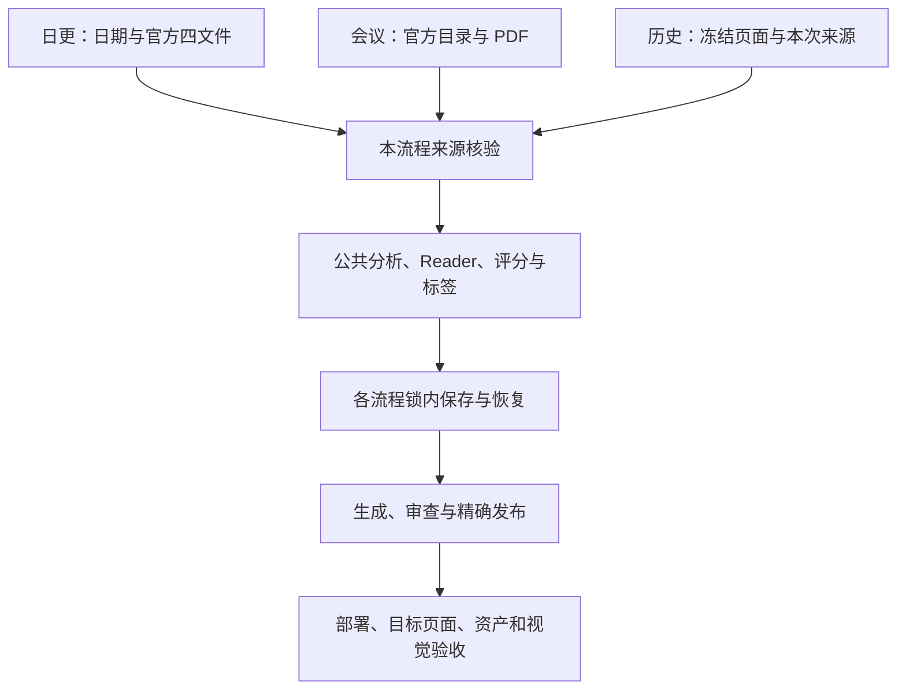

# 三条生产流程的运行、恢复与发布规则

日更、官方会议和历史博客更新调用同一 `analysis-engine.js`、`deep-analyzer.js`，共用主分析、核心摘要、Reader、八维评分、标签和页面展示。各自核验来源、完整成员、父稿、预算和发布事务。操作入口见[手册](../SKILL.md)，模块定位见[共享实现](shared-workflow-review.md)。

## 共同处理与独立范围

图中箭头是正常执行顺序；部署、页面和视觉仍按本次任务分别核验。公共模块修复由实际调用传给各流程，旧稿仍沿自己的来源、次数和费用恢复。

| 对象 | 日更 | 会议 | 历史 |
|---|---|---|---|
| 全批范围 | 日期、候选指纹、正式入选集 | 官方计划、process 和全成员 | 冻结页面、投影、run 与 URL |
| 来源 | 本批 arXiv 四文件及获取代次 | 官方记录、PDF、抽取及计划 | 本次 arXiv 代次或核验过的会议 PDF |
| 恢复 | 同源、原候选、反馈和原预算 | 原 process、父包、子运行和许可 | 原页面计划、来源路线和恢复文件 |
| 发布 | 日更页面清单及审查/发布记录 | 原会议单篇、汇总及发布状态 | 历史独立事务与保留 URL |
| 最终验收 | 完整日批和本次视觉范围 | 实际会议页面及发布范围 | 声明的 full/sample 范围与页面覆盖 |

来源凭证、成功状态和预算不能跨任务复制。新公共模块进入真实依赖指纹；外层工作流的依赖集合、deep 各阶段输入及 Python 依赖合同分别核验，不把一层指纹当成所有阶段的执行身份。

## 日更：从当天候选到上线

### 获取、筛选与来源封存

`digest:prepare` 与 `digest:api` 等价，经角色检查进入 `run-daily-digest.sh` 和 `full-fetch.js`。只有北京时间当天可从抓取开始；历史日期使用已有受控材料继续允许的后续阶段。

1. 核对角色、环境、模型、代理、博客和进程，安排发布错峰。
2. 同步博客远端，按已核验检查点派生来源边界，保留重叠、旧编号和时间见证。
3. 完整处理每页及窗口，只按正式已发布页面去重；库内未发布论文仍参加补更。
4. 保存完整候选，关键词预筛后按当前提示词和配置请求筛选，逐篇保留决定、输入和响应。
5. 为正式入选论文重新获取官方 HTML 文本和 PDF，封存 TXT、PDF、runtime、manifest，绑定运行、日期、完整成员及来源 SHA。
6. 进入来源计划和论文锁内分析。图片只在当前调用的系统临时目录准备。

`papers.json` 是累积库。候选、筛选决定、正式入选集与分析结果分别核验日期、来源、输入和成员；文件存在本身不证明对应。Atom/OAI/RSS 恢复按[抓取边界](daily-fetch-boundary.md)，5xx 或过期 RSS 不自动满足官方 OAI 恢复条件。

### 分析与恢复

`full-fetch`、deep、batch、reanalyze 及 Reader 刷新使用同一来源适配和原封存材料；恢复不重新抓取、不补建缺失来源、不从旧缓存写作。

先完成全批一轮，再仅续可重试失败集合，每轮每篇一次。来源、认证、余额、配置、费用或存储等运行级故障停止新派发并保存结果。技术轮次、内容响应、完整长文及传输分别计数，必要后续窗口在持续授权内登记，原稿、失败与费用完整保留。

评分成功后持论文锁立即保存 `dailyScoringRefreshCheckpoint`。同一来源、反馈、父稿、科学上游和完整评分指纹重验通过时，只续 Reader。正式保存失败保全处理后的评分原件并停止；原件不是原始模型响应。原件和待完成字段阻断普通重分析及发布，新日更运行或其他历史任务不继承旧运行的义务。

### 生成、审查与完成

Python 发布层读取真实保存结果，重验来源、Reader、作者和评分，再生成页面及资产、执行程序检查、独立审查和 Hugo。通过页按路径及内容 SHA 复用；内容拒稿仍按旧、新协议及实际字节决定能否重审。

push 持共享博客锁，只提交允许的精确差异，核远端身份和 OID。推送后核对应部署、全部目标页面、受控资产和用户本次视觉范围；`complete`、HTTP 200 或标题长度单独都不构成完整上线验收。见[完成要求](../SKILL.md#审查发布与完成)。

## 官方会议：从完整目录到正式页面

### 来源与正常处理

acquire、discover、摘要证据与每会筛选固定完整官方目录和入选集合。保留原 spec、目录、元数据、唯一准确 PDF 及选择回执。PDF 文本、页码、表格和图像能力来自真实抽取，不伪造 HTML DOM、原 TeX 或 arXiv 身份。

`conference:process` 创建原计划和执行，由 `conference-analysis-adapter.js` 将真实会议 ID、PDF 文本及来源能力传给公共引擎。材料保存在独立会议运行，不写入日更当前批次。

已登记的 JEP/ICMC 短篇档位接受至少 3000 个非空白字符的完整定稿 PDF；主分析、Reader-only 与评分＋Reader 使用同一规则，须持有同篇、同会议和相同结构化文本的真实 PDF 能力并复验文件。普通来源保持原 5000 字符边界，公式及表格不可用状态如实保留。跨标题预印本仅适用[执行约束](../AGENTS.md#锁失败记录与事实反馈)中的唯一已授权例外。

### 后处理、迁移与发布

- 完成稿先通过来源、整篇和页面检查，再暂存单篇及完整汇总。后处理池最多 5 线程、禁止模型；线程重建真实来源，主线程持操作锁核全部成员、原状态和资产后 CAS 保存。
- 旧完整会议先统一后处理，再按完整失败集合恢复。按实际上游和资源预检选择 Reader-only、评分＋Reader 或完整分析，成功评分即时保存；父稿、最新失败、子运行、窗口与费用连续保留。
- 只更新展示时复用合格分析、Reader、评分及费用，正常重暂存全成员与汇总。原 process 已有 `publish.json` 时重复生成返回原状态；更新已有正式 URL 使用历史维护。
- 生成、审查、推送及网页核验保留会议独立记录，正常入口和特殊恢复见[会议流程](conference-workflow.md)。

## 历史：从冻结页面到保留 URL 的更新

inventory 固定页面路径、Git blob、内容身份和仓库快照；inputs、投影与 plan 绑定论文到所有目标 URL、汇总成员和选定范围。旧页面只用于范围和 URL，对新的分析提供本次真实论文来源。

sources 只准备来源，不请求分析。arXiv 保存本次 TXT、PDF、runtime、manifest，按 generation 区分获取；会议重读原计划绑定的元数据和 PDF，核 SHA 后抽取。发布元数据 sidecar 使用真实官方记录，不取旧博客摘要。

正常分析进入同一公共引擎。`historical-direct-rewrite-runner.js` 绑定本次 run、真实路线、来源及候选身份，三处暂存检查在需要时重放真实来源上下文；普通 JSON、克隆对象、错成员和四源漂移拒绝。只需全文的检查不额外获得 PDF 表格或脚注权限。

暂存写入、冷读取和 aggregate 使用同一精确路径派生：原 route、当前 renderer、当前 renderer＋analysis。额外后缀、错误来源或旧 renderer 不因兼容放行；来源、资产、清单与页面字节仍核验。

保存完成后，在原论文锁内核对持久保存回执、本次正文和冷读记录，完成目录 fsync，再结束原候选事务。保存、读取、正文、目录同步或退休改名失败时保留候选，旧正文配不同核心不能代替本次结果。

aggregate 使用投影中的完整 `requiredPaperIds` 和 `requiredPageKeys`；publication 绑定真实计划、registry、页面投影、视觉处置、Git 基线及精确文件。full/sample 分别声明，`rewritePlanSha256` 与发布事务 `planSha256` 分别核验。见[历史分析](history-rewrite.md)与[历史发布](history-direct-publication.md)。

## 评分、局部修复与来源核验

### 共识与旧评分恢复

正常分析和评分维护共用 `scoring-audit-consensus`：实际正文有效分优先于旧缓存，变动超过 0.5 时追加审计；前两份相差超过 0.3 再审第三份，最接近的一对仍无共识则失败。最多三份独立审计，各份内容、传输和费用按原规则计数。Node/Python 冷核均比较实际第三份 score/SHA 与所选审计；旧合法 second-pass 及 first/third、second/third 记录保持支持。

资源重探后复用已付评分，须经受控真实快照、停稳整批和逐篇 CAS，在论文锁及真实日更来源中重核完整评分输入、输出、模型、协议、证据与首请求输入 SHA。URL、重定向、作者资源、来源和归属保持核验。私有句柄限原作用域、原 run；未归档原响应时，不由费用 SHA 推造原始响应。Reader 失败及原费用继续保留。

### 局部补丁反馈

`patchRejectionFeedback` 保存固定前缀、最多 3000 字符的上次拒绝诊断，传输中断时保留、成功应用后清除。当前问题、目标和节点 SHA 仍由正常来源重建；诊断不改变 `lastContentError` 的预算、停止条件或修改范围。

实现误报须用真实保存稿、完整来源和具体诊断重现，在生产停止后修公共规则及正反例。事实错误、缺失正文或来源漂移分别处理，旧付费响应不因规则改善自动被选为通过。

### 表格、科学量与显示

- 原表按完整表头、行身份、实验条件、单位与精度绑定。相邻 PDF 行或表注补证须来自同篇完整原表，不跨表借单位或据数值猜分组。
- 实验条件、单因素控制和质量权衡须绑定同源原值、真实固定条件与方向。模型版本、尺寸和配置本身不是评测结果。
- 条件、否定、假设与第三方归属按本段真实范围解释；合法 ATX、平衡加粗或普通标题下的归属保持，空行不解除第三方范围，独立当前肯定仍核验。
- `3×10⁻⁴` 按系数、有符号指数及单位完整核对，同一原引用行须支持全部量。普通标量仍使用原 HTML 合并/PDF 逐引用规则，不跨行或单元格拼量。
- 科学量兼容字形只用于异常检测；显示转换保持精确全格及原来源。Node 与 Python 采用各自明确支持的窄规则，不推定任意 Unicode 或 TeX 等价。
- 修复分量 `rep/W` 与破坏率 `break-rate` 按同源定义、分母、主模型、实验组和语料区分。相对增加与百分点分别表述，模型省略只在同一物理段紧邻且可重解析的同源观测内承接。
- 同源 DOM 图号共用 URL/像素时，仅原允许路线从真实证据派生别名；保留全部证据及次数。选中重复、假证明、来源漂移或跨作用域继续拒绝，其他流程不借日更能力放行。
- 出版读取同一原稿和四源，以有限 JSON 身份区分布尔与数字，允许同一 JSON 数字的 `1`/`1.0`；正常派生视图继续保护原正文、作者和来源。

### 字面符号、图片与图注

完整置信区间格内的百分比和 1–3 颗逐颗转义星只作原允许的显示等价处理；双重转义、其他反斜杠、TeX、四星、额外文字及不完整格不适用。正常加粗、内部斜体及正确转义保留，紧贴正文或残留 Markdown 仍拒绝。

SVG 黑底不可读诊断同时核文字及背景的 `display`、`visibility`、`opacity`、`fill-opacity`，逐声明核查；隐藏、透明和未知样式不取得见证。完整 PDF 原页派生仍要求同篇四源、真实几何、唯一图号及完整图注，保留旧 SVG、Reader 与模型像素，派生后正常图片审查。

## 文件、费用与验证

1. 来源 FD 有界读取最多原大小及预算内字节，加 1 字节增长哨兵；末端身份与 SHA 仍核对。
2. 临时文件只清理由本次独占创建且 inode 匹配的对象。`EEXIST`、短写、I/O 错误、回读变化和改名后的他人对象均受保护。
3. 账号错误 type/code 为精确字符串；metadata 按原顺序取首个合法 JSON 对象，合法空对象不跳过。普通认证、429、5xx 不触发同逻辑请求内切号，原冷却与等权轮转保留。
4. 出版全文范围只在完整原输入、成员、运行、四源及作者重放后创建，取文本时重读，退出再次核验；声明封存来源的记录不回退旧 Manual 引文。
5. 正式测试隔离全部数据根，真实来源回放使用原 PDF 和明确材料身份。保留超时、输出截断、错误类型、来源漂移、无请求和原字节不变的反例。
6. 修改先完成必要定向和交叉审阅，再由最终提交完成完整 CI。局部通过、条件跳过与完整结果分别记录，原失败不覆盖。运行数据、凭据、响应、日志及生成图片保持本地受保护状态。

完成任务还须核验真实发布集合、对应部署、页面标题、canonical、正文、资产、当前纠错义务和用户确认的视觉范围。脚本的有限观察工具与人工完整验收分工见[维护指南](maintenance.md#发布后网页核验与收尾)。
