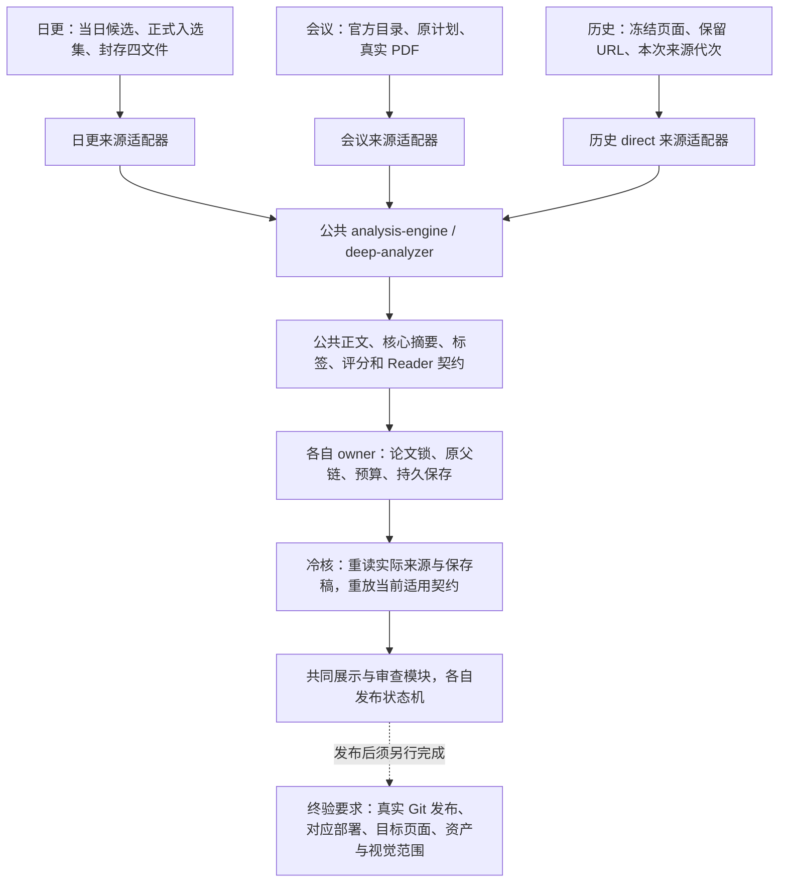

# 三条生产流程的现状、共同契约与改进计划

本页记录 2026-10-23 对当前实现的交叉核读与离线回归，区分已经存在的共用实现、本轮修复和仍需实证的后续项目。操作入口以 [SKILL.md](../SKILL.md)、[三流程架构](three-workflows.md)及各流程专项文档为准；本页说明为什么改、改在哪里、如何证明修改有效。2026-10-17 的 [早期审查](shared-workflow-review.md)保留其原时间范围，不替代本次结论。

## 当前最重要的判断

日更、会议和历史重写已经调用同一 `analysis-engine.js`、`deep-analyzer.js`。主分析十三节、Reader、核心摘要修复、八维评分、标签及多数恢复算法共有一套实际执行代码。不能把现状描述为三套独立旧引擎，也不需要再搭建一套总调度器来替代它们。

需要继续统一的是共同契约：同一份合格来源在主分析、Reader-only、评分＋Reader 中的准入判断；写入端、冷读取端和汇总端对合法目录的解释；真实保存后候选事务的收尾；以及发布后是否已经完成部署、页面和资产验收的表达。来源获取、成员范围、父稿和预算仍由各自流程保管。

“使用最新共用实现”指修复公共实现后，各流程通过真实调用使用该修复。它不表示给旧稿补签当前版本、清零旧消费、改写封存来源，或把日更凭证复制给会议和历史。

三条流程的共同部分和各自保管的边界如下。实线表示共同调用结构；虚线表示发布后仍须完成、目前未统一自动实现的终验要求。箭头不表示一种来源可以兑换另一种来源的权限。

### 已提交、已进入生产与待集成的区别

下表以已经核对的提交为边界，不把隔离分支上的通过写成生产已经采用。

| 范围 | 已核对状态 | 后续动作 |
|---|---|---|
| P-01 账号补齐 | 生产运行启动前已完成；主副配置各8个既有账号，新增账号真实请求成功 | 保留原冷却、费用及私有备份；不据此推断8个账号均有余额 |
| P-02 至 P-08 通用改进 | 隔离共享分支已提交并推送；冻结 `00c1d0ae` 的完整 CI 成功 | 等当前日更完全结束，以最新主线集成；不是已进入生产的声明 |
| 日更保存稿反馈修复 | 生产维护者逐项审查迁移；已核对主线 `c8c0bce8` 包含本页下述核心率指标修复，其完整 CI 的12个任务全部成功 | 正常原响应恢复、Reader、整篇采纳及发布验收由日更任务继续；主线 CI 与旧共享分支 CI 分开记 |
| P-09 历史冷核来源作用域 | 最小提交 `c5890575` 已推送，相关测试及两位独审通过 | 与通用改进一并安排后续集成；本次日更不需要迁移这项历史变更 |
| P-10 原已付评分候选恢复 | 生产维护者提交 `90cb68fe`，迁移为主线 `627aa89f`；固定真实快照合同的独审完成 | 评分正常采用、Reader 和发布仍各自核验；下文区分候选复验与整篇成功 |

当前生产任务拥有主工作区、实际环境、运行数据和博客。隔离开发不热更新生产源码，也不推进主线。旧集成提交 `dc6955d5` 不可合并。新的隔离候选先以 `c8c0bce8` 合并共享改进，核心契约与 Python PDF 单位模块完整保留主线字节；自动合并的 deep 保留主线来源输入身份及共享全文档位、副池解析，脚本索引去掉重复行。随后合入 P-09，再合入 `627aa89f` 的评分修复，形成 `e82aa2d4`。这些操作只改变隔离候选，不表示生产已经采用通用及历史改进。

候选 `959f0c38` 的相关七组共417项全部通过；新增评分修复后的 `e82aa2d4` 另有五组64项全部通过。前者不覆盖后加的评分代码，后者不是全库验收，不能把两个数字相加当成最终完整测试。日更完成分析、发布、网页和本次视觉范围后，再以安全窗口内最新主线冻结最终候选、完整验证、独立审查及精确提交 CI，最后快进主线并核对真实远端 OID。

## 日更从当天候选到上线

### 获取、筛选与来源封存

`digest:prepare` 与 `digest:api` 是等价入口，经工作区角色守卫进入 `run-daily-digest.sh`，再调用 `full-fetch.js`。只有北京时间当天可以从抓取开始；历史日期只能使用已有受控数据继续生成、审查、推送等允许阶段。

1. 核对角色、环境、模型、代理、博客仓库和运行进程，安排发布任务错峰。
2. 同步真实博客远端，从已核验检查点派生各来源获取边界，保留受控重叠及旧编号、时间见证。
3. 完整获取来源页面和窗口，用真正已发布页面去重。未发布的库内论文仍可能进入补更。
4. 保存完整候选，先关键词预筛，再按当前筛选 Prompt 和配置批次请求模型；逐篇保留决定、输入指纹及响应。
5. 确定正式入选集合后，重新获取每篇官方 HTML 文本和 PDF。封存 TXT、PDF、runtime、manifest 四文件，绑定运行、日期、完整成员和来源 SHA。
6. 在来源计划及论文锁内进入公共分析。图片在当前调用的系统临时目录准备，不成为 `data/current` 或运行目录的长期缓存。

`data/current/papers.json` 是累积库；候选、筛选决定、入选集、分析结果是各自阶段材料，不能只因文件存在就认为对应。日期、来源、候选指纹、完整论文集合和封存引用必须相互一致。

### 分析、失败集合与恢复

`full-fetch.js` 通过日更来源适配器调用公共 `analyzeBatch`。`deep`、`batch`、`reanalyze` 及 Reader 刷新也使用当前正式结果绑定的同一组封存来源；这些恢复入口不重新抓取，不自动补建缺失来源，也不拿旧缓存代替本次来源。

每篇进入主分析、必要后处理、核心摘要、评分、标签和 Reader 的当前阶段规则。完整成功需要正文、阶段绑定、来源、标签、评分稳定性、Reader 和事实反馈义务共同成立。旧正文可保留用于恢复，但最近失败及尚未完成的纠错义务继续阻断成功和发布。

正常批次先完成整轮，再仅续可重试失败集合；每轮每篇一次。来源、认证、余额、配置、费用保存或运行级故障先停止新派发、保存在途结果。技术轮次、内容响应、完整长文和传输尝试分别记录，新增合法恢复窗口保留原稿和全部费用，不改写旧窗口。

### 生成、审查、推送与验收

Python 发布层读取实际保存结果，执行来源及 Reader 冷核、共享展示、页面和资产生成、程序检查、独立模型审查及 Hugo。通过缓存绑定路径和内容 SHA，当前实现改变时仍按实际合同重新执行所需程序检查。

推送必须绑定本次生成、审查、精确文件集合和博客 Git 基线，在共享锁内完成事务，并核验远端 OID。随后核验对应部署、目标网页和资产，再完成本次视觉范围或与当前发布绑定的有效豁免。

当前 shell 在准备视觉后仍提示执行者继续部署、页面及视觉验收。它的退出成功不是整个日更已经上线完成。新增 `daily_observed_projection.py` 也只提供有限的部署元数据观察，不能替代完整网页或资产验收。

## 官方会议从完整目录到正式页面

### 获取和选集

会议使用官方完整目录、规范会议 ID、元数据和唯一准确匹配的 PDF，经 acquire、discover、证据准备和每会筛选形成受控全集及入选集合。共享关键词、筛选 Prompt、决定解析、模型路由和费用规则；保留每会 spec、原目录、PDF 及选择回执。

会议来源不是 arXiv HTML。PDF 抽取凭证、页码、原文范围和图像像素决定证据能力；PDF 文本不自动具有原始 TeX 或认证表格结构。唯一明确授权的跨标题预印本例外仍受固定身份、标题、作者、DOI、来源 SHA 和非 camera-ready 提示约束，不能扩大到其他论文。

### process 与公共引擎

`conference:process` 是正常分析入口。它建立实际计划和执行，`conference-analysis-adapter.js` 重放官方来源，将规范会议身份、PDF 文本与真实能力传给公共引擎。主分析、评分、Reader、标签与日更共享；保存材料位于独立会议运行，不写进日更当前批次。

完成稿先通过完整资格、来源和页面冷核，再暂存单篇和完整汇总。私有后处理池最多5个线程、硬禁模型，各线程实际重建来源能力，主线程持操作锁核对完整成员、原状态和页面资产后 CAS 保存。JSON 或选定子集不能代替完整批次能力。

JEP、ICMC 的已登记短篇抽取档位允许至少3000个非空白字符的完整定稿 PDF。本轮修复后，主分析、Reader-only 和评分＋Reader 共用该准入规则：必须持有当前真实 PDF 私有能力，绑定同篇、同会议、相同文本和结构化来源，并重新核验原文件；公式和表格的不可用声明保持原样。普通来源仍保留原5000字符边界。

### 维护、重试和发布

完整旧会议仅改变展示时，先复用合格分析、Reader、评分和费用，正常重暂存全成员与汇总。当前规则拒绝旧稿时，迁移先统一完成后处理、收集失败集合，再通过显式恢复入口创建真实来源绑定的子运行。

恢复按实际上游和资源预检选择 Reader-only、评分＋Reader 或完整分析，评分检查点成功立即保存，后续不为 Reader 失败重复评分。父稿、最新失败、子运行、原窗口及费用必须连续可追溯；不能把旧完成稿改成未完成以绕检查。

`conference:publish:generate/review/push/verify` 保留会议自己的生成、审查、发布和网页核验状态。已有 `publish.json` 的 process 重复生成返回原状态；修改已有正式 URL 走历史维护，不改写不可变旧凭证。

## 历史博客从冻结页面到保留 URL 的重写

### 页面范围与真实新来源

inventory 冻结原页面路径、Git blob、内容 SHA 和仓库快照；inputs、会议投影和 plan 绑定论文到全部目标 URL，明确选定范围与完整汇总成员。旧页面用于确定范围及保留 URL，不作为新的科学证据。

sources 调度器只准备来源，不请求分析或 Reader。arXiv 从本次真实获取封存 TXT、PDF、runtime、manifest，并以 generation 区分每次来源；会议重读计划所绑定的保留元数据和实际 PDF，核对 SHA 后抽取。发布 metadata sidecar 来自真实官方元数据，不能用旧博客摘要填充。

### 公共分析与暂存

`historical-direct-rewrite-runner.js` 的默认分析进入公共 `analyzeBatch` 和 deep。历史 direct 上下文绑定本次 run、真实路线、来源、结构化记录及候选身份；会议保留真实会议 ID，不能造一个 arXiv 别名进入日更。

分析通过后还要执行来源、上游、Reader、评分、标签及整篇冷核，再生成历史单篇页。arXiv 页面使用共同发布器；会议页复用会议呈现。共享作者、资源、评分、Reader 和标签展示逻辑，不另造历史评分算法。

暂存读取必须与正常写入一致。本轮修复将原已合法的三种精确目录派生统一到 `historical-direct-page-staging.js`：原 route、当前 renderer、当前 renderer＋analysis。增加的新 analysis 绑定目录不再被 aggregate 误拒。其他来源、旧 renderer、错误 analysis 或额外后缀仍拒绝；来源、资产、manifest 和页面字节核验继续执行。

### 完整汇总与发布事务

aggregate 按 projection 的完整 requiredPaperIds 和 requiredPageKeys 读取实际暂存页及分析，不能把本次选定子集叫作全站完成。publication 绑定真实 plan、registry、页面投影、视觉处置、当前 Git 基线和精确文件清单；full 与 sample 范围分别声明。

生成、独立审查、激活、提交和推送使用历史自己的状态机及共享博客锁。`rewritePlanSha256` 是生产计划身份，publication 的 `planSha256` 是发布事务身份，两者不能混用。推送完成后仍继续部署和正式页面核验。

历史已经通过的语义审查按内容 SHA 复用是现行合同。模型、Prompt 或实现改变时仍执行当前必要程序及 Hugo、重建外层凭证，不能无理由再次付费审查未变化正文，也不能为统一而改写旧签名。

## 哪些逻辑必须共用

| 共同契约 | 当前共用实现 | 修改后的验收范围 |
|---|---|---|
| 模型路由、协议、代理与 Node 请求 | `utils.requestLlmJson()`、账号池及配置 | 同路由主副池继承、Responses 截断、重试分类、正常费用记录 |
| Python 发布请求 | `publish_common.call_publish_llm_api()` | 与 Node 使用相同路由及账号切换合同；配额标记须为精确字符串，冷却元数据只按顺序选择合法 JSON 对象，跨语言用固定向量核对 |
| 关键词及筛选 | keyword-prefilter、filter Prompt、决定解析 | 来源证据不同，解析、判断协议和费用算法相同 |
| 主分析、摘要、Reader、评分、标签 | analysis-engine、deep、当前 Prompt 及 reader 模块 | 修复真实正例，同时保留否定、假设、错误归属、错单位、来源漂移等负例 |
| 文本全文资格 | `analysis-text-profile.js`，经 deep 三入口调用 | 同一认证短篇在三个入口一致；普通来源及弱证据不扩大资格 |
| 阶段输入、来源 SHA 和恢复计数 | 共享阶段指纹、候选、失败轮及预算模块 | 复用未变阶段；旧来源、旧响应、旧费用和窗口不能重置 |
| 保存完整性、锁与 CAS | 共用文件原语及各来源 owner | 机械读取、精确路径和拥有的临时文件可共享；物理来源能力继续由 owner 签发 |
| Reader 冷核和来源消费 | 当前 Reader 解析与真实来源上下文 | 写作完成、保存稿恢复和出版都重放当前适用规则，不能只看成功布尔值 |
| 作者、资源、评分和标签呈现 | 共享发布解析器、tag_presentation 等 | 三类单篇与汇总一致，保留各自官方记录链接和页面范围 |
| 内容审查与博客事务 | 当前审查模块、共享博客锁、精确文件清单 | 合理复用已通过内容 SHA；核对本次真实 Git 提交及远端 OID |

会议、历史等相关外层 Node 工作流使用 `workflow-implementation-files.js` 收集传递依赖；deep 各阶段的指纹仍按各自登记的输入和实现字节核验，不能把外层闭包当作每个阶段的完整执行闭包。Python owner 也按各自已登记的依赖合同核验。提取新公共模块后，须核对真正消费入口的调用、资格重验与适用的指纹范围；仅把文件列在文档中不算接线。新增共用函数应减少规则分叉，不能建立可跨任务复制的 `verified: true` 缓存。

## 哪些身份和状态不能合并

| 对象 | 日更 | 会议 | 历史 |
|---|---|---|---|
| 全批范围 | 日期、候选指纹、正式入选集 | 官方计划、process 和原全成员 | 冻结页面、投影、run 与 URL 集合 |
| 来源身份 | 本批 arXiv 四文件与代次 | 官方记录、PDF、抽取及计划能力 | 本次 arXiv 代次或保留会议 PDF |
| 恢复父链 | 当前来源、失败与原候选 | 原 process、父包、子运行及许可 | 原页面计划、来源和恢复文件 |
| 发布凭证 | 日更 generation 和正常审查/发布 | 原会议暂存、汇总及 publish 状态 | 历史 publication 事务和原 URL |
| 最终验收 | 本次完整日更、部署、页面、资产和视觉范围 | 实际会议页面集合及发布范围 | 明确 full/sample 范围、保留 URL 与线上内容 |

这些域保留差异是为了防止把其他任务的成功借给当前任务。可统一检查模式、错误表达及展示，但不能降低各自原事实要求。

## 本轮问题、修复与验证方法

| 编号 | 实际问题 | 最小修复 | 必须保留的反例 |
|---|---|---|---|
| P-01 | 本地项目主副池各缺统一池中的一个既有账号 | 备份私有配置后向两份 fallback 增加同一缺项，保留模型、路由、代理和全部旧账号 | 不展示凭据，不清冷却；新增账号真实请求成功不代表8个账号均有余额 |
| P-02 | 账号报告把9条历史观察记录误叫当前账号池 | 只读报告区分当前配置与历史；副池解析从 deep 提取到共同纯函数 | 配置8、历史9同时真实；缺失或坏状态不写文件、不清账、不探测余额 |
| P-03 | 合格短篇在主分析误降摘要，两种刷新继续硬拒5000以下全文 | 三入口共用真实认证短篇规则 | JEP/ICMC 真 PDF 正例；无私有能力、克隆、错来源、错会议及普通短来源拒绝 |
| P-04 | 历史 writer 和自身冷读接受的 analysis 后缀被 aggregate 拒绝 | 三端复用严格路径派生 | 正常写入与冷读后汇总；错误 source/renderer/analysis、后缀及页面漂移拒绝 |
| P-05 | 会议来源 stat 后增长，先读完整大文件才拒绝 | 机械有界 FD 读取，最多原大小与上限内字节加1个增长哨兵 | 真实来源前后正控；同 inode 增长在预算内停止，末端身份和 SHA 仍核验 |
| P-06 | 会议替换 JSON 在创建失败后可能删除他人临时文件 | 只清理本次实际独占创建且 inode 仍匹配的临时文件 | EEXIST 外来文件保留、短写、EIO、回读变化、rename 后新拥有者均受保护 |
| P-07 | 历史默认分析真实保存后未正确收尾延迟 Reader 候选事务 | 在原论文锁内，以持久保存回执、完整冷读和目录 fsync 完成原私有事务 | 保存、冷读、目录 fsync 或退休 rename 失败继续保留候选；旧正文及其他核心不得充当本次保存 |
| P-08 | Node 将数组类型强转成配额错误标记，非法 metadata 容器又遮蔽后续合法冷却说明，与 Python 不一致 | type/code 仅接受精确字符串；按原优先级选择首个合法 JSON 对象 metadata，不跳过合法空对象 | 非字符串 type/code 拒绝，非对象 metadata 不遮蔽后续对象；普通失败不切号，无效类型也不能借 metadata 获准切号 |
| P-09 | 历史分析退出来源作用域后，无认证表或脚注的正文在冷核时无法取回同一份全文 | 三处冷核共用真实 owner 来源重放门；文本作用域仅在原 PDF 需求存在时附 PDF 能力 | 四文件漂移、错来源、假句柄、坏核心、评分、Reader 和最新失败仍拒；退出作用域不留资格缓存 |
| P-10 | 资源重探中断后，真实 URL 或重定向变化使旧评分指纹失效；禁止新评分请求时，即使原快照仍保留单次付费检查点也不能继续 | 从受控真实原快照提供候选，重新执行同一个完整原生评分指纹、正常审计、输出重放和首请求输入 SHA 检查，通过后正常保存检查点 | 不忽略 URL 或重定向；来源、快照、费用、原生输入、受保护稿件变化及跨作用域句柄拒绝；不清 Reader 失败、次数或费用 |
| P-11 | 本地完整验证把已忽略的调查冲突快照和生成目录当源码扫描，正式测试前即被片段语法错误拦住 | 源码遍历沿用原精确目录排除规则，补上 `_understanding`、`output` | 正式源码、测试、相似目录名、普通同名文件及其他新增 gitignore 规则不缩减检查；外部符号链接仍不跨越 |
| P-12 | 局部补丁被拒后，每轮归一化重建当前问题，使下一局部提示丢失实际拒绝原因，真实三次提示完全相同 | 独立、有界的提示词诊断贯穿局部渲染出口与传输中断恢复，补丁应用后清除 | 当前问题、目标及 SHA 仍由正常来源重建；原尝试、停止条件和 `lastContentError` 预算语义不变 |
| P-13 | 完整测试发现旧历史脚注 VM 夹具遗漏 P-09 新依赖，三项在加载或分派时失败 | 测试完整提取当前 helper、selector 和 guard，显式提供其依赖并标注合成范围 | 不改产品实现；模拟 token 克隆、来源漂移及整篇拒绝仍失败，真实 owner 集成另外核验 |
| P-14 | 真实日更设置表在整篇检查中通过，数据校验却只读取旧 manual 来源，缺少同批封存全文而误拒 | 把本次完整来源检查返回的局部文本 Map 传给现有正文及 manifest 检查 | 任一来源检查失败整批清空；声明 sealed 的输入不回退 manual；文本不授予 owner、Reader 或预算权限 |
| P-15 | Git 大输出测试另设2秒期限，本地全批运行时先触发超时，混淆输出上限与期限两种拒绝原因 | 输出上限分支改用既有 `runtime.GIT_LOCAL_TIMEOUT_SECONDS`（30秒）；短期限分支仍为0.08秒 | 保留64字节上限、4096字节输出及原四项超时／截断断言；不改执行器、wrapper 或生产期限 |

生产日更运行期间，共享源码、实际 `.env`、当前数据和博客保持冻结；开发修改在独立工作树完成，使用占位环境和离线测试，不复制生产凭据或整个检查点。真实回归只选择必要的公开原来源及完整保存稿或有明确依据的片段，剔除请求、账号和费用包，保留原字节 SHA 与拒绝历史。配置 P-01 已在生产运行启动前完成并独立核验；后续代码只有在生产停止、协调好安全窗口后，由生产任务逐项审查并选择迁移。

每项按真实最短路径先保留 RED，再最小修复、作者测试、其他执行者独立审查；发现新反例就回到修复。审查结论限定到实际冻结的实现和证据范围，不能写成“整个项目永远没有问题”。未变化的检查结果复用，不为重复同一证明新增模型请求。

### 完整测试中新发现的期限混用

P-15 在 `10174284` 的 Python 分套件运行及 `eb065212` 的本地完整验证中各出现一次：`tests/python` 均运行2155项，同一大输出测试失败、25项跳过。随后用于定位的单项运行通过，原失败记录仍保留。修复用受控夹具在大输出前等待2.1秒，保留旧2秒期限时在原 `assertFalse(timed_out)` 处确定失败，改用既有30秒本地预算后通过。这不证明原机器的冷启动或调度原因。该文件7项、真实输出边界2项及进程组超时清理1项合计10项通过，冻结测试独审0问题；执行器和 wrapper 未变，提交为 `afea5ffc`。

`eb065212a48096fc8573fe9244b9742de1e85549` 本地完整验证的 JavaScript 结果为6794项、6747通过、47项原有跳过、0失败；随后上述 Python 失败使完整验证以失败结束，未进入 `manual/tests/python` 和数据校验。运行前后登记的1577份 tracked 文件保持相同，该次运行不能记为完整验收通过。

[CI 39931447855](https://github.com/nanless/audio-paper-digest/actions/runs/39931447855) 对应 `eb065212a48096fc8573fe9244b9742de1e85549`，[CI 39933809250](https://github.com/nanless/audio-paper-digest/actions/runs/39933809250) 对应 `101742840cffed1a6aad4894aeaf50013093e662`，各12个任务均成功。CI 成功与本地失败分别保留；这两次结果不覆盖 `afea5ffc`、`ce7d471d` 或后续修复，也不能替最新组合的验收。

## 后续批次与停止条件

### 第一优先：关闭已复现的不一致

P-01 至 P-08 已完成各自定向测试及独立审查，修复已按有限范围分别提交。P-02 至 P-06 的共同消费者相关回归325项通过；扩大 CI 后发现评分测试抽取函数体遗漏新的私有全文档位依赖，单独修复测试夹具并以真实公共 helper 验证5000拒绝、5001通过，44项通过。独立审查覆盖普通及不透明资源两类、4999/5000/5001六条路径。

冻结提交 `00c1d0ae7de1b7a32ef261623566cc32ef36368d` 的完整 CI（run `39901890424`，`workflow_dispatch`，attempt 1）已正式结束，Node 20、Node 22 的10个验证分片及2个汇总任务全部成功。旧 run `39896618700` 的测试夹具依赖失败记录继续保留；此后新增的生产反馈修复另行测试、审查，不能沿用该冻结提交的 CI 结果。

生产主线 `c8c0bce85428189d85005bc57f0c60393f03dab5` 的[独立完整 CI](https://github.com/nanless/audio-paper-digest/actions/runs/39913685150)也已正式成功。该运行由日更任务发起；本任务另行只读核对官方 run 与 jobs，确认精确主线 SHA、完成状态及12个任务均成功，没有为重复同一结果再派 CI。它覆盖该主线已采用的修复，不覆盖尚未进入主线的通用改进或 `c5890575` 历史变更，也不代表本次论文已经发布上线。

P-08 以两轮正式反例修复，并已独立提交 `45778bee`。最终 Node 账号相关测试75项通过、无跳过，其中96条固定跨语言向量逐一比较分类、冷却类别与截止时间；Python 实现及发布调用方未变，复用原账号池36项与发布侧13项通过结果。独立审查另执行15条真实 Node/Python 向量及最终5项定向回归，均通过。主副池继承、稳定账号 ID 轮转、冷却归队和原状态格式不变；普通401、429及5xx不触发同一逻辑请求内的账号切换，正常外层重试仍可按轮转使用另一账号。这些离线形状反例不是当前真实服务异常的证据，也不证明8个配置账号均有余额；没有因此探测账号、修改实际状态或重新请求论文。

所有新旧记录的来源、失败、预算和费用保持原样。任何一项仍有有效反例，就继续修该项，不进入它依赖的后续集成。

提交只包含源码、必要正式测试、安全 fixture 和维护文档。真实四文件来源回归必须使用原 PDF；即使文件较大，也不能换成另一篇小 PDF 或伪造来源来降低测试成本。`.env`、密钥备份、运行数据、原始请求和响应诊断包、日志、`_understanding/` 和生成图片 `output/` 保留本地并忽略；正式回归不能依赖这些未追踪材料。

P-11 来自 `af7c9da4` 的实际本地完整验证失败，原日志保留；失败发生在调查目录中的原合并冲突快照语法检查，尚未启动正式测试。新增正式回归先复现失败，再对两个既有本地产物目录作精确排除，最终验证入口定向12项通过。没有改 `npm test` 文件集合、分片或测试计划，也没有泛化为跳过所有 gitignore 路径；该定向结果不替后续完整验收。

P-13 来自修正扫描边界后 `b45ca0b7` 的完整 JavaScript 检查。三项旧 VM 测试仍依赖退休包装器，漏掉当前来源 helper 及核心契约依赖；修复只涉及测试。原三项失败、独立定向三项失败及修后三项通过分别保存，另选已有真实 owner 回归7项通过。VM 测试核对分派、拒绝和作用域清退，不声称合成 token 是生产私有来源能力。P-09 产品字节未为测试放宽。

P-14 由生产维护者提交为 `9af99cd4`，只改变校验器和必要回归。日期、完整成员、每篇来源绑定、四文件及当前适用渲染规则全部通过后，文本 Map 才返回给本次调用；任一来源问题都返回空 Map，不缓存先成功的成员。声明 sealed 的对象或数组不能借旧 manual 文本继续检查；没有此声明的旧输入仍沿用原路径。数据校验只消费文本，不创建私有来源能力，也不授予分析或发布成功。

新增正例使用实际 `2610.29613` 完成稿和同篇原文，`2610.29434` 是另一真实来源的负例；第二成员及 PDF 是明确的机械夹具，不称两篇真实完整来源正控。初次合成树相关八文件87项通过；独审补出的回退断言弱点另行修复：只移除 sealed 回退守卫时，旧断言仍通过，新断言则准确失败，正常实现与 legacy 相关7项通过。生产维护任务的实际 `validate:data` 记录已通过，58篇正文未改；这项真实运行与隔离回归各自保留依据，不把夹具结果当作生产发布完成。

### 第二优先：保存后的候选事务

这项核读已用实际候选生命周期复现并修复。公共引擎保持不变；不能为了历史的对象复制问题移动 WeakMap 事务，影响日更现有检查点收尾。历史 runner 在真实 `onPaperResultLocked` 内持久保存恢复文件，核对完整回执、记录 SHA 和本次结果，再执行目录 fsync，最后向原真实私有事务交付冷读记录。

正式回归先出现9项失败、2项通过，修复后11项全部通过；相关回归188项通过。独立审查补充真实退休 rename EIO 及恢复正控，未发现该冻结范围内的未解决问题。保存、读取、正文漂移、旧 Reader 配上不同核心、目录 fsync 和退休写入故障均不能把候选提前退休，也不返还原请求或费用。实现已单独提交，生产任务按实际需要迁移，不强迫当前日更取无关的历史变更。

### 第三优先：完整任务验收

目前不同流程的 `complete` 分别表达分析、暂存或发布事务完成，不能直接当作用户整项任务完成。日更有限部署观察已能绑定实际提交和元数据，但不证明全部生产输入、artifact 血缘、目标页面正文、完整资产或当前科学纠错义务。

后续应先定义明确的只读验收结果：分析资格、生成/审查、Git 发布、对应部署、精确目标页面、资源资产、当前反馈义务及视觉范围逐项显示已核验、失败、待完成或未知。再为会议和历史从其真实 owner 提供适配；不导入普通 JSON 来复用日更特有权限，不补签旧凭证。

上线回归必须以真实发布集合比对页面标题、canonical、正文和资产；站点标志存在、HTTP 200 或标题长度足够都不能单独证明命中了本篇。该部分需要单独的事实与测试范围，不能在本轮文件修复中顺带宣告已实现。

### 已实证的新批次：历史冷核与本次来源

历史 runner 的普通分析、已完成稿恢复和已暂存稿重放最终都调用 `assertDirectAnalysisReadyForStaging()`。旧实现只有 Reader 含认证 PDF 表或资源脚注时才恢复来源作用域。需要真实来源才能解释的核心摘要，在分析回调内可以通过，返回后却可能借不到历史来源，转而尝试日更计划并被拒。这是历史 owner 的接线问题；复制日更来源引用、增加词形白名单或跳过核心检查都不能修复它。

正式回归先保留旧实现的失败：同一测试记录在真实来源作用域内通过原完整引擎、Reader 和核心阶段绑定，退出后由真实 runner 冷核失败，未进入暂存。原文和 PDF 使用同一篇 `2610.30385` 的封存字节；四文件由正常来源 owner 在测试临时目录重建。测试中的元数据、其余正文及 Reader 明确属于合成夹具，不能据此声称该论文科学审查、Reader 采纳或出版已经通过。

`c5890575` 只改变历史 runner 的来源重放安排。三个接点共用 `requiresHistoricalSourceScope()`：保留原 PDF 需求；普通核心当前无法在无来源检查中通过时，再重放真实 owner 来源。句柄由原计划和封存文件核验后创建，使用前再核原字节，普通 JSON 或克隆不能取得权限。完整引擎、Reader、评分、阶段绑定及最新失败仍按原逻辑检查。在无来源检查中已通过的普通核心保留原路径；仅需文本的冷核不附 PDF 表或脚注能力。

作者相关组116项中115通过、1项原有跳过、0失败，覆盖 runner、汇总、发布、Reader PDF 来源上下文及认证脚注。两位独审分别实际核验新暂存、两条冷重放、四源漂移、真实句柄与 PDF 边界；根复核另在分析返回与暂存之间改变 runtime 字节，确认在保存分析前拒绝。正控通过、成功及异常退出后作用域清退；当前冻结范围剩余问题0，不扩大为历史全站已经重写或所有科学结论无误。

### 已实证的新批次：原已付评分与资源重探

评分复用不能只看旧阶段为 complete。旧第三方资源重放仍只允许原四个可达状态字段差异；真实 URL、重定向、作者资源、来源和归属都保留在正常比较中。本次四篇故障既有第三方状态变化，也有作者代码或模型资源的真实超时，不能统称为无关第三方误报。

`saved-scoring-audit-replay.js` 只从固定真实历史快照取候选。生产受控入口固定完整 bindings、原快照、停稳整批和逐篇 CAS，以及实现、四文件来源和原首终费用；模块在实际日更来源作用域及论文锁内签发私有句柄。普通 JSON、退出作用域和另一真实日更 run 都不能使用该句柄。正常历史、会议入口不传该能力，仍走原路径。

原完整评分指纹提取为共同函数，旧 complete 检查和候选检查使用相同规则；独审逐条件比较与原表达式等价。资源重新正常探测后，还须重新核验模型、协议、提示、AUX 策略、证据、核心输入、审计及完整输出，并重建原生首请求体，与唯一原费用输入 SHA 对应，才由正常入口保存评分检查点。原响应 JSON 没有归档；费用输出 SHA 只保留关联，不冒称可以重建原始模型响应。可信前提是受控入口固定的真实快照，不是任意调用者提供自签 SHA 就能授予资格。

独审核对固定材料、原生指纹等价，并分别运行两组必要隔离探针，各1项通过：不完整候选仍被正常完整评分指纹门拒绝、模型禁令仍生效、四源或快照变字节拒绝、Reader 和原费用保护，以及真实句柄跨作用域和另一真实 run 拒绝。生产维护者随后报告四篇原评分均已正式复验并保存，未新增模型请求。原 Reader 失败、次数及后续恢复仍保留；这不表示四篇整稿或整批已通过，更不授予发布状态。

### 已实证的新批次：局部修复拒绝反馈

Style 的三次实际请求均包含正确的草稿和节点 SHA，三次实际 HTTP 200 付费响应却返回错误或截短的 SHA。独立只读核对请求、响应及费用终态后，确认三次提示和实际输入字节相同；可观察到两条“坏补丁返回后，下一请求没有拒绝原因”的连续边，不存在可用于证明第三次响应后行为的第四次请求。

问题不是严格 SHA 检查本身。正常归一化每轮重建 `currentIssues`，下一局部提示只读取这组当前问题；原拒绝虽然保存，未进入下一提示。修复使用独立 `patchRejectionFeedback`，只接受带固定拒绝前缀的字符串，最多3000字符；在各局部模式的共同渲染出口解释上一拒绝，当前目标及其 SHA 仍是唯一有效依据。传输中断单独保存诊断，正常应用补丁后清除。该诊断不参与当前问题分类，不授予目标、阶段资格或预算；当前目标及原阶段检查不变，保存内容和请求输入仍由正常哈希绑定。审查发现 `lastContentError` 同时控制原余额及截断恢复，因此实现保持它的原逻辑，不借该字段存普通诊断。

正式回归使用明确的合成草稿，走真实生成循环、来源表格归一化、严格补丁解析、应用及保存，只替换模型响应叶。两类错误先各自在下一实际提示缺少拒绝原因处失败；最终八文件173项通过，覆盖冷续跑、成功应用后的清退、重复拒绝停止、非法类型及长度、目标隔离和预算不变。两位独审均未发现这组冻结实现的剩余问题。原付费包不进入正式夹具；这些结果不声称旧付费稿已通过，也不替本次最终完整验收。

### 新生产反馈的处理

条件句、否定、假设和第三方归属被误判为本篇真实结论时，先保留原付费稿、完整来源和具体诊断，在生产停止后重放真实失败，再统一修公共校验及正反例。单独摘出一句构造通过样例不足以证明修复；首轮仍应先完整运行，开发修改不热更新其解析器。首轮结束后，按保存稿和来源判别实现误拒、原稿事实错误或缺少恢复材料，再安排各自受控恢复。

日更诊断还发现旧说明容易混淆主分析、筛选、Reader 传输及局部补丁预算；本轮同步纠正说明，遵循实现的独立计数，不把本机显式覆写当作默认值。来源失败建议也应准确反映官方 OAI 恢复的实际触发条件，不能把任意5xx或过期 RSS 都建议为可切换 OAI。

## 2026-10-23 保存稿反馈的独立增量

本轮实际生产反馈已经用于验证公共规则，而非只用构造正例证明。以下机械规则通过不授予稿件采纳资格；正常来源、完整内容、最新事实反馈、预算和发布审查仍分别成立才可采纳。

| 增量 | 已确认问题及处理 | 验证与边界 |
|---|---|---|
| Geometry 原 PDF 表格 | 原表均值、括号标准差分居 PDF 行，SI-SDR 单位只在表注；原完整表及双段连续引文可唯一映射 | 实际完整 PDF、日更四文件热核及保存稿冷核通过；非空白引文缺口、错误父表头、借 PESQ 单位和数值精度变化继续拒绝。不能把损坏的 TeX DOM 表强制当正确结构 |
| 核心摘要量化与设置 | 保存稿中的空间 MAE、Fmeter/MV2H、R²、实际实验条件和目标音素时长等被旧词形规则误拒 | 六份真实全文与摘要、10项定向及相关350项（347通过、3原跳过）；独立反例促使新增词形也拒绝第三方归属。模型尺寸、版本号和普通配置仍不是评测结果 |
| 资源待核验条件句 | HC-AINet 明说资源未核验，并提出拿到代码后仍须逐项确认；旧规则把条件要求误作已公开 | 完整已付 Reader 正例与多轮真实反例；最终相关60项通过。独立当前公开声明、集体肯定、转折和双重肯定仍拒绝，不借局部条件范围掩盖外部断言 |
| 方法真实产物交接 | 并行测量共享切分、梅尔谱交给声码器、符号交给合成、局部诊断汇合及内外层优化被旧模板漏认 | 五份真实稿、12项定向及相关362项（359通过、3原跳过）。独立审查发现“合成不使用该符号”误过后，改为闭合的紧邻消费语法；相同原窗口复验拒绝。SyRA 成本事实错误不因方法链过关而获准采纳 |
| 未选图片的 DOM 别名 | CAVC 原 DOM 的不同图号共用同一 URL 和像素，未选的图号被全量证据去重误拒 | 公共绑定器仅在真实日更四文件与同源 direct 上下文中同步派生例外，保留全部5条原证据及原次数。相关22项通过，最终测试新增证据 SHA/count 断言后独立定向通过；真实落盘、文件与目录 fsync、新进程重读四源及展示重放通过。选中重复、伪造票据、四源漂移、异步和退出作用域继续拒绝；不授予完整科学资格、候选采纳或发布成功 |
| 实验条件、单因素对照与质量权衡 | 29613 的听力图／音乐条件身份和质量换可听度结果、29434 的真实 placement-only 控制被旧模板漏认 | 设置轴须同属一个真实来源表；对照须同一实验段具有 held-fixed 条件及对应深度、指标和数值；质量权衡须逐对绑定同源表的原值并核有向最大损失。定向9项、相关86项通过；跨表、跨实验、原值改动、错归属、假设和标题壳反例继续拒绝 |
| 前行标题归属 | 新方法及实验例外曾把紧邻第三方标题下的证据算作本文结果 | 两个新实验判据及方法链复用局部 `normalizeLocalEvidenceHeading`，识别当前已核 plain、合法 ATX（含 closing）和完整平衡粗体外壳；正常 Markdown 空行不解除标题限定。方法补丁定向14项通过，连同结构23项通过，组合414项中411通过、3原跳过、0失败；独立审查另有83项方法断言通过。本文同形标题及已结束的第三方段落不被全局否定，不声称任意 Markdown 或自然语言归属均已完备 |
| 原实验表的行身份与统计边界 | 30385 的原第二表完整保留 A-C／F-T 与语料身份，精确“对比”表头却被漏认；已有自然语料净 WER 区间含零的边界也被误拒 | 精确列名与同来源主模型、对照、语料、净值、跨零且含点估计的区间共同绑定；不固定 arXiv ID 或原数值。局部模型归属与撤回声明复用现有标题归一；实验报告和撤回检查共用原前缀判据，保否定、假设及转折后的独立肯定 |
| 核心摘要的修复分量与破坏率 | 30385 三份原付费摘要的真实 `rep/W`、`break-rate` 及无音频／有音频方向被旧通用模板漏认 | 从完整同源定义、主模型、实验组、语料、原表及连续结果段推导，不增加通用 `rep/dam/ins` 词形白名单；两个分母与自我修正／跨系统组不能互换。来源局部归属、紧邻真实撤回和异常数值精度均有反例 |

CAVC 的 `General-80` 在原来源中确为基准名称。严格探针未传普通入口已有的确定性引文修复选项，才出现数字80缺引文；按真实正常选项复验后原表逐字保留且通过，错误数值仍拒绝。因此不据该探针放宽数字规则。图片绑定实现由公共入口调用，但历史和会议不能借日更的四文件能力取得例外；各自来源适配器没有相应真实证明时继续严格拒绝。

30385 使用原保存检查点（SHA `9a4fb97c…207bd`）及同一封存来源（SHA `72b3da3c…d61f`），原稿与来源字节均未修改。原保存全文共2张可读 Markdown 表，均位于实验结果节，其中第二表为6列、6行。

作者31项定向、100项相关通过；独立225项原向量通过，根复核32项正反例及完整表契约通过，扩大相关492项中489通过、3原跳过、0失败。当前完整实验表格契约已通过；末次被拒结构响应的完整正文仍不可读，不据此补第7列，也不声称该缺失末稿已经离线复验通过。补丁 `0ee6d72c` 的局部与相关验证不能沿用 `00c1d0ae` 的完整 CI，也不授予 Reader、整篇采纳或发布资格；生产任务须以实际最新提交继续正常恢复及独立审查。

后续核心率指标补丁 `7bd73bd3` 已由生产维护者审查迁移为主线 `c8c0bce8`。破坏率是无错输入变坏的比例，自我修正中由12.8%降至2.3%；修复分量是参考词元中的修复比例，跨系统中由2.06%升至3.31%，相对增加约61%，不能写成增加61个百分点或修复率。原小数没有被错误切句；漏认来自指标和对照方向模板。前两份摘要省略的主模型只允许承接同一物理段中紧邻、重新解析成功的同源破坏率观测，未扩展跨标题或换行的隐含继承。

独审先补出来源表、分组和主模型的局部归属漏洞，以及候选明确撤回仍被采信的问题，修复后再审。最终相关514项中511通过、3项原有跳过、0失败；独立266个定向案例、来源边界及根复核数值／模型派生正反例均符合预期。根复核还只读核验三次原请求、响应及 disposition 的完整链，将每份原摘要放回原完整输入全文，确认其余章节未改，再以实际完整封存来源调用正常 `deep.getCoreSummaryDetailIssue()`，三项均返回 `null`，包括最新原请求 `602433eb-efad-4134-a305-8da69562ab96`。旧 rejected、三次消费及费用未改；该结果只证明当前核心语义检查，不代替正常采纳、事实反馈、Reader 或发布审查。

旧付费响应若存在事实错误，不能因校验器改善就挑选为通过；旧失败响应没有保存完整正文时，也不能声称可以离线重放。新实现、模型请求、人工局部纠正和新增完整窗口应各自记录，保留原消费与失败。生产维护者独立核查必要提交后迁移，开发工作树不直接修改生产数据或启动恢复。
