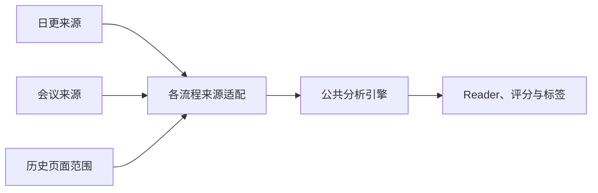

# 中文技术文档与论文解读的写作约定

本文面向项目维护者和论文解读的作者。目标是让刚接触项目的读者能找到入口、理解步骤，并知道结论的依据。日更、会议、历史更新及其文档采用同一套表达原则。

操作与来源规则仍以 [操作手册](../SKILL.md)、[执行约束](../AGENTS.md)和各流程实现为准。论文正文的结构、证据与恢复要求见 [Reader 写作](reader-writing.md)；本页解释怎样把内容组织得清楚、自然。

## 先确定读者要完成什么

同一个主题通常需要四种不同的说明。先判断本页承担哪种职责，再决定写到什么深度。

| 读者的问题 | 适合的写法 | 本项目的入口 |
|---|---|---|
| 第一次用，要先学什么？ | 按顺序完成一个小任务，解释关键步骤 | [首页](../README.md)、[安装配置](setup.md) |
| 我现在要做这件事，怎么操作？ | 前提、命令、正常结果、失败后的下一步 | [操作手册](../SKILL.md)、三条流程的操作文档 |
| 参数或文件是什么意思？ | 稳定的字段表、类型、默认值与边界 | [数据格式](data-format.md)、[脚本索引](../scripts/README.md) |
| 为什么这样设计？ | 问题、选择、取舍、例子和适用范围 | [三流程架构](three-workflows.md)、本页及设计说明 |

首页提供选择和阅读路线。详细恢复条件放在对应恢复文档，首页只保留必要提醒与链接。一个规则确定一个权威位置；其他页面用简短说明指向它，避免多份长规则逐渐分叉。

## 先把事情说清，再调整语气

句子尽量指出具体对象和动作。例如，“历史任务按冻结清单处理每一页”，比“通过全链路闭环保障历史一致性”更容易理解。

写明改变了什么、为什么改变，以及读者能据此做什么。没有实测数据时说明预期作用和成立条件；有实测数据时交代测量范围。一次 PDF 提取微基准不能代表整批日更的耗时。

技术文档用朴实、平和的语气。删去不增加信息的开场、重复赞美和结尾升华。保留有作用的连接词，让相邻段落沿问题自然推进；不为改变节奏故意制造短句、口头禅、错字或个人经历。

必须、禁止、仅、可能、尚未等词承担真实约束和确定程度。修订时核对它们表达的范围，不能为了顺口把条件、否定或失败状态删掉。

### 修改示例

原句：“通过构建统一的分析闭环，全面赋能三大工作流，实现效率与质量的双重提升。”

改写：“日更、会议和历史更新调用同一个分析引擎。修复公共 Reader 校验器后，三条流程都使用修正后的规则。”

改写说明了调用关系，没有编造加速比例。若要讨论性能，另起一段写测试对象、前后耗时和测量条件。

## 一段讲清一件事

段首先交代当前问题或判断，再补充原因、过程和例子。话题从操作步骤转到例外条件，或从实验结果转到推测时，另起一段并留一行空白。

长短句按内容安排。不要给每段固定相同句数，也不要让每一句单独成段。多个并列对象适合列表，有先后关系的操作适合编号；需要连续推导的解释保留为连贯段落。

标题说清这一节解决什么问题，例如“Reader 失败后怎样继续”。避免每篇都使用同一套空泛标题。标题层级逐级递进，短小的操作提示不必再拆出多层小标题。

Markdown 的段落、标题、列表、代码块、表格和图示之间留一行空白。列表中的独立说明可以分段；不要依靠连续空格制造换行，也不要在同一个超宽表格单元格里塞入整段操作手册。

## 术语先解释，再统一称呼

第一次出现术语时，先说明它在本场景中的作用，再给名称或缩写。后文沿用同一名称。专有名词、命令、文件名和协议字段保持原样，不为语言变化轮换同义词。

以下是阅读项目文档时常见的词。它们的技术身份不能互换。

| 名称 | 在本项目中的意思 | 阅读时注意什么 |
|---|---|---|
| Reader | 面向入门研究者的论文解读长文 | 区别于内部的十三节主分析 |
| 来源封存 | 保存本次实际使用的原文、PDF 和身份清单 | 文件存在还不够，内容与身份也须对应 |
| 检查点 | 已保存的阶段输入、结果和恢复信息 | 继续原阶段，不等于重新获得请求次数 |
| 清单 manifest | 需要核验的一组文件及其身份记录 | 解释清单覆盖的范围，不泛称“已校验” |
| SHA-256 | 按文件字节计算的内容指纹 | 用于发现内容变化，不表示内容科学正确 |
| CAS | 写入前比较原内容身份的保护方式 | 当前稿变了就停止，避免覆盖他人的新结果 |
| Git OID | Git 对象的标识；发布时通常指提交 ID | 远端有该提交仍须继续核验部署和网页 |
| 凭证 receipt | 某一步完成后保存的范围与核验记录 | 说明签发条件，不能替其他流程授予资格 |

相同字母在不同任务里可能有不同含义。例如，论文中的 score 可能指分布的对数密度梯度，也可能指一个评价数值。先按原文定义解释，再使用中文名称；不能一律翻译成“评分”。

## 把机制拆成读者能够跟随的步骤

介绍一个概念时，先说它解决什么具体困难，再交代输入、处理过程和输出。复杂机制按执行顺序展开，每一步说明接收的信息、执行的操作及交给下一步的结果。

多个组件组合时，解释各自分工、为什么需要搭配，以及组合后多了什么能力。区分训练与推理，说明哪些参数更新、冻结或重置。涉及近似、梯度或统计聚合时，指出它在哪一步发生，以及会损失什么信息。

类比可以帮助读者建立直觉，但要接回实际对象。类比没有覆盖的条件直接说明。没有真实消融时，只能把“去掉组件可能造成什么”写成机制推测，不能当作作者已经做过的实验。

不要把上述角度机械地变成每节重复的栏目。内容较短时，用两个相连的段落就能解释清楚；机制较长时，再使用有实际含义的小标题或分步图。

## 比较条件和计算过程写在结果旁边

比较前说明对象、数据集、样本范围、训练或测试条件、指标定义，以及数值变大还是变小更好。条件不一致时明确差异，避免把不同实验中的数值拼成同一排行榜。

涉及计算时，依次给出原始量、运算、结果和结果的含义。分母、单位及取整方式放在计算附近。观察到的结果、对原因的解释和尚待验证的推测分别成段。

下面是教学示例，不是某篇论文的实验：错误率从 20% 降到 15%，绝对变化为 5 个百分点；相对下降比例为 `(20 − 15) / 20 = 25%`。这里分母是原错误率 20%，所以不能把“下降 5 个百分点”写成“相对下降 5%”。

### 项目评分的计算示例

八维评分先按各维的证据和上限核验，再求和，最后将总分封顶为 10。当前八维上限之和为 11，不能把它解释成除以 11 后再换算到十分制。实现见 `scripts/deep-analyzer.js` 的 `recalculateScoringAudit`。

用 `s_i` 表示第 `i` 个维度的一位小数分数，`T` 表示总分，工程计算可以写为：

```text
T = min(10, s_1 + s_2 + … + s_8)
```

例如，八维取 `1.8、1.3、1.2、0.9、1.2、1.0、0.5、1.3` 时，合计为 `9.2`，总分也是 `9.2`。各维都达到当前上限时合计为 `11`，展示总分为 `10`。这些数值只解释程序计算，不评价任何真实论文；实际评分还须满足文档类型与证据约束。

## 字母、符号、公式和单位

变量首次出现时说明含义、取值范围、单位，以及它是标量、向量、矩阵还是集合。下标解释清楚后再推导。同一段里不要用同一个字母同时表示样本数和训练轮数。

简单表达式可放在句中。多步推导单独成段，说明每一步做了什么变换、为什么可以这样变换，再回到方法中解释用途。公式后的解释覆盖关键运算，而不只把字母逐个翻译一遍。

论文长文的展示公式必须来自结构化来源中的原始 TeX，由程序插入。作者定义、符号正负号、上下标和等式条件保持原样；新增的讲解不能冒充作者公式。本文的项目计算示例属于维护文档，不授予 Reader 新增公式的权限。

普通叙述使用中文标点；命令、JSON、代码、路径和原始 TeX 使用其自身语法。数学乘法用 `×`，减法用 `−`；代码中的 `*` 和 `-` 保留为代码。箭头用于有明确方向的流程或映射，不替代因果论证。

数值与单位写在一起，例如 `30 s`、`128 MiB`。百分比和百分点分清；MB 按十进制、MiB 按二进制解释。`128 MiB = 134,217,728 bytes`，不能把两个单位当成同一个上限。`tokens` 是模型计量单位，不等于中文字数；字符估算不作为实际费用。

同句出现不同指标时，数值只归属明确命名的指标。例如“UTMOS 提升到 3.983，但词错误率变差”中的分值不属于词错误率；若另外给出错误率结果，仍须说明其比例或百分比。否定、假设、第三方归属和相似模型名称不能用来替另一指标补单位，原文证据与最终整稿核验仍须通过。

## 让图表承担明确的解释任务

表格用于同一组对象的多个可比属性。只有单个属性的一串项目通常用列表即可。表前提出比较问题，列名写明含义和单位，数据后的段落解释关键差别、代价与限制。

维护文档的长表优先按比较问题拆分，避免反复寻找表头。论文原表的行列选择仍须符合正常 `selection`、`completeTable` 及原授权范围；不能因排版方便拆掉完整表要求、改变签名数量或改写来源记录。没有来源的格值如实标示缺失，不补成零。具体边界见 [Reader 来源要求](reader-writing.md)。

图示先确定要解释的关系，再画必要节点。一个总览说明主要模块，复杂模块另画局部图。节点名称、箭头方向、图注与正文保持一致；不能用装饰线条暗示没有证据的双向关系。

下面的图只解释“来源适配后进入公共分析”的关系，箭头表示传入内容与身份记录。



历史输入先限定页面范围，再由该流程准备真实来源。三条输入进入同一分析引擎，并不表示它们的来源凭证可以互换。图外的生成、审查、推送和上线核验见 [三流程表](three-workflows.md)。

论文图片按导读、看图路径、原图、图注和解释展开。原图注保留作者信息，解释段帮助读者定位实际可见内容。没有本次图片像素时，不猜颜色、曲线、坐标轴或模块位置。

## 修改与复审的顺序

1. 通读全文，记录命令、字段、数字、单位、公式、来源、否定和适用范围。
2. 按读者任务重排说明，合并重复内容，补充必要的解释与明确标示的教学例子。
3. 回看原文与代码，逐项核对事实和约束；更新标题时检查链接与锚点。
4. 让另一位审阅者沿实际操作或论证顺序阅读，标出无法独立理解的步骤。
5. 修正后再核对段落、空行、图表和 Markdown 呈现，完成适当验证，再中文提交、推送。

删除前检查 npm 入口、动态加载、子进程路径、测试和历史记录。没有普通 import 不表示没有用途。旧提示词与协议可能被原 SHA 绑定；这类文件按原核验链保留，现行说明另作导航，不改写原凭证。

## 参考方法与本项目的取舍

以下资料于 2026-10-17 查阅。这里只吸收适合技术说明的编辑方法，没有安装或执行外部 skill。

| 资料 | 本项目采用的方法 |
|---|---|
| [Google：清楚的句子](https://developers.google.com/tech-writing/one/clear-sentences) | 写清对象和动作，用事实支撑程度判断 |
| [Google：连贯段落](https://developers.google.com/tech-writing/one/paragraphs) | 一段围绕一个问题，解释内容、依据与用途 |
| [Diátaxis](https://diataxis.fr/) | 区分入门学习、具体操作、参考和设计解释 |
| [Microsoft：表格](https://learn.microsoft.com/en-us/style-guide/scannable-content/tables) | 用可比较的属性组织表格，给出明确列名 |
| [Google：技术图示](https://developers.google.com/tech-writing/two/illustrations) | 先明确图意，控制单图信息量，复杂关系分层展开 |
| [Google：数学记号](https://developers.google.com/style/mathematical-notation) | 变量、运算和渲染各自清楚；论文 TeX 继续服从本项目来源规则 |
| [blader/humanizer](https://github.com/blader/humanizer/blob/main/SKILL.md) | 查找重复铺垫、空泛强调和面向错误读者的解释，保留原意 |
| [syw2039/humanizer-zh](https://github.com/syw2039/humanizer-zh/blob/main/SKILL.md) | 先核对事实与文体，再调整中文段落和语气 |
| [op7418/Humanizer-zh](https://github.com/op7418/Humanizer-zh/blob/main/SKILL.md) | 把语言模式作为检查线索，保留条件、归因与确定程度 |
| [harshaneel/humanize](https://github.com/harshaneel/humanize/tree/main/plugins/humanize/skills/humanize) | 参考自查与重读方法，不采用英语句长配额和标点禁令 |

社区清单用于帮助编辑。单个词、破折号或三项列表不能判定作者身份；本项目不把检测器分数当成写作目标。最终按事实准确、推理完整、术语一致和读者能否独立理解来评价。
